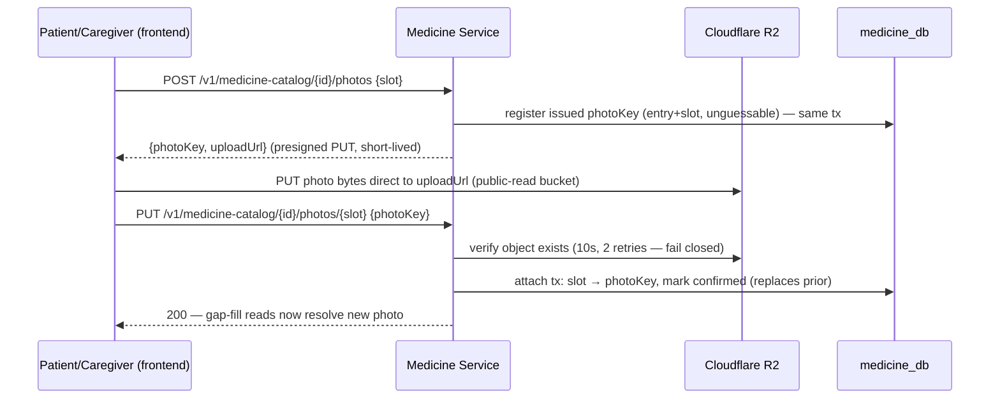
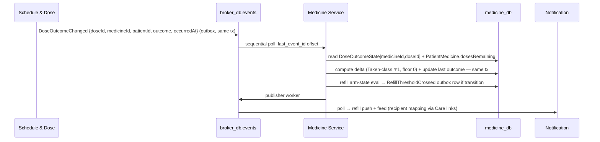
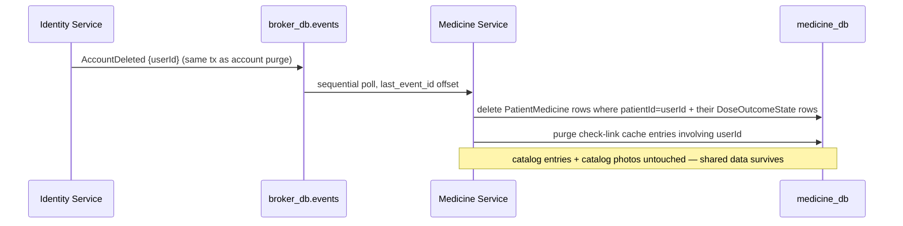

# HLD-MEDO-MEDICINE-001: Medicine Service — Medicine Catalog and private Medicine records

## 1. Document control header

Medicine | backend-microservice | PRD-MEDO-MEDICINE-001@1.0 | approved

## 2. Design context and scope

### 2.1 Upstream PRD consumed

`PRD-MEDO-MEDICINE-001@1.0` (status: approved). Sections consumed by reference: §2 goals G-1…G-8 and non-goals NG-1…NG-10; §3 actors; §4 user stories US-MED-01…08; §5 functional requirements FR-MED-001…027 grouped 5.1 catalog browse & read, 5.2 catalog create & community edit, 5.3 photo upload, 5.4 private Medicine records, 5.5 Doses Remaining & refill events, 5.6 internal read/deletion/authz; §6 NFRs NFR-MED-01…06; §9 data requirements; §10 contract inventory; §7.5 boundary statement. No requirement text is restated here (cite-don't-copy, hld-standard §6.1).

### 2.2 Component place in system

The Medicine Service owns two aggregates: the shared, community-maintained **Medicine Catalog** (drug identity + tagged photos — never owned, survives `AccountDeleted`) and the private patient **Medicine** record linked to it via `catalogEntryId` (prescribing doctor, dosage, doses remaining, price, pharmacy name). It also owns the photo pipeline (presigned PUT → Cloudflare R2 → attach confirm), the per-dose last-outcome tracking that makes **Doses Remaining** correct under at-least-once event delivery, the persisted refill arm state, and the two published events `RefillThresholdCrossed` + `MedicineArchived` (`service-catalog.md#medicine-service@2026-11-22`; PRD §7.5).

It does NOT own: schedules, dose rows, outcome classification, or dose generation (Schedule & Dose Service); refill/alert delivery, recipient mapping, feed rows (Notification Service); Harmony Points/theme (Gamification Service); user accounts, profiles, or sessions (Identity Service — Medicine makes **no** directory calls); Care Links or link state (Care Service — Medicine only consumes `check-link` answers as a caller). Catalog entries carry no owner and have no delete path in v1 (PRD NG-9).

### 2.3 Design goals

- DG-MED-1: Strict dual-aggregate ownership — catalog data is shared community property written by any session with last-write-wins and never purged; private records are per-patient and purged on `AccountDeleted`. [`PRD-MEDO-MEDICINE-001@1.0#G-3/G-8`; `service-catalog.md#medicine-service@2026-11-22`]
- DG-MED-2: Catalog fields are resolved at read time through `catalogEntryId` — never copied into private records — so community edits propagate instantly and no stale duplicate exists. [FR-MED-011/014; PRD §9.1]
- DG-MED-3: Photo upload is a capability-key flow — presigned PUT generation is local, confirm verifies the key was issued for that entry+slot AND the object exists in R2, failing closed on any verification failure. [FR-MED-007…010; `platform-quality-baseline.md#resilience-defaults@2026-11-21` R2 row]
- DG-MED-4: Doses Remaining is correct under at-least-once, possibly redelivered `DoseOutcomeChanged` events — correctness comes from persisted last-applied outcome per doseId, never from delta arithmetic alone. [FR-MED-018/019; `.scratch/medo-backend/issues/07-message-broker-event-transport.md@2026-11-21`]
- DG-MED-5: Every event-emitting write is transactional-outbox wrapped in the same `medicine_db` transaction; `RefillThresholdCrossed` fires exactly once per qualifying arm-state transition. [`inherited:ticket-07`; FR-MED-021/023]
- DG-MED-6: All synchronous dependencies fail closed — `has-dose-records` unreachable ⇒ delete refused; `check-link` unreachable ⇒ caregiver calls denied; R2 verify failure ⇒ attach refused. No authz, delete-guard, or photo-attach path ever fails open. [FR-MED-017/026, FR-MED-010; baseline matrix]
- DG-MED-7: The service is stateless at process level except `medicine_db` + documented in-memory exceptions (rate-limit windows, check-link positive cache); restart/deploy loses nothing durable. [`inherited:ticket-09@2026-11-21`; `scheduled-jobs.md#pattern@2026-11-21`]

### 2.4 Design non-goals

- Presigned-URL TTL values, photoKey format/encoding, R2 existence-check mechanism (S3 HeadObject vs public HEAD), duplicate-check collation, catalog `q` matching semantics, DTO field lists, table/column shapes → LLD.
- Frontend photo upload UX, IndexedDB photo caching, degraded-mode rendering → Frontend HLD (`frontend-map.md` offline contract).
- Refill alert delivery, feed rows, recipient mapping → Notification Service HLD.
- Schedule & Dose consumption of `MedicineArchived` internals → Schedule & Dose HLD.
- Orphan photo-object physical deletion mechanism → decided at policy level by HD-MED-03 (retain + registry); any future sweeper is a new map decision.
- Rate-limit numeric tuning beyond locked defaults → LLD config.

### 2.5 Inherited locked decisions

- Runtime/framework: Node.js + TypeScript + Fastify + Drizzle ORM (`inherited:.scratch/medo-backend/issues/01-backend-runtime-framework.md@2026-11-20`).
- Deployment/hosting: single AWS EC2 `t3.micro` + Docker Compose; frontend Vercel; `.env` local / SSM Parameter Store prod; Budget alert $25 (`inherited:…/02-deployment-model-hosting.md@2026-11-20`).
- Database: self-hosted Postgres container, six logical DBs with per-service users, `drizzle-kit` migrations; `medicine_db` + own DB user (`inherited:…/03-database-technology.md@2026-11-21`).
- Object storage: **Cloudflare R2** — S3-compatible, public-read bucket for catalog photos with unguessable keys; presigned-PUT upload flow via AWS SDK v3 + custom R2 endpoint; zero egress (`inherited:…/04-object-storage-provider.md@2026-11-21`). Medicine is the platform's only R2 client.
- API gateway: Caddy reverse proxy, explicit public-route table, per-service JWT verify, proxy-level CORS (`inherited:…/05-api-gateway-entry-point.md@2026-11-21`).
- Auth token mechanics: user JWTs verified locally via Identity JWKS/static config; internal service JWTs `iss=medo-<caller>`, `aud=medo-medicine`, 5-min, minted per call, static pubkey config (`inherited:…/06-auth-token-mechanics.md@2026-11-21`).
- Event transport: per-service transactional outbox → publisher → `broker_db.events`; sequential in-order per consumer, `last_event_id` offset, `eventId` dedupe, 5 attempts → `broker_db.dead_letters`; `@medo/eventing` shared package (`inherited:…/07-message-broker-event-transport.md@2026-11-21`).
- Observability: Pino JSON + `X-Request-Id`/`eventId`; per-service `/metrics`, `/health`, `/ready`; Sentry per service (`inherited:…/08-observability.md@2026-11-21`; `platform-observability.md@2026-11-21`).
- Rate limiting & caching: per-service Fastify plugin, in-memory sliding window; public 30/min/IP, auth'd writes 60/min/userId, auth'd reads 300/min/userId, internal exempt; 429 + `Retry-After`; **caller-side** caches Medicine depends on: Care check-link positive-only ~15 s TTL (`inherited:…/09-rate-limiting-caching.md@2026-11-21`). Medicine owns no provider-side cache.
- Notification prefs owned by Notification Service — Medicine holds no preference state (`inherited:…/10-notification-preferences-scope.md@2026-11-21`).
- Domain: `simmaps.com` — `app.simmaps.com` (Vercel), `api.simmaps.com` (Caddy→EC2), `photos.simmaps.com` (R2 custom domain) (`inherited:.scratch/medo-hld/issues/01-domain-selection.md@2026-11-22`).
- Deploy mechanism: `medo-infra` repo (`compose.yml` + `Caddyfile` + `deploy.sh`); git-SHA images on GHCR; `deploy.sh` health-gates `/health`+`/ready` ~60 s with auto-rollback to `.last-good` (`inherited:.scratch/medo-hld/issues/02-cicd-deploy-mechanism.md@2026-11-23`).
- Quality/ops baselines: `platform-quality-baseline.md@2026-11-21`, `scheduled-jobs.md@2026-11-21`, `platform-observability.md@2026-11-21`.
- Catalog/private-record split + community-edit rules: `service-catalog.md#medicine-service@2026-11-22` (Map 2 ticket 07 amendment, user-approved).
- Refill rules (per-medicine `refillThreshold` default 6 first-cross/re-arm, 0 symmetric re-arm mandatory, Taken-only decrement, floor 0): `feature-list.md` + PRD FR-MED-019…023 + OQ-MED-06 (Map 1 ticket 08; amended 2026-11-26).

## 3. System context

FIG-MED-01: system context diagram

```mermaid
flowchart LR
    subgraph Users
        P[Patient]
        C[Caregiver]
    end
    FE[Combined Frontend<br/>app.simmaps.com]
    MED[Medicine Service]
    CARE[Care Service]
    SCH[Schedule & Dose Service]
    NOT[Notification Service]
    ID[Identity Service]
    CADDY[Caddy reverse proxy<br/>api.simmaps.com]
    R2[(Cloudflare R2<br/>photos.simmaps.com)]
    BROKER[(broker_db.events<br/>+ dead_letters)]

    P --> FE
    C --> FE
    FE -->|public Medicine REST| CADDY
    CADDY --> MED
    FE -->|presigned PUT photo bytes| R2
    MED -->|presign + existence verify| R2
    MED -->|check-link<br/>service JWT aud=medo-care| CARE
    SCH -->|has-dose-records answer| MED
    MED -->|GET /v1/patients/{id}/has-dose-records<br/>service JWT aud=medo-schedule-dose| SCH
    ID -->|AccountDeleted| BROKER
    SCH -->|DoseOutcomeChanged| BROKER
    BROKER -->|poll| MED
    MED -->|outbox publish| BROKER
    BROKER -->|poll| NOT
    BROKER -->|poll| SCH
    NOT -->|GET /v1/medicines/{id}<br/>service JWT aud=medo-medicine| MED
```

| Counterparty | Relationship (calls/consumes/publishes/is-called-by) | Contract(s) |
|---|---|---|
| Patient / Caregiver (via Combined Frontend) | is-called-by | All 12 public REST rows §7.1 (catalog + patient medicine routes) |
| Combined Frontend | calls through Caddy; PUTs photo bytes direct to R2 `uploadUrl`; never calls internal routes | §7.1 public rows; `frontend-map.md#per-screen-service-calls@2026-11-22` medicine rows |
| Caddy reverse proxy | pass-through entry; public-route table | `inherited:ticket-05@2026-11-21` |
| Cloudflare R2 | object storage — presigned PUT issuance inputs, existence verify on confirm, public-read photo serving | §7.1 photo rows; `inherited:ticket-04@2026-11-21`; `.scratch/medo-hld/issues/01-domain-selection.md@2026-11-22` |
| Care Service | calls `GET /v1/care/check-link` for caregiver authz on patient-scoped routes | §7.2; §10.4 cache binding |
| Schedule & Dose Service | calls `GET /v1/patients/{id}/has-dose-records` (delete guard); publishes `DoseOutcomeChanged`; consumes `MedicineArchived` | §7.2; §8.1/§8.2/§8.4 |
| Notification Service | consumes `RefillThresholdCrossed`; calls `GET /v1/medicines/{id}` internal for reminder text | §8.1; §7.1 internal row |
| Identity Service | publishes `AccountDeleted` consumed by Medicine | §8.2 |
| `broker_db` event fabric | publishes via own outbox; consumes `DoseOutcomeChanged` + `AccountDeleted` | §8.1/§8.2; `inherited:ticket-07@2026-11-21` |
| Resend / Web Push | no direct interaction — delivery owned by Notification | none (explicit none) |
| Gamification Service | no direct interaction — consumes `DoseOutcomeChanged` independently, never calls Medicine | none (explicit none) |

## 4. Application topology and service boundaries

### 4.1 Deployable unit & entry path

Medicine runs as the `medicine` container in the single Docker Compose stack on the AWS EC2 `t3.micro` (region ap-south-1 recommended, confirmed at deploy), alongside the other five services and the shared Postgres container (`inherited:ticket-02@2026-11-20`, `ticket-03@2026-11-21`, `.scratch/medo-hld/issues/02-cicd-deploy-mechanism.md@2026-11-23`). Public traffic enters via `api.simmaps.com` → Caddy → explicit public-route table → `medicine` (`inherited:ticket-05@2026-11-21`, `.scratch/medo-hld/issues/01-domain-selection.md@2026-11-22`). Photo bytes bypass the service entirely — the browser PUTs directly to the presigned R2 URL on `photos.simmaps.com`. Service-to-service calls go direct on the Docker network with per-service JWTs. Deploys are manual SSH via `medo-infra` (`deploy.sh` health-gates + rollback) pulling git-SHA images from GHCR.

### 4.2 Boundary statement

Mirroring `service-catalog.md#medicine-service@2026-11-22` and PRD §7.5: Medicine solely owns the shared Medicine Catalog aggregate and the private patient Medicine record split, plus photo objects referenced by catalog entries, Doses Remaining tracking state, refill arm state, and the `RefillThresholdCrossed`/`MedicineArchived` events.

Denied capabilities (explicit): no schedules, dose rows, outcome classification, or dose-window logic (Schedule & Dose); no reminder/refill delivery, feed rows, push subscriptions, or recipient mapping (Notification); no Harmony Points/theme (Gamification); no accounts, sessions, profiles, or directory data (Identity — zero directory calls); no Care Link state (Care — check-link consumed as caller only); no API-gateway logic (Caddy); no catalog moderation/ownership/delete tooling (community-editable by design, PRD NG-6/NG-9); no photo byte proxying — uploads go direct-to-R2 (FR-MED-008).

### 4.3 Boundary invariants

- Own repository, own logical database `medicine_db` in the shared Postgres container with own DB user; cross-DB access prohibited — peers are reached only via contracts/events (`inherited:ticket-03@2026-11-21`).
- No shared domain models or schemas with peer services; DTOs at every boundary (`service-catalog.md#conventions@2026-11-22`). The catalog/private split is *within* this boundary — it is one service owning two aggregates, not two services.
- Four logical layers `Infrastructure / Core / Application / WebAPI` per Architecture Standard; every §5 block carries exactly one primary layer (cross-layer justified inline).
- Read/write flow pattern: writes WebAPI → Application → Core → Infrastructure → `medicine_db`; reads reverse; event-emitting writes additionally write the outbox row in the same transaction (`inherited:ticket-07@2026-11-21`). Deviations: photo confirm performs an R2 object-existence check before the local tx (HD-MED-02); delete performs a synchronous Schedule & Dose call before the local tx (HD-MED-06); `DoseOutcomeChanged` consumption applies deltas through `medicine-core` rules inside the consumer transaction.

FIG-MED-02: topology position

```mermaid
flowchart TB
    subgraph EC2["AWS EC2 t3.micro — Docker Compose"]
        CADDY[Caddy :443<br/>public-route table]
        subgraph SVC["backend services (Docker network)"]
            MED[Medicine]
            ID[Identity]
            CARE[Care]
            SCH[Schedule & Dose]
            NOT[Notification]
            GAM[Gamification]
        end
        PG[(Postgres container<br/>6 logical DBs incl. medicine_db + broker_db)]
        MED --- PG
        ID --- PG
        CARE --- PG
        SCH --- PG
        NOT --- PG
        GAM --- PG
    end
    FE["Combined Frontend — Vercel<br/>app.simmaps.com"] -->|HTTPS| CADDY
    CADDY -->|public routes only| MED
    FE -.->|presigned PUT| R2["Cloudflare R2<br/>photos.simmaps.com"]
    MED <-.->|service JWTs, direct| CARE
    MED <-.->|has-dose-records| SCH
    NOT <-.->|GET /v1/medicines/{id}| MED
    SVC <-.->|broker_db.events poll| PG
```

## 5. Decomposition and internal structure

| Block | Responsibility | Layer | Contracts/events | HD-ref |
|---|---|---|---|---|
| `webapi-public` | HTTP presentation for all 12 public Medicine routes (6 catalog + 6 patient-medicine); user-JWT verification boundary; dual-authz entry for `GET /v1/medicines/{id}` | WebAPI | §7.1 public rows | — |
| `webapi-internal` | HTTP presentation for the service-token variant of `GET /v1/medicines/{id}`; service-JWT gate (`aud=medo-medicine`) | WebAPI | §7.1 internal row | HD-MED-01 |
| `rate-limit` | Per-route sliding-window limiter plugin (auth'd classes) + 429/`Retry-After` | WebAPI | all §7.1 rows | — |
| `catalog-core` | Medicine Catalog rules: browse/search, detail with gap-fill resolution, community create + duplicate-check, last-write-wins edit, photo slot issue/confirm rules | Core | catalog routes; consumes R2 via `r2-client` | HD-MED-02 |
| `medicine-core` | Private Medicine rules: adopt guard (≥1 confirmed photo), list/detail with catalog resolution, private-field edit + manual `dosesRemaining` threshold evaluation, archive + `MedicineArchived`, guarded hard delete | Core | patient-medicine routes; publishes `MedicineArchived`, `RefillThresholdCrossed` | HD-MED-04/05/06 |
| `dose-outcome-consumer` | `DoseOutcomeChanged` reaction orchestration: resolve target Medicine, apply idempotent Doses Remaining delta via `medicine-core`, evaluate refill thresholds | Application | consumes `DoseOutcomeChanged`; publishes `RefillThresholdCrossed` | HD-MED-04 |
| `account-deletion-consumer` | `AccountDeleted` reaction: purge user's private Medicine records + dose-outcome tracking rows; catalog untouched | Application | consumes `AccountDeleted` | — |
| `authz-client` | Care `check-link` calls for caregiver authz on patient-scoped routes; positive-only ~15 s caller-side cache + shared invalidation hook | Infrastructure | §7.2 check-link row | — |
| `schedule-dose-client` | Schedule & Dose `GET /v1/patients/{id}/has-dose-records` sync call for the delete guard; fail-closed, no cache | Infrastructure | §7.2 has-dose-records row | HD-MED-06 |
| `r2-client` | R2 interactions: presigned-PUT issuance inputs, object-existence verify on attach-confirm, public URL composition (`photos.simmaps.com`) | Infrastructure | §7.1 photo rows | HD-MED-02/03 |
| `persistence` | `medicine_db` repositories + transactional outbox writes for both published events | Infrastructure | §8.1 published events | — |
| `eventing` | Outbox publisher worker → `broker_db.events`; `DoseOutcomeChanged` + `AccountDeleted` consumer workers (offset + dedupe) via `@medo/eventing` | Infrastructure | §8.1/§8.2 | — |

Read/write flow: HTTP requests enter `webapi-*` (Zod DTO validation, rate-limit plugin, authz chain), delegate to `catalog-core`/`medicine-core` rules via `persistence` repositories; `authz-client`, `schedule-dose-client`, and `r2-client` supply peer/storage calls; `dose-outcome-consumer` and `account-deletion-consumer` orchestrate Application-level state transitions off `broker_db`; `eventing` drains the outbox and polls `broker_db.events` independently. Cross-layer deviations: R2 existence verify pre-tx on photo confirm (HD-MED-02) and Schedule & Dose call pre-tx on delete (HD-MED-06) — peer I/O never inside the `medicine_db` transaction.

## 6. Data architecture

### 6.1 Owned store & entity inventory

Owned store: `medicine_db` — sole ownership; never shared, never read by peers (`PRD-MEDO-MEDICINE-001@1.0#9.1`; `inherited:ticket-03@2026-11-21`). Persistence approach: PostgreSQL + Drizzle ORM + `drizzle-kit` migrations at deploy (`inherited:ticket-01/03`). Shape classification at approach level: relational entity set (two aggregates + tracking/arm-state rows) plus transactional outbox table (`inherited:ticket-07@2026-11-21`; uniform platform pattern, no `HD-` needed). The catalog aggregate and private-medicine aggregate coexist in one DB — the split is logical ownership, not physical (`service-catalog.md` Medicine section).

Entity inventory (ownership granularity, lifecycle per PRD §9.1 — cited, not re-derived):

| Entity | Lifecycle class | Notes |
|---|---|---|
| MedicineCatalogEntry (brandName, ingredientNames[], form, packagingQuantity, photo slot refs, createdAt, updatedAt) | create → community-edited forever → never deleted | shared community data — owned by no one (FR-MED-004…006); duplicate-check on create (FR-MED-005) |
| Catalog photo slot records + issued `photoKey` registry (entryId, slot, key, issuedAt, confirm state) | issue → upload → confirm → replace per slot | issued-key registry enables confirm binding + orphan accounting (HD-MED-02/03); photo objects live in R2, keys unguessable |
| PatientMedicine (patientId, catalogEntryId, prescribingDoctor, dosage, dosesRemaining, refillThreshold, price, pharmacyName, archived flag, createdAt) | adopt → edit/archive → hard-delete (zero dose records) or purge on `AccountDeleted` | private per-patient record; catalog fields resolved via `catalogEntryId` at read time, never copied (DG-MED-2) |
| DoseOutcomeState (medicineId, doseId → last applied outcome + occurredAt) | insert on first event per dose → update per change → purge with medicine/account | enables idempotent delta under at-least-once (FR-MED-018; HD-MED-04) |
| Refill arm state (per medicine: low-stock armed, out-of-stock armed) | derived → persisted → re-armed on threshold crossings | restart-surviving by requirement (FR-MED-023a; HD-MED-05) |
| Outbox rows (`RefillThresholdCrossed`, `MedicineArchived`) | insert same-tx → publish → delete | `@medo/eventing` pattern |
| Check-link cache entries (patientId+caregiverId → active) | request-time create → TTL expire → event-invalidate | caller-side obligation per ticket 09; in-process only |

### 6.2 Shared / consumed data

- **Medicine Catalog + catalog photos are shared/community data owned by this service's boundary but by no user** — any session may create (duplicate-checked) and edit (last-write-wins); `AccountDeleted` never touches them (FR-MED-024). This is the catalog-split pattern approved in Map 2 ticket 07 — stated here because Medicine is the *store* side of that contract.
- Consumed (sync, internal REST): Schedule & Dose `GET /v1/patients/{id}/has-dose-records` — delete guard only; must be current, never cached, fail closed (§14). Care `GET /v1/care/check-link?patientId=&caregiverId=` — caregiver authz per patient-scoped request; positive-only ~15 s caller-side cache, negatives never cached (`inherited:ticket-09@2026-11-21`).
- Read-through data owned elsewhere: catalog entries are Medicine-owned; everything patient-scoped beyond `userId` references (profiles, links, doses, points) is never replicated — `patientId`/`catalogEntryId`/`doseId` are opaque foreign references resolved only through contracts.

### 6.3 Consistency & coordination model

- Local transaction ownership: every `medicine_db` write is one local transaction; event-emitting writes commit the domain change + outbox row atomically (`inherited:ticket-07@2026-11-21`).
- Cross-service workflows (§8.4): photo confirm verifies object existence in R2 *before* the local attach tx; delete verifies `has-dose-records` *before* the local delete tx; both are sync-call-then-local-tx coordination (HD-MED-02/06). Adopt resolves the catalog entry inside the local read/tx path — catalog is same-service data, no peer call.
- Event consistency: outbox → publisher → `broker_db.events` → per-consumer sequential poll, `last_event_id` offset, at-least-once + `eventId` dedupe, 5 attempts → `dead_letters` (`inherited:ticket-07@2026-11-21`). Medicine both publishes (2 events) and consumes (2 events).
- `DoseOutcomeChanged` consistency: consumer applies deltas inside its own transaction per event; `DoseOutcomeState` last-applied-outcome makes redelivery and repeats no-ops; ordering relies on per-consumer sequential in-order delivery (ticket 07) with last-writer semantics on `occurredAt` per PRD FR-MED-019 (HD-MED-04).
- Catalog edit consistency: last-write-wins by design — concurrent community edits resolve to the latest commit; no versioning, no conflict UI (PRD FR-MED-006).
- Check-link cache consistency: positive answers cached ~15 s; `AccountDeleted` consumption purges cache entries for the deleted `userId` via the shared invalidation hook; `CareLinkEnded` is **not** in Medicine's subscription set (catalog) — residual staleness is bounded by the 15 s positive TTL, the documented instant-revoke bound (§10.4, §18.3).

### 6.4 Retention & deletion

Per `platform-quality-baseline.md#data-retention@2026-11-21` + `scheduled-jobs.md#medicine-service@2026-11-21` (zero jobs), Medicine-owned obligations:

- Catalog entries + confirmed catalog photos: retained indefinitely — community asset, no delete path (PRD §9.4, NG-9).
- Private Medicine records: account lifetime; archived records retained as history; hard delete only via the `has-dose-records` guard (FR-MED-017).
- `AccountDeleted` consumption: purges the user's private Medicine records + their `DoseOutcomeState` rows; catalog entries and catalog photos untouched (FR-MED-024). Rows are removed in the consumer transaction after outbox needs are satisfied (no Medicine event is emitted on purge — catalog consumers of `AccountDeleted` handle their own scope).
- Orphan photo objects (issued `photoKey`, never confirmed): retained indefinitely in v1 — policy decided by HD-MED-03; the issued-key registry keeps them accounted and cleanable by a future decision.
- Terminal/deleted private records leave no tombstone — dose history lives in Schedule & Dose under its own retention.
- Backups: none in v1 — accepted risk (`platform-quality-baseline.md`).

## 7. External contracts

### 7.1 Exposed contracts

| Contract (verbatim) | Block | Sync/Async | Public/Internal | Authz binding | Idempotent? | Rate-limit class | Catalog ref |
|---|---|---|---|---|---|---|---|
| `GET /v1/medicine-catalog?q=&page=` | `catalog-core` via `webapi-public` | REST sync | public | any valid session | n-a | auth'd read 300/min/userId | catalog §Medicine public REST — catalog |
| `GET /v1/medicine-catalog/{id}` | `catalog-core` via `webapi-public` | REST sync | public | any valid session | n-a | auth'd read 300/min/userId | catalog §Medicine public REST — catalog |
| `POST /v1/medicine-catalog` | `catalog-core` via `webapi-public` | REST sync | public | any valid session | duplicate-check conflict (FR-MED-005) | auth'd write 60/min/userId | catalog §Medicine public REST — catalog |
| `PATCH /v1/medicine-catalog/{id}` | `catalog-core` via `webapi-public` | REST sync | public | any valid session | yes (last-write-wins) | auth'd write 60/min/userId | catalog §Medicine public REST — catalog |
| `POST /v1/medicine-catalog/{id}/photos` | `catalog-core` via `webapi-public` + `r2-client` | REST sync | public | any valid session | n-a (key issuance) | auth'd write 60/min/userId | catalog §Medicine public REST — catalog |
| `PUT /v1/medicine-catalog/{id}/photos/{slot}` | `catalog-core` via `webapi-public` + `r2-client` | REST sync | public | any valid session + issued-key ownership | yes (re-confirm replaces slot) | auth'd write 60/min/userId | catalog §Medicine public REST — catalog |
| `GET /v1/medicines?patientId=` | `medicine-core` via `webapi-public` | REST sync | public | patient-self or linked caregiver (check-link) | n-a | auth'd read 300/min/userId | catalog §Medicine public REST — patient's medicines |
| `POST /v1/medicines` | `medicine-core` via `webapi-public` | REST sync | public | patient-self or linked caregiver | natural idempotency not guaranteed — client retry safe (baseline rule) | auth'd write 60/min/userId | catalog §Medicine public REST — patient's medicines |
| `GET /v1/medicines/{id}` | `medicine-core` via `webapi-public` | REST sync | public | patient-self, linked caregiver, or Medo service token | n-a | auth'd read 300/min/userId | catalog §Medicine public + internal REST |
| `PATCH /v1/medicines/{id}` | `medicine-core` via `webapi-public` | REST sync | public | patient-self or linked caregiver | yes (last-write-wins) | auth'd write 60/min/userId | catalog §Medicine public REST — patient's medicines |
| `POST /v1/medicines/{id}/archive` | `medicine-core` via `webapi-public` | REST sync | public | patient-self or linked caregiver | yes (once-only event, FR-MED-016a) | auth'd write 60/min/userId | catalog §Medicine public REST — patient's medicines |
| `DELETE /v1/medicines/{id}` | `medicine-core` via `webapi-public` + `schedule-dose-client` | REST sync | public | patient-self or linked caregiver | yes (repeat → not-found/conflict) | auth'd write 60/min/userId | catalog §Medicine public REST — patient's medicines |
| `GET /v1/medicines/{id}` | `medicine-core` via `webapi-internal` | REST sync | internal | service JWT `aud=medo-medicine` only | n-a | internal exempt | catalog §Medicine internal REST |

Rate-limit classes per `inherited:ticket-09@2026-11-21` defaults. Medicine has **no unauthenticated route** — every public row requires a valid session, so the public-by-IP class does not apply; catalog community-write routes are auth'd-write class like all mutations (catalog authz = session only, no `check-link`, FR-MED-027). The internal row is the same path as the public detail route under a different token class — cross-token-class calls are rejected both directions (FR-MED-025; HD-MED-01).

### 7.2 Consumed contracts

| Contract (verbatim) | Provider | Sync/Async | Public/Internal | Cache/staleness binding | Failure ref (§14) | Catalog ref |
|---|---|---|---|---|---|---|
| `GET /v1/patients/{id}/has-dose-records` | Schedule & Dose Service | sync REST | internal | none — must be current; fail closed | §14 row SCH-DOSE-CHECK | catalog §Schedule & Dose internal REST |
| `GET /v1/care/check-link?patientId=&caregiverId=` | Care Service | sync REST | internal | positive-only ~15 s caller-side TTL; negatives never cached; `AccountDeleted` purges entries for the user (`inherited:ticket-09`) | §14 row CARE-CHECKLINK | catalog §Care internal REST |

### 7.3 Contract realization notes (backend profile §4.3/§4.5)

- Route groups: `webapi-public` hosts all 12 public routes — catalog routes resolve entirely inside `catalog-core`; patient-medicine routes run the authz chain (patient-self `sub` match, else `check-link` via `authz-client`) before `medicine-core`. `webapi-internal` hosts the service-token variant of `GET /v1/medicines/{id}`.
- Shared aggregates: one MedicineCatalogEntry aggregate underlies all catalog routes + photo routes; one PatientMedicine aggregate underlies all patient-medicine routes — multiple route groups per aggregate.
- Thin proxies: none — every route executes Core rules against `medicine_db`; the internal detail read is a direct live read.
- Sync fan-out to peers: `medicine-core` calls `authz-client` (Care `check-link`) per caregiver request and `schedule-dose-client` (`has-dose-records`) inside DELETE only; `catalog-core` calls `r2-client` for presign inputs + existence verify on photo confirm. All peer I/O is pre-transaction (HD-MED-02/06); timeout/retry/fail-mode per §14.
- Internal surface: `GET /v1/medicines/{id}` only; callee-side expectation `iss=medo-<caller>`, `aud=medo-medicine`, 5-min token (`inherited:ticket-06@2026-11-21`); unreachable via Caddy public table AND independently service-JWT gated (`inherited:ticket-05@2026-11-21`). Callers: Notification (reminder text composition) — the sole catalog-listed internal consumer.
- Caller-side caching obligations: Medicine *is* a consumer of the check-link positive-only ~15 s cache contract — the cache lives in `authz-client` and is invalidated via the shared hook on events Medicine consumes (`AccountDeleted` purges the user's entries); `CareLinkEnded` is not subscribed (catalog) so link-end staleness is TTL-bounded only (§10.4).
- Dual-authz single route: `GET /v1/medicines/{id}` accepts either a user JWT satisfying patient-self/linked-caregiver authz (public path) or a service JWT `aud=medo-medicine` (internal path); the two token classes never satisfy each other's routes (FR-MED-025).

## 8. Integration events and workflows

### 8.1 Published events

Both events are produced by `persistence` outbox writes inside the same transaction as their triggering domain write; `eventing` publishes via `@medo/eventing`. Ordering within Medicine's stream: events are independent — no ordering guarantee is offered or required; consumers must tolerate any order (PRD §10.3). Dedup: at-least-once delivery; consumers dedupe on `eventId`.

| Event (verbatim) | Block | Trigger | Consumers | Ordering/dedup notes |
|---|---|---|---|---|
| `RefillThresholdCrossed` | `medicine-core`/`dose-outcome-consumer`/`persistence` | any `dosesRemaining` transition into ≤`refillThreshold` (first crossing or re-arm re-crossing) or into 0 — event-driven or manual edit | Notification | independent; `{medicineId, patientId, dosesRemaining, threshold}` threshold = medicine's `refillThreshold` or 0; once per arm-state transition (HD-MED-05) |
| `MedicineArchived` | `medicine-core`/`persistence` | archive transition commit | Schedule & Dose | independent; `{medicineId, patientId}`; once per archive (terminal-state guard, FR-MED-016) |

### 8.2 Consumed events

| Event (verbatim) | Producer | Required reaction | Idempotent-consumer statement | Failure path |
|---|---|---|---|---|
| `DoseOutcomeChanged` | Schedule & Dose | Apply Doses Remaining delta on target PatientMedicine via last-applied `DoseOutcomeState`; Taken-class transitions ∓1, floor 0; evaluate refill thresholds | `DoseOutcomeState` per (medicineId, doseId): identical last outcome → no-op; redelivery safe (FR-MED-018/019; HD-MED-04) | 5 attempts → `broker_db.dead_letters`; manual replay |
| `AccountDeleted` | Identity | Purge user's private Medicine records + `DoseOutcomeState` rows; catalog untouched; purge check-link cache entries for userId | Terminal-state idempotent — redelivery finds nothing to purge (FR-MED-024b) | 5 attempts → `broker_db.dead_letters`; manual replay |

### 8.3 Explicit none-statements

- Consumes exactly two events: `DoseOutcomeChanged` + `AccountDeleted` (§8.2). `CareLinkEnded`, `ProfileChanged`, and all other catalog events are **not** subscribed — Medicine has no directory data to invalidate and its check-link cache is TTL-bounded (§6.3).
- Publishes exactly the two catalog events; no welcome/notification events — delivery is Notification's concern.
- `AccountDeleted` purge emits **no** Medicine event — no consumer needs a "medicine purged" signal (Schedule & Dose consumes `AccountDeleted` directly for its own purge; catalog data survives by design).
- Snooze and plan-skip produce no `DoseOutcomeChanged` upstream — Medicine sees only the four outcome classes (PRD §10.2).

### 8.4 Cross-service workflows

| Workflow | FIG | Coordination model per hop | Failure semantics |
|---|---|---|---|
| Photo upload two-step | FIG-MED-04-1 | `POST .../photos` → local key issuance (registry row) + presign inputs → browser PUT direct to R2 → `PUT .../photos/{slot}` confirm → R2 existence verify → local attach tx | R2 verify fail → fail-closed reject, slot unchanged (FR-MED-010); issued-but-unconfirmed keys = orphans per HD-MED-03 |
| Adopt catalog entry → private Medicine | FIG-MED-04-2 | `POST /v1/medicines` → authz (self or check-link) → catalog entry resolve + ≥1-photo guard → local tx create PatientMedicine | unknown catalogEntryId / photo-less entry → reject, no record (FR-MED-011/012); check-link down → caregiver denied, patient-self unaffected |
| Dose outcome → Doses Remaining + refill alert | FIG-MED-04-3 | Schedule & Dose outcome write → `DoseOutcomeChanged` outbox → `broker_db.events` → Medicine consumer → delta + threshold eval → `RefillThresholdCrossed` outbox → Notification | consumer retry → `dead_letters` after 5; deltas idempotent (HD-MED-04); threshold once-per-transition (HD-MED-05) |
| Guarded hard delete | FIG-MED-04-4 | `DELETE /v1/medicines/{id}` → authz → sync `has-dose-records` → zero ⇒ local delete tx (record + tracking rows); nonzero/unreachable ⇒ refuse | check unreachable/timeout ⇒ fail-closed refuse retryable (FR-MED-017); dose creation racing the check is Schedule & Dose's ordering concern — accepted window documented PRD §8 |
| Archive → schedule-stop propagation | FIG-MED-04-5 | `POST .../archive` → local tx (archived flag + `MedicineArchived` outbox) → `broker_db.events` → Schedule & Dose stops generation, keeps history | archive idempotent — repeat = no-op, no dup event; outbox retry → `dead_letters` |
| Account deletion purge (inbound) | FIG-MED-04-6 | Identity `AccountDeleted` → Medicine consumer → purge private records + tracking rows + check-link cache entries | consumer retry → `dead_letters`; idempotent re-run; catalog untouched by design |

FIG-MED-04-1: photo upload two-step



FIG-MED-04-2: adopt catalog entry → private Medicine

```mermaid
sequenceDiagram
    participant U as Patient/Caregiver (frontend)
    participant MED as Medicine Service
    participant CARE as Care Service
    participant DB as medicine_db
    U->>MED: POST /v1/medicines {catalogEntryId, doctor, dosage, dosesRemaining, price, pharmacy}
    MED->>MED: authz — patient-self (sub match) or caregiver → check-link
    opt caregiver session
        MED->>CARE: GET /v1/care/check-link (service JWT aud=medo-care; ≤15s positive cache)
        CARE-->>MED: active | inactive
    end
    MED->>DB: resolve catalogEntryId + verify ≥1 confirmed photo slot
    MED->>DB: local tx: PatientMedicine create (+ refill arm state init)
    MED-->>U: 201 private record
```

FIG-MED-04-3: dose outcome → Doses Remaining + refill alert



FIG-MED-04-4: guarded hard delete

```mermaid
sequenceDiagram
    participant U as Patient/Caregiver (frontend)
    participant MED as Medicine Service
    participant SCH as Schedule & Dose Service
    participant DB as medicine_db
    U->>MED: DELETE /v1/medicines/{id} (session JWT)
    MED->>MED: authz — patient-self or caregiver → check-link
    MED->>SCH: GET /v1/patients/{id}/has-dose-records (service JWT aud=medo-schedule-dose; 3s+1 retry)
    alt dose records exist OR check fails
        SCH-->>MED: true / timeout-error
        MED-->>U: refuse — archive instead (fail closed, retryable on error)
    else zero records
        SCH-->>MED: false
        MED->>DB: local tx: delete PatientMedicine + DoseOutcomeState rows
        MED-->>U: 200 — catalog entry untouched
    end
```

FIG-MED-04-5: archive → schedule-stop propagation

```mermaid
sequenceDiagram
    participant U as Patient/Caregiver (frontend)
    participant MED as Medicine Service
    participant OB as medicine_db outbox
    participant BR as broker_db.events
    participant SCH as Schedule & Dose Service
    U->>MED: POST /v1/medicines/{id}/archive (session JWT)
    MED->>MED: authz + terminal-state guard (already archived → no-op)
    MED->>OB: archive flag + MedicineArchived outbox row (same tx)
    MED-->>U: 200
    OB->>BR: publisher worker
    BR->>SCH: poll → stop dose generation for medicine's schedules; existing Dose rows kept as history
```

FIG-MED-04-6: account deletion purge (inbound)



## 9. Frontend contract surface

| frontend-map row | Screen/module | Contract IDs used | Sync pattern | Offline classification |
|---|---|---|---|---|
| Today (dose list + theme + points + notifications) | Today screen | `GET /v1/medicines?patientId=` (display data per dose) | parallel fan-out leg alongside Schedule & Dose/Gamification/Notification calls | medicine display fields Dexie-cached per `frontend-map.md#dexie-offline-sync-contract`; refresh on open/reconnect/post-mutation/~15min interval |
| Medicines list | Medicines list screen | `GET /v1/medicines?patientId=`; `GET /v1/medicine-catalog?q=` | parallel fan-out; catalog search on demand | medicine list API-read + Dexie display cache; **catalog browsing API-only — never Dexie-cached** |
| Medicine detail / edit / archive / delete | Medicine detail screen | `GET /v1/medicines/{id}`, `PATCH /v1/medicines/{id}`, `POST /v1/medicines/{id}/archive`, `DELETE /v1/medicines/{id}`; `GET /v1/medicine-catalog/{id}` | user-driven sequential actions + list refresh after mutation | API-only mutations (online); detail readable from Dexie display cache offline |
| Add medicine (adopt catalog) | Add-medicine flow | `POST /v1/medicines`; unknown drug → `POST /v1/medicine-catalog` first | strictly sequential two-call flow (FR-MED-012) | API-only — requires live catalog + authz |
| Medicine/catalog photos | Photo upload step | `POST /v1/medicine-catalog/{id}/photos` → `{photoKey, uploadUrl}` → direct PUT → `PUT /v1/medicine-catalog/{id}/photos/{slot}` | three-step user-driven flow; bytes bypass service | API-only + direct-to-R2 PUT; photo *display* cached via CacheFirst SW on `photos.simmaps.com` (`inherited:.scratch/medo-hld/issues/03-frontend-offline-architecture.md@2026-11-23`) |

`patientId` rule binding: for Patient accounts `patientId` = Identity `userId`; for Caregiver accounts the frontend passes the selected Care Link's `patientId` (from `GET /v1/care/links`) — Medicine treats `patientId` as an opaque reference and authorizes via patient-self `sub` match or Care `check-link` per request; it never resolves profiles. Offline implications: no Medicine contract is Dexie-write-queued (the write-queue carries dose outcomes/snooze only per `frontend-map.md`); all Medicine mutations are online-only actions — consistent with the offline contract, which assigns medicine *display data* to the Dexie cache and everything else to API-only. Catalog browsing and the entire photo pipeline require connectivity.

## 10. Cross-cutting concerns

### 10.1 Authentication & authorization summary

Two trust domains (`inherited:ticket-06@2026-11-21`):

- **User JWTs** — issued by Identity, verified locally via JWKS/static config. All 12 public routes require a valid access JWT. Catalog routes authorize on session alone — any role, no `check-link` (FR-MED-027). Patient-medicine routes authorize per request: patient-self when record `patientId` = session `sub`, else linked caregiver via Care `check-link` (FR-MED-026); caregiver gets full parity (Map 1 ticket 03).
- **Service JWTs** — `GET /v1/medicines/{id}` internal path requires `aud=medo-medicine`, 5-min token minted per call; user tokens rejected on the internal path and service tokens rejected on patient-scoped routes (FR-MED-025).

Authz level per contract is stated in §7.1; the distinctive Medicine rules: catalog community-edit has **no ownership check by design** (any session edits any entry, LWW); photo confirm authorizes on **issued-key ownership** — the `photoKey` issued for that entry+slot is the capability (FR-MED-009); `check-link` denial or Care-unreachable ⇒ deny, fail closed (FR-MED-026b).

### 10.2 Observability binding

Per `platform-observability.md@2026-11-21` with Medicine deltas:

- Logs: Pino JSON, `service=medicine`, `requestId`/`eventId` correlation; never log `photoKey` values, presigned URLs, or `prescribingDoctor`/`price`/`pharmacyName` field values beyond request-scoped need.
- `GET /metrics` (service-JWT gated, internal): fixed RED set + Medicine counters — catalog creates/edits, duplicate-check conflicts, photo issues/confirms/rejects, medicines created/archived/deleted, delete-check refusals, `dosesRemaining` deltas applied, threshold events emitted, `DoseOutcomeChanged`/`AccountDeleted` consumed + failed, outbox backlog, `broker_db` lag, `dead_letters` count (PRD NFR-MED-06).
- Sentry project: `medo-medicine` (DSN via env/SSM).
- `GET /health` public liveness; `GET /ready` internal readiness — dependency checks: own `medicine_db` ping + `broker_db` ping (publisher + two consumers). Deps named: `medicine_db`, `broker_db`. R2 is checked per-request, not in readiness (external provider; confirm path fails closed independently).

### 10.3 Resilience binding

Medicine's dependency rows from `platform-quality-baseline.md#resilience-defaults@2026-11-21`:

| Dependency | Binding |
|---|---|
| Own Postgres (`medicine_db`) | 5 s fast-fail → 503; cited, no delta |
| Schedule & Dose `has-dose-records` (internal REST row) | 3 s timeout + 1 retry/200 ms → **fail closed**: delete refused retryable (FR-MED-017); delete-guard only — no other route affected; cited |
| Care `check-link` (internal REST row) | 3 s timeout + 1 retry/200 ms → fail closed deny on patient-scoped caregiver calls; patient-self + catalog routes unaffected; ~15 s positive caller cache absorbs blips (`inherited:ticket-09`); cited |
| Cloudflare R2 (object storage row) | 10 s timeout + 2 retries → **fail closed on attach-confirm** (FR-MED-010); presign issuance is local and unaffected; cited |
| `broker_db` event transport (publisher + 2 consumers) | outbox retry built into `@medo/eventing`; 5 attempts → `dead_letters`; cited |
| Resend / Web Push | N/A — Medicine has no direct external provider calls (delivery owned by Notification; stated PRD §11.1) |

### 10.4 Rate limiting & caching

Per `inherited:ticket-09@2026-11-21`: per-service Fastify plugin, in-memory sliding window; internal service-JWT routes exempt; 429 + `Retry-After`. Medicine deltas: **no public-by-IP exposure** — every route requires a session or service JWT, so auth'd classes apply throughout: reads 300/min/userId (or per internal caller where applicable — internal exempt), writes 60/min/userId. Business rules stack on top: duplicate-check conflicts and photo-key issuance are state transitions, not rate-limit counters. Caches: Medicine owns the **Care check-link caller-side cache** in `authz-client` — positive-only ~15 s TTL, negatives never cached, shared-hook invalidation on `AccountDeleted` (purges entries involving the deleted userId); `CareLinkEnded` is not subscribed so ended-link answers remain possible for ≤15 s — the documented instant-revoke bound. No other caches — catalog browse/search is a direct `medicine_db` read (<10k entries, no cache needed per PRD §6.1).

### 10.5 Error handling & input protection

Standard JSON error body platform-wide; `Retry-After` on 429; fail-cleanly rule (clear 4xx/5xx, never crash/hang; degrade where cheap; no silent data loss) per `platform-quality-baseline.md#availability`. DTO-at-boundary with Zod validation at `webapi-*` (`inherited:ticket-01@2026-11-20` libs). Response posture: duplicate catalog create → conflict carrying existing entry identity (FR-MED-005); unknown ids → not-found; photo-less adopt → reject directing to photo flow (AC-MED-011d); delete guard failures → retryable 5xx-class refusal, never fail-open.

### 10.6 Sensitive-data handling

PII: `prescribingDoctor`, `price`, `pharmacyName`, and the `patientId` linkage on private records = health-adjacent PII (PRD §9.5); `patientId`/`catalogEntryId`/`doseId` are opaque references. Catalog data (drug identities, photos) is non-personal shared content. Photo objects sit on a **public-read** R2 bucket under unguessable keys — obscurity, not access control; no signed reads in v1 (`inherited:ticket-04`). `photoKey`/`uploadUrl` values are capabilities — never logged, never in events. Event payloads carry minimal fields only per catalog conventions — the minimal-change rule doubles as data minimization. No secrets beyond service private key + DB credentials + R2 credentials/endpoint (SSM/`.env`).

## 11. Security architecture

### 11.1 Trust boundaries

| Boundary | Mechanism | Binding |
|---|---|---|
| Internet → Caddy → Medicine (public routes) | explicit public-route table only; unlisted = 404; user JWT verified per-service | `inherited:ticket-05@2026-11-21` |
| Browser → R2 photo PUT | presigned URL, short-lived, slot-scoped key — capability, not session | FR-MED-007/008; HD-MED-02 |
| R2 → public photo reads | public-read bucket, unguessable keys on `photos.simmaps.com` | `inherited:ticket-04`; `.scratch/medo-hld/issues/01-domain-selection.md@2026-11-22` |
| Service → Medicine internal route | service JWT `aud=medo-medicine`, independently gated (defense in depth behind route table) | `inherited:ticket-05/06` |
| Frontend → API | `Authorization: Bearer` access JWT; refresh cookie `HttpOnly; Secure; SameSite=Lax; Path=/v1/auth`, host-only on `api.simmaps.com`, set by Identity via proxy | `inherited:ticket-05@2026-11-21`; domain ticket 01 |
| CORS | terminated once at Caddy; exact-origin allowlist + `Allow-Credentials`; no wildcard+credentials | `inherited:ticket-05@2026-11-21` |
| Medicine → Care / Schedule & Dose | service JWT `aud=medo-care` / `aud=medo-schedule-dose`, minted per call | `inherited:ticket-06@2026-11-21` |

### 11.2 Token lifecycle binding

Medicine is stateless-verify only — it owns no session store (`inherited:ticket-06@2026-11-21`):

- User access JWTs: 25-min stateless, verified via Identity JWKS/static config; revocation lag ≤25 min accepted platform-wide.
- `photoKey`/`uploadUrl` (Medicine-issued capabilities): unguessable, entry+slot-scoped, short-lived presign; confirm consumes the issued-key binding — a key issued for entry X slot A cannot attach to entry Y slot B (FR-MED-009; HD-MED-02).
- Refresh/session lifecycle: entirely Identity-owned — Medicine has no obligation beyond rejecting expired/invalid access JWTs.
- Service JWTs: 5-min aud-scoped, minted per call for `check-link`, `has-dose-records`, and inbound `aud=medo-medicine` verification — no caching of minted tokens.

### 11.3 Data exposure analysis

- Catalog DTOs: visible to any session — community data by design; detail resolves photo slots via gap-fill (FR-MED-003) returning public R2 URLs.
- Private Medicine DTOs: patient-scoped only — list is `patientId`-filtered under authz; detail merges private + catalog fields at read time.
- Internal DTO: `GET /v1/medicines/{id}` service path returns the same merged shape to Medo service callers (Notification reminder text) — no extra fields exposed internally.
- Signed-URL photo flow: two-step presigned PUT → direct-to-bucket → confirm; service never proxies bytes (FR-MED-008); reads are public URLs — exposure = unguessable-key obscurity, accepted at this scale (`inherited:ticket-04`).
- PII classes: health-adjacent private fields at rest in `medicine_db`; catalog content non-personal; `userId`-shaped `patientId` references only.

### 11.4 Abuse controls

| Control | Binding |
|---|---|
| Auth'd read 300/min/userId on all GET routes | `inherited:ticket-09@2026-11-21` |
| Auth'd write 60/min/userId on all mutations (catalog create/edit, photo issue/confirm, medicine create/edit/archive/delete) | `inherited:ticket-09@2026-11-21` |
| Internal route exempt from rate limits, service-JWT gated | `inherited:ticket-09` + `ticket-05` |
| Catalog duplicate-check conflict on create | FR-MED-005; prevents catalog spam-by-duplication |
| Photo keys unguessable + entry/slot-scoped + short-lived presign + confirm-time existence verify | FR-MED-007…010; HD-MED-02 |
| Patient-scoped authz server-side per request; check-link fail-closed | FR-MED-026; §10.1 |
| Delete guard fail-closed on unreachable check | FR-MED-017; HD-MED-06 |
| Community-edit LWW has no ownership check — accepted abuse surface | PRD FR-MED-006/NG-6 (deliberate; catalog vandalism bounded by auditability of `updatedAt` — LLD may add actor field) |

No new security choice beyond HD records — nothing flagged for approval.

## 12. Deployment topology and assumptions

### 12.1 Runtime & platform binding

Node.js + TypeScript + Fastify + Drizzle (`inherited:ticket-01@2026-11-20`); `medicine` container in the shared Docker Compose stack on AWS EC2 `t3.micro` (ap-south-1 recommended) with five peer services + one Postgres container hosting `medicine_db` among six logical DBs (`inherited:ticket-02/03@2026-11-20/21`). Frontend on Vercel at `app.simmaps.com` (`inherited:.scratch/medo-hld/issues/01-domain-selection.md@2026-11-22`).

### 12.2 Entry path & network position

`app.simmaps.com` (browser) → `api.simmaps.com` → Caddy public-route table → `medicine` container for all 12 public routes. `GET /v1/medicines/{id}` additionally accepts the internal service-token path, gated inside the service (unlisted-token-class = reject; the path itself is public-listed). Peers reach Medicine directly on the Docker network (`has-dose-records` caller, `aud=medo-medicine` callers); events flow via `broker_db` tables in the same Postgres container (`inherited:ticket-05/07`). Photo bytes flow browser → R2 directly on `photos.simmaps.com`, never through Caddy or the service.

### 12.3 Environments & secrets

Local Docker Compose dev + single AWS prod; no staging (`inherited:ticket-02@2026-11-20`). Secrets: `.env` local / SSM Parameter Store prod via instance IAM role — Medicine's secrets: service private key (mint `aud=medo-care`/`aud=medo-schedule-dose` calls; verify inbound `aud=medo-medicine` callers against static pubkey config), DB credentials, R2 access credentials + custom endpoint + public base URL (`photos.simmaps.com`), Sentry DSN (`inherited:ticket-02/04/06/08`).

### 12.4 Resource & scaling assumptions

Single instance per service; RAM footprint class small-to-moderate (Fastify service + photo presign/verify calls + two event consumers; no media processing — bytes never touch the service). In-memory rate-limit windows and the check-link positive cache valid because single-instance (`inherited:ticket-09@2026-11-21`) — documented exceptions; stores swappable if horizontal scaling arrives. Catalog search is the highest-volume read — a single-table text match over <10k entries (PRD §6.1); `DoseOutcomeChanged` consumption tracks <5k events/day.

### 12.5 Health, jobs hooks & deploy checks

- `GET /health` — public liveness (UptimeRobot target via gateway).
- `GET /ready` — internal readiness; checks `medicine_db` ping + `broker_db` ping.
- Deploy: `medo-infra` `deploy.sh` health-gates `/health`+`/ready` ~60 s, auto-rollback to `.last-good` (`inherited:.scratch/medo-hld/issues/02-cicd-deploy-mechanism.md@2026-11-23` — identical binding across all HLDs).
- Jobs hook: **none** — Medicine has zero scheduled jobs (`scheduled-jobs.md#medicine-service@2026-11-21`); all behavior is request-driven or event-driven. No embedded `node-cron`.

### 12.6 Assumptions register

| Assumption | Owner | Revisit trigger |
|---|---|---|
| Region ap-south-1 confirmed at AWS deploy | user | EC2 provisioning |
| Elastic IP reserved for stable `api.simmaps.com` A-record | user | DNS cutover (`inherited:ticket-01` carried note) |
| Cloudflare free-tier front layer deferred to V2 | user | V2 planning |
| Vercel preview deploys have no login in v1 | user | first preview needing auth |
| R2 public base URL = `https://photos.simmaps.com` per domain ticket | ops | R2 custom-domain connect at deploy |
| Single instance per service holds for Medicine's deploy lifetime | user/ops | first horizontal-scaling need (cache/limit store swap per ticket 09) |
| Schedule & Dose `has-dose-records` route shape is stable for the delete guard | Schedule & Dose HLD | contract change (additive-only rule protects it) |

## 13. Scalability, performance and capacity

Cited envelope (`platform-quality-baseline.md#load-envelope@2026-11-21`): <50 concurrent users, <5k dose events/day, <10k catalog entries, single `t3.micro` sizing. Latency classes (`#latency-targets`): public reads <300 ms p95 (catalog browse/search/detail, medicines list/detail), public writes <500 ms p95 (catalog create/edit, photo issue/confirm, medicine create/edit/archive/delete), internal <200 ms p95 (`GET /v1/medicines/{id}` service path).

Medicine's position in the envelope:

- Catalog browse/search is the highest-volume read — text match + pagination over <10k rows in one `medicine_db` table; no search engine, no cache (PRD §6.1/NFR-MED-03). Photo confirm adds one R2 existence verify (10 s bound, off the read path).
- `GET /v1/medicines?patientId=` joins private records to catalog entries at read time — bounded by per-patient medicine count (small).
- `DoseOutcomeChanged` consumption is <5k events/day — trivial poll+apply volume; delta computation is O(1) per event via `DoseOutcomeState`.
- The delete guard's synchronous `has-dose-records` call is rare (delete is uncommon) and sits in the write class.
- Stress point: none beyond envelope; the only fan-in is `DoseOutcomeChanged` volume which is bounded by dose-event volume platform-wide.

Scaling model: scale-up-then-horizontally-per-service — single instance now; design must not preclude horizontal scaling. Statelessness holds: all durable state in `medicine_db`; the only non-scalable components are the in-memory rate-limit window and check-link positive cache (documented exceptions, swappable stores — `inherited:ticket-09`). Event consumers are offset-driven — adding instances is safe because `last_event_id` is per-consumer-group in `medicine_db` (partitioning is an LLD/ops concern if ever needed).

## 14. Failure, recovery and degraded operation

| Dependency/Contract/Event | Failure mode | Required behavior | Mechanism class | HD-ref |
|---|---|---|---|---|
| `medicine_db` | timeout/unavailable | 503 JSON; all Medicine routes + both consumers pause (offset not advanced) | fast-fail per baseline | — |
| Care `check-link` | timeout/error on caregiver call | deny — patient-scoped caregiver routes fail closed; patient-self (`sub` match, no peer call) + all catalog routes unaffected | fail-closed deny per baseline | — |
| Care `check-link` | stale positive ≤15 s after link end | bounded by positive-only TTL — documented instant-revoke bound; `CareLinkEnded` not subscribed | TTL-bounded cache | §10.4 |
| Schedule & Dose `has-dose-records` | timeout/error during DELETE | refuse delete, retryable error — never fail open; other routes unaffected | fail-closed deny per baseline | HD-MED-06 |
| Schedule & Dose `has-dose-records` | `true` returned | refuse delete, direct to archive | business guard | FR-MED-017 |
| Cloudflare R2 | verify timeout/error on photo confirm | reject confirm, prior slot photo unchanged, no partial state | fail-closed per baseline R2 row | HD-MED-02 |
| Cloudflare R2 | presign issuance | unaffected — generation is local, no R2 call (FR-MED-007a) | local computation | — |
| Outbox → `broker_db.events` | broker_db unavailable | domain write still commits; outbox row persists; publisher retries | retryable via outbox republish; 5 attempts → `dead_letters` | — |
| `DoseOutcomeChanged` consumption | consumer down/crash mid-processing | offset advances only after success → redelivery; `DoseOutcomeState` makes re-apply idempotent | at-least-once + offset-after-success | HD-MED-04 |
| `DoseOutcomeChanged` | duplicate/redelivered/out-of-order event | identical last outcome → no-op; delta vs stored last-applied outcome | idempotent consumer per ticket 07 | HD-MED-04 |
| `DoseOutcomeChanged` | event for unknown medicineId (post-purge/foreign) | no-op — no record to update | natural missing-record guard | — |
| `AccountDeleted` | duplicate/redelivered event | already-purged records → nothing to delete; cache entries already gone | idempotent consumer | — |
| `POST /v1/medicine-catalog` | concurrent duplicate creates | duplicate-check conflict; residual race closed by persistence-level uniqueness on normalized identity (LLD detail) | natural conflict guard + constraint | §14.3 |
| `POST /v1/medicines/{id}/archive` | repeat archive / concurrent archive+delete | terminal-state guard — already-archived = success no-op, no dup event; delete still requires zero dose records | natural terminal-state guard | HD-MED-06 |
| Any route | malformed input/DTO violation | 4xx JSON; never crash | Zod validation at WebAPI | — |

### 14.1 Degraded modes & user-visible behavior

- `medicine_db` down: all Medicine routes + both consumers return clean 503/pause — Today screen loses medicine display data and catalog browsing fails; frontend degrades per its own contract (frontend-map degraded states; frontend HLD owns UX detail).
- Care down: patient-self medicine routes + all catalog routes keep working (no `check-link` needed); caregiver patient-scoped routes deny — partial degrade is real and safe; the ≤15 s positive cache absorbs brief blips.
- Schedule & Dose down: only DELETE is affected — refused retryable; every other Medicine function unaffected (the sole hard synchronous peer dependency, PRD §11.3).
- R2 down: photo confirm fails closed (slot unchanged); catalog/medicine reads still return stored photo URLs (clients may fail to load images — cosmetic); presign issuance still succeeds.
- `broker_db` down: domain writes still commit (outbox rows persist); `RefillThresholdCrossed`/`MedicineArchived` deliver late — refill alerts and schedule-stop lag by outbox delay + ~10 s poll; documented bound.
- No cheap degrade for authz: `check-link` answers are never defaulted — correctness over availability (FR-MED-026).

### 14.2 Recovery semantics

- Restart/deploy: fully safe — all durable state in `medicine_db`; sessions are Identity-owned and unaffected; in-memory rate-limit windows + check-link cache reset (self-heal within TTL — accepted, ticket 09).
- Event redelivery: outbox rows survive restarts; publisher resumes; both consumers advance `last_event_id` only after success → at-least-once (`inherited:ticket-07`).
- Dead letters: manual replay per `@medo/eventing`; watchdog + 30-day purge owned by Notification `broker-watchdog` — Medicine owns none of that machinery.
- No catch-up jobs exist or are needed: Medicine has zero scheduled jobs; consumer lag self-heals on next poll, request-time guards (duplicate-check, arm state, terminal states) enforce correctness independent of job timing.
- Orphaned issued `photoKey`s after restart: registry rows persist; confirm remains possible until the key's presign expiry — orphans accounted per HD-MED-03.

### 14.3 Idempotency bindings per retryable command group

| Command group | Idempotency mechanism class |
|---|---|
| `POST /v1/medicine-catalog` | natural — duplicate-check conflict guard (FR-MED-005) + persistence uniqueness on normalized identity |
| `PATCH /v1/medicine-catalog/{id}` | natural — last-write-wins; repeat applies same fields |
| `POST /v1/medicine-catalog/{id}/photos` | natural — key issuance is repeatable; each issue registers a new key (orphans bounded, HD-MED-03) |
| `PUT /v1/medicine-catalog/{id}/photos/{slot}` | natural — re-confirm replaces slot; same `photoKey` re-confirm is a no-op-equivalent attach |
| `POST /v1/medicines` | none natural — client retry creates a distinct record (baseline rule; UI-level dedupe is frontend concern) |
| `PATCH /v1/medicines/{id}` | natural — last-write-wins; `dosesRemaining` threshold eval is arm-state guarded so repeats cannot double-fire |
| `POST /v1/medicines/{id}/archive` | natural — terminal-state guard; repeat = no-op, exactly one `MedicineArchived` |
| `DELETE /v1/medicines/{id}` | natural — repeat → not-found/conflict, no partial state; guard re-evaluates on retry |
| `DoseOutcomeChanged` consumer | natural — `DoseOutcomeState` last-applied outcome per (medicineId, doseId); identical → no-op |
| `AccountDeleted` consumer | natural — purge is set-deletion; redelivery finds nothing |
| `RefillThresholdCrossed` emission | natural — persisted arm state permits exactly one event per transition (HD-MED-05) |

## 15. Operations: scheduled jobs, health and maintenance

| Job | Cadence | Purpose | Failure behavior |
|---|---|---|---|
| no scheduled jobs | — | Medicine has zero jobs per `scheduled-jobs.md#medicine-service@2026-11-21`; all behavior is request-driven or event-driven | n-a |

No jobs invented — refill arm-state expiry, photo-key orphan cleanup, and catalog dedup maintenance are explicitly **not** jobs in v1 (arm state has no TTL need; orphan policy = HD-MED-03 retain; dedup tooling rejected PRD NG-9).

### 15.1 Health surface & readiness deps

`GET /health` public liveness; `GET /ready` internal readiness checking `medicine_db` ping + `broker_db` ping (§12.5, §10.2). Metrics deltas listed in §10.2.

### 15.2 Retention & maintenance duties owned

- `AccountDeleted` purge: private records + `DoseOutcomeState` rows + check-link cache entries for the user (HD-MED consumer tx).
- Guarded hard delete: removes `PatientMedicine` + its `DoseOutcomeState` rows atomically; catalog entry + photos untouched.
- Archive: retains record + history + `dosesRemaining` readability; `MedicineArchived` stops upstream generation.
- Issued `photoKey` registry rows: retained with their catalog entry; orphan objects retained per HD-MED-03 — no sweeper exists.
- Outbox row deletion after publish: inline publisher hygiene via `@medo/eventing` — not a cron job (`scheduled-jobs.md#platform-level`).
- Dead-letter purge (>30 d): NOT owned — Notification `broker-watchdog` is sole writer.
- Backups: none in v1 — accepted risk, stated.

## 16. Design decisions register

### HD-MED-01: Internal block decomposition + dual-authz route realization

- Status: accepted
- Context: §5 requires logical building blocks at responsibility granularity before LLD can place code (hld-standard §3.5; Architecture Standard layer model); `GET /v1/medicines/{id}` is the platform's only dual-authz route (public patient-scoped + internal service-token on one path, FR-MED-025).
- Options: (a) single "medicine module" block — rejected: mixes two aggregates, photo pipeline, event consumers, peer clients; LLD would re-derive boundaries; (b) per-route blocks — rejected: fragments shared aggregates; (c) responsibility blocks aligned to the two Core aggregates + WebAPI/Infrastructure shells — chosen.
- Decision: thirteen blocks per §5 table — WebAPI surfaces (`webapi-public`, `webapi-internal`, `rate-limit`), Core aggregates (`catalog-core`, `medicine-core`), Application orchestrators (`dose-outcome-consumer`, `account-deletion-consumer`), Infrastructure (`authz-client`, `schedule-dose-client`, `r2-client`, `persistence`, `eventing`). The dual-authz detail route is realized as one Core read behind two WebAPI authz chains — public chain (session + patient authz) and internal chain (service JWT `aud=medo-medicine`) — sharing `medicine-core`.
- Rationale: mirrors Architecture Standard four-layer responsibilities; every contract/event traces to exactly one primary block; the catalog/private split maps cleanly to two Core blocks; peer I/O isolated in Infrastructure clients keeps Core transaction-free of network calls (HD-MED-02/06 pattern).
- Consequences: LLD maps blocks to modules/folders; adding a block later = HLD revision.
- Inherited: no
- Links: §4.3, §5, §7.3, FR-MED-025, Architecture Standard layer responsibilities

### HD-MED-02: Photo key issuance & confirm binding

- Status: accepted
- Context: FR-MED-007…010 require `{photoKey, uploadUrl}` issuance, direct-to-R2 upload, and confirm that verifies the key was issued for this entry+slot AND the object exists — fail closed. Where issued keys live and how confirm binds them is not fixed upstream; OQ-MED-03 (orphan cleanup) depends on this choice.
- Options: (a) stateless signed `photoKey` (self-describing token) — rejected: cannot bind to slot/entry tamper-proof without a store, and cannot enumerate orphans for HD-MED-03; (b) DB-registered issued keys in `medicine_db` — chosen: registry row per issuance `{entryId, slot, key, issuedAt, confirmState}`; confirm verifies registry binding + R2 object existence; enables orphan accounting.
- Decision: every `POST .../photos` writes an issued-key registry row in the same transaction; `PUT .../photos/{slot}` confirm validates (1) key issued for this entry+slot, (2) key not already consumed by a different slot, (3) object exists in R2 — then attaches in a local tx marking the slot confirmed and the key consumed.
- Rationale: makes the `photoKey` a real capability with server-side binding (FR-MED-009 negatives all enforceable); registry doubles as the orphan ledger for HD-MED-03; consistent with platform hashed-token discipline (no raw secrets at rest — keys are unguessable locators, not credentials, so plaintext storage is acceptable and required for R2 addressing).
- Consequences: LLD defines registry shape + presign TTL + verify mechanism (S3 HeadObject vs public HEAD — OQ-HLD-MED-01); orphan objects are enumerable via unconfirmed registry rows.
- Inherited: partial — flow shape `inherited:PRD@1.0#FR-MED-007…010` + `ticket-04` R2/bucket binding; registry design is new.
- Links: FR-MED-007…010, OQ-MED-03 → resolved-by HD-MED-03, §14 R2 rows, §11.4

### HD-MED-03: Orphan photo object policy (resolves OQ-MED-03)

- Status: accepted
- Context: PRD OQ-MED-03 — issued `photoKey`s that are uploaded-but-never-confirmed (or never uploaded) leave orphan objects in the public-read bucket; no Medicine job exists per `scheduled-jobs.md`, and catalog entries have no delete path.
- Options: (a) R2 lifecycle rule expiring objects by age — rejected: cannot distinguish confirmed photos (must persist) from orphans; would delete live catalog photos; (b) scheduled sweep job — rejected: zero-job inventory is locked (`scheduled-jobs.md`), and adding one reopens a closed baseline; (c) retain indefinitely + registry accounting — chosen: orphan objects stay in the bucket; the issued-key registry (HD-MED-02) marks them, bounding and enumerating the waste.
- Decision: v1 retains orphan photo objects indefinitely; no cleanup mechanism ships. Revisit trigger: catalog photo storage growth becomes material (bucket is 10 GB free-tier — effectively never at <10k entries × ≤3 slots × photo-size).
- Rationale: volume is trivially bounded — worst case ≈ catalog ceiling × 3 slots of unconfirmed uploads, and unconfirmed uploads still require an authenticated session + issued key; the cost of a wrong lifecycle rule (deleting confirmed photos) far exceeds the storage cost of retention.
- Consequences: accepted risk documented §18.3; if a future map adds catalog maintenance, the registry makes orphans a one-query sweep away.
- Inherited: no
- Links: OQ-MED-03 → resolved-by HD-MED-03, HD-MED-02, PRD §9.4, `scheduled-jobs.md`

### HD-MED-04: Doses Remaining delta idempotency mechanism

- Status: accepted
- Context: FR-MED-018/019 require idempotent Doses Remaining updates under at-least-once, possibly out-of-order `DoseOutcomeChanged` delivery; delta arithmetic alone cannot distinguish redelivery from a genuine outcome change.
- Options: (a) eventId dedupe set only — rejected: dedupes exact redelivery but not re-driven state or consumer restart mid-batch; (b) last-applied outcome per (medicineId, doseId) — chosen: `DoseOutcomeState` stores the last applied outcome + `occurredAt`; each event computes delta vs stored state (Taken-class transition ∓1, floor 0) and updates state in the same tx — redelivery of identical state is a structural no-op.
- Decision: persisted per-dose last-outcome state is the idempotency substrate; delta = f(stored outcome → incoming outcome); arm-state + `dosesRemaining` update commit atomically with the state write.
- Rationale: matches Gamification's ordered-recompute need for the same event stream (it consumes independently); survives consumer restarts and redelivery without extra infrastructure; PRD FR-MED-019/020 semantics map directly onto outcome-pair transitions.
- Consequences: LLD defines `DoseOutcomeState` row shape and the transition table (taken-on-time/taken-late ↔ skipped/missed); `occurredAt` ordering assumption relies on per-consumer sequential delivery (ticket 07).
- Inherited: partial — delta semantics `inherited:PRD@1.0#FR-MED-019/020`; mechanism is new.
- Links: FR-MED-018…020, §8.2, §14.3, ticket 07 ordering

### HD-MED-05: Refill arm-state persistence

- Status: accepted
- Context: FR-MED-023/AC-MED-023a require arm state (whether `refillThreshold` and 0 alerts are currently armed) to survive service restarts — in-memory flags are explicitly insufficient.
- Options: (a) derive arm state by scanning `dosesRemaining` history — rejected: history isn't fully retained (hard deletes, account purge) and derivation is fragile; (b) persisted per-medicine arm flags — chosen: two persisted flags updated inside the same transaction as every `dosesRemaining` change (event path and manual-edit path share `medicine-core` evaluation).
- Decision: arm state lives in `medicine_db` per PatientMedicine; threshold evaluation runs inside the same tx as the count change; `RefillThresholdCrossed` outbox row inserts atomically — restart-safe and exactly-once per transition.
- Rationale: FR-MED-023a mandates restart survival; same-tx evaluation makes event/manual paths identical (PRD FR-MED-015/021) and prevents double-fire under redelivery.
- Consequences: LLD defines flag fields + transition rules (`refillThreshold` arm/re-arm, 0 symmetric re-arm per FR-MED-021); arm state purges with the medicine.
- Inherited: partial — arm-state requirement `inherited:PRD@1.0#FR-MED-023`; persistence mechanism is new.
- Links: FR-MED-021/023, HD-MED-04, §14.3

### HD-MED-06: Delete-check ordering & concurrency guard

- Status: accepted
- Context: FR-MED-017 requires a synchronous `has-dose-records` check before hard delete, fail closed; ordering vs the local transaction and behavior under concurrent archive/delete are not fixed upstream.
- Options: (a) check inside the delete transaction — rejected: holds `medicine_db` locks across a network call and couples tx lifetime to Schedule & Dose availability; (b) check pre-tx, then atomic local delete — chosen: authz → sync `has-dose-records` → only on `false` proceed to local delete tx (record + `DoseOutcomeState` rows); any check failure refuses before any write.
- Decision: all peer I/O is pre-transaction; the local tx performs only `medicine_db` writes. Concurrent archive+delete resolves via terminal-state guards — archive is absorbing for generation purposes but delete still re-evaluates the dose-record guard independently (an archived medicine with zero dose records remains deletable; with records, refused — PRD §8 edge case).
- Rationale: mirrors Care HD-CARE-05/Identity HD-ID-06 pre-tx-check pattern; fail-closed authz/guard correctness never depends on tx timing; residual race (dose created between check and delete) is bounded by Schedule & Dose's own generation ordering and documented in PRD §8 — accepted at this scale.
- Consequences: LLD implements workflow ordering in `medicine-core` + `schedule-dose-client`; §14.1 documents delete-only degradation.
- Inherited: partial — fail-closed delete rule `inherited:PRD@1.0#FR-MED-017` + Map 2 t03; tx boundary is new.
- Links: FR-MED-016/017, §8.4 FIG-MED-04-4/04-5, §14

## 17. Traceability matrix

| PRD element (goal/FR/NFR-group) | Design element (§/block/HD) | Contract(s)/Event(s) | Verification surface |
|---|---|---|---|
| G-1 catalog browse/search/detail | §5 `catalog-core`; §7.1 catalog reads | `GET /v1/medicine-catalog?q=&page=`, `GET /v1/medicine-catalog/{id}` | contract + integration tests (PRD §15) |
| G-2 catalog create + duplicate-check | §5 `catalog-core`; §14.3 | `POST /v1/medicine-catalog` | integration tests |
| G-3 community edit LWW + photo pipeline | §5 `catalog-core`+`r2-client`; HD-MED-02/03; §8.4 FIG-MED-04-1 | `PATCH /v1/medicine-catalog/{id}`, photo routes | integration tests (R2 stubbed) |
| G-4 adopt → private record | §5 `medicine-core`+`authz-client`; §8.4 FIG-MED-04-2 | `POST /v1/medicines`, patient routes | integration tests (Care stubbed) |
| G-5 two-step photo flow | §5 `catalog-core`+`r2-client`; HD-MED-02 | `POST .../photos`, `PUT .../photos/{slot}` | unit + integration tests (R2 stubbed) |
| G-6 Doses Remaining + threshold events | §5 `dose-outcome-consumer`+`medicine-core`; HD-MED-04/05; §8.4 FIG-MED-04-3 | `DoseOutcomeChanged` consume; `RefillThresholdCrossed` publish | integration + contract tests |
| G-7 archive/delete rules | §5 `medicine-core`+`schedule-dose-client`; HD-MED-06; §8.4 FIG-MED-04-4/04-5 | `POST .../archive`, `DELETE /v1/medicines/{id}`; `MedicineArchived` publish; `has-dose-records` consume | integration tests (Schedule & Dose stubbed) |
| G-8 AccountDeleted split purge | §5 `account-deletion-consumer`; §8.4 FIG-MED-04-6 | `AccountDeleted` consume | integration tests |
| NFR-MED-01/03 latency/scale | §13 | all §7.1 rows | `/metrics` RED + route-class checks |
| NFR-MED-02 availability | §10.3, §14 | `medicine_db`, peers, R2, `broker_db` | `/ready` deps + failover check |
| NFR-MED-04 security/authz | §10.1, §11, HD-MED-02 | token rules, check-link, issued-key confirm, service JWT | contract tests on claims/token/authz |
| NFR-MED-05 data/privacy | §6.4, §10.6, HD-MED-03 | retention + `AccountDeleted` purge + orphan policy | consumer-run metrics + audit |
| NFR-MED-06 observability | §10.2, §15.1 | `/metrics`, `/health`, `/ready` | metric checks + smoke tests |
| Platform jobs baseline | §15 | none — zero jobs stated | n-a (explicit none) |
| Every §5 block | — | traced via §7/§8 tables above | — |
| Every §7/§8 contract/event | — | all rows carried in §17 groups above | — |

## 18. Glossary, assumptions, risks and open questions

### 18.1 Glossary deltas

Terms used → `GLOSSARY.md` anchors: **Patient**, **Caregiver**, **Medicine**, **Medicine Catalog**, **Doses Remaining**, **Refill alert**. PRD-flagged technical terms confirmed in use here: **Catalog entry**, **Photo slot**, **Gap-fill**, **Taken-class outcome**, **Refill arm state**, **Photo key (`photoKey`)** — carried as `proposed-glossary-entry` for promotion (unchanged from PRD §14; HLD adds no new domain terms). Avoid-list compliance: no "drug/medication/prescription" for Medicine in normative text; no "stock/inventory/quantity left" for Doses Remaining; no "reminder/alert/alarm" for Refill alert in normative text; no "database/dictionary/master list" for Medicine Catalog; "account" used only for the Identity-owned aggregate.

### 18.2 Assumptions

| Assumption | Owner | Revisit trigger |
|---|---|---|
| Single instance per service holds for Medicine's deploy lifetime | user/ops | first horizontal-scaling need (cache/limit store swap per ticket 09) |
| `medicine_db` logical DB + dedicated DB user provisioned by compose/migration tooling | LLD | LLD persistence design |
| SSM Parameter Store reachable from EC2 instance role for secrets | user/ops | AWS deploy (`inherited:ticket-02`) |
| Care + Schedule & Dose reachable on Docker network for sync calls | ops | compose topology change |
| R2 credentials + custom endpoint (`photos.simmaps.com`) configured via env/SSM | ops | R2 bucket setup at deploy |
| Schedule & Dose `has-dose-records` contract shape stable | Schedule & Dose HLD | contract change (additive-only rule protects it) |
| Concurrent catalog duplicate-create race is closed by persistence uniqueness | LLD | LLD persistence design (constraint choice) |

### 18.3 Risks

| Risk | Mitigation / accepted-risk citation |
|---|---|
| Single-instance ceiling / single Postgres container blast radius | accepted at envelope scale — `platform-quality-baseline.md` sizing; scale-up path §13 |
| ~10 s event latency delays `RefillThresholdCrossed`/`MedicineArchived` delivery | bounded by outbox retry + consumer poll; refill alerts are not time-critical (push+in-app); schedule-stop lag harmless (generation is nightly-extended) — documented bound |
| `DoseOutcomeChanged` consumer lag → Doses Remaining drifts from Schedule & Dose truth | sequential in-order consumer + offset-after-success; lag visible via `/metrics` broker_db lag counter; self-heals on catch-up; deltas idempotent so replay is safe |
| Check-link positive cache staleness ≤15 s after link end (CareLinkEnded not subscribed) | documented instant-revoke bound (`inherited:ticket-09`); `AccountDeleted` purges entries for the deleted user; negatives never cached |
| R2 public-read obscurity — photo URLs are unguessable but not access-controlled | accepted at scale — `inherited:ticket-04`; catalog photos are non-personal community content; private medicine fields never appear in photo URLs |
| Orphan photo objects accumulate unboundedly | bounded by session-gated issuance + catalog ceiling; HD-MED-03 retains deliberately; registry enables future sweep |
| Community-edit vandalism of catalog (any session, LWW, no ownership) | deliberate design (PRD NG-6); `updatedAt` auditable; duplicate-check limits spam entries; hackathon-scale community |
| Delete-check race: dose created between `has-dose-records` and delete commit | bounded window, documented PRD §8; fail-closed direction preserved (worst case = delete proceeds just before a dose row materializes — Schedule & Dose retains the row as history) |
| No backups v1 — catalog + private record data loss on host failure | accepted risk — `platform-quality-baseline.md` retention table |

### 18.4 Open questions

- OQ-MED-03 (carried from PRD): orphan `photoKey` cleanup — **resolved-by: HD-MED-03** (retain indefinitely + registry accounting; revisit on storage growth).
- OQ-MED-05 (carried from PRD): R2 public-read base URL — **resolved-by: `.scratch/medo-hld/issues/01-domain-selection.md@2026-11-22`** (`photos.simmaps.com` custom domain).
- OQ-HLD-MED-01: photo existence-check mechanism on attach-confirm — S3 `HeadObject` vs public-URL HEAD on `photos.simmaps.com`; owner: LLD; blocks-LLD: **no** (approach fixed: verify existence, fail closed — mechanism is interchange-safe).
- OQ-HLD-MED-02: catalog `q` text-match semantics (substring vs tokenized/weighted) and `page` size default — owner: LLD; blocks-LLD: **no** (contract shape fixed; ranking irrelevant at <10k entries).
- No `OQ-HLD-SYS` items — no cross-HLD inconsistency surfaced. Sibling consistency checked: Schedule & Dose consumes `MedicineArchived` `{medicineId, patientId}` verbatim (its HLD must state the providing side identically); Notification consumes `RefillThresholdCrossed` + calls `GET /v1/medicines/{id}` internal — both catalog-verbatim here.

### 18.5 TBD register

None — `TBD-hld:` items: zero. All structural choices resolved via §16 `HD-` records or cited upstream.

## Appendix A. LLD-readiness checklist result

- Result: **pass**
- Date: 23-11-26 07-47-34 UTC
- Checker: Devin (self-check vs `hld-standard.md` §7 + `hld.schema.json` via `shared/scripts/validate_hld.py`)
- Conditions: none — all §7 items verified: header complete with approved upstream PRD; zero open `blocks-LLD` items; all `HD-` records `accepted`; 100% catalog contract/event coverage (§7.1 = 12 public + 1 internal rows verbatim incl. dual-authz detail route; §8.1 = 2 published, §8.2 = 2 consumed); every consumed contract has a §14 failure row; every multi-service workflow has FIG + coordination model; jobs diffed vs `scheduled-jobs.md` (zero owned, zero invented — explicit none stated); §17 covers all PRD goal/FR/NFR groups; zero LLD-leakage identifiers; all FIGs referenced and consistent with tables.

## Appendix B. Revision history

None — initial version
