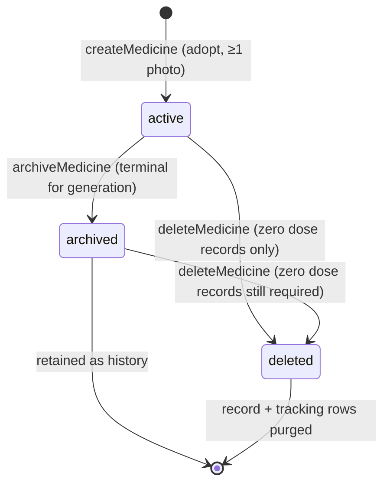
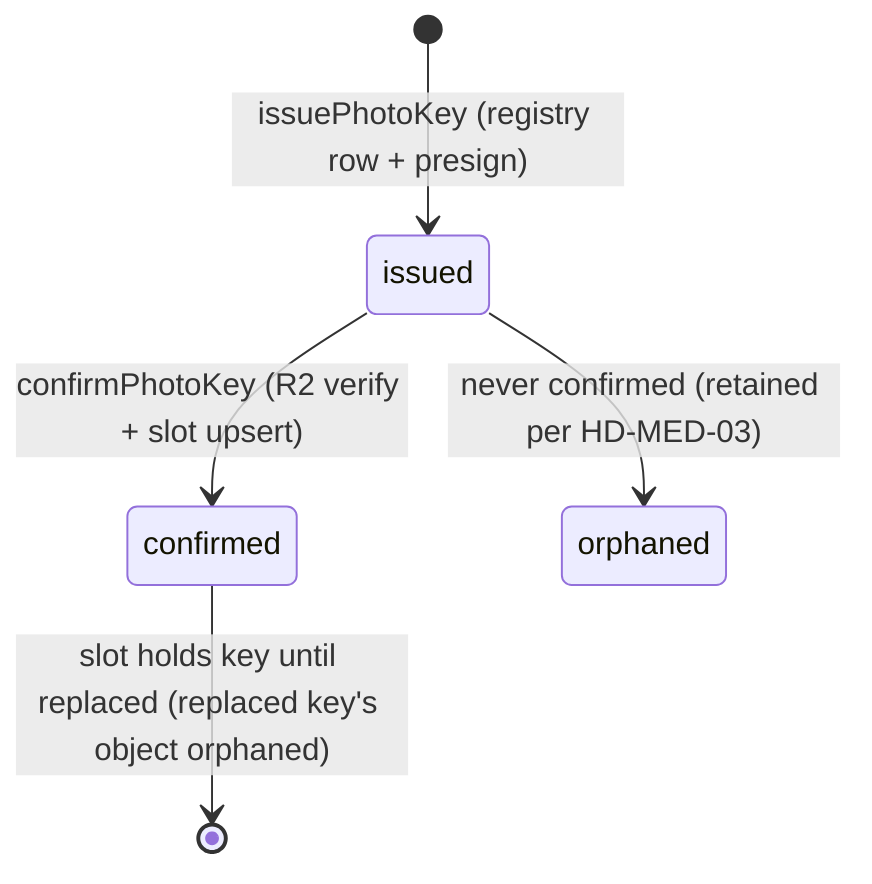

# LLD-MEDO-MEDICINE-001: Medicine Service — Medicine Catalog and private Medicine records

## 1. Document control header

Medicine | backend-microservice | HLD-MEDO-MEDICINE-001@1.0 | approved

## 2. Design context and scope

### 2.1 Upstream HLD consumed

`HLD-MEDO-MEDICINE-001@1.0` (status: approved, `lld_readiness: pass`). Sections/blocks consumed by reference: §2 goals DG-MED-1…7; §4 boundary statement + invariants; §5 all thirteen blocks (`webapi-public`, `webapi-internal`, `rate-limit`, `catalog-core`, `medicine-core`, `dose-outcome-consumer`, `account-deletion-consumer`, `authz-client`, `schedule-dose-client`, `r2-client`, `persistence`, `eventing`); §6 data architecture (`medicine_db` ownership, two-aggregate entity inventory, consistency model, retention); §7 external contracts (12 public + 1 internal REST rows + 2 consumed internal contracts); §8 events (2 published, 2 consumed) + workflows FIG-MED-04-1…6; §9 frontend surface; §10 cross-cutting; §11 security; §12 deployment; §13 scaling; §14 failure/recovery/idempotency; §15 jobs; §16 HD-MED-01…06; §17 traceability; §18 OQ register (OQ-HLD-MED-01/02 carried here).

### 2.2 Component place in system

The Medicine Service is the `medo-medicine` repository — one autonomous repo under GitHub owner `kiro-ai-bit` (`inherited:.scratch/medo-lld/issues/02-repo-shared-package-layout.md@2026-11-23`), built as the `medicine` container in the shared Docker Compose stack on AWS EC2 `t3.micro` (`inherited:HLD-MEDO-MEDICINE-001@1.0#12.1`). It realizes the HLD's thirteen blocks as modules inside `Infrastructure/`, `Core/`, `Application/`, `WebAPI/` + `planning/` + `tests/` (Architecture Standard lines 169–218). It does NOT design: schedules/dose rows/outcome classification (Schedule & Dose), alert delivery/feed/push (Notification), Harmony Points/theme (Gamification), accounts/profiles/sessions (Identity — zero directory calls), Care Link state (Care — `check-link` consumed as caller only), gateway routing (Caddy), photo byte proxying (browser PUTs direct to R2), or `@kiro-ai-bit/*` package internals.

### 2.3 Implementation goals

- LG-MED-1: Every catalog contract row (12 public + 1 internal) has a route module + handler signature + request/response DTO schema. [`service-catalog.md#medicine-service@2026-11-22`; HLD §7.1]
- LG-MED-2: `medicine_db` schema fully specified — catalog entries, photo slot + issued-key registry, patient medicines, dose-outcome state, arm state, consumer offsets — with columns, constraints, indexes, migrations. [HLD §6.1; `inherited:ticket-03`]
- LG-MED-3: Photo two-step flow (issue → direct PUT → confirm) is implementable without decisions — key binding, R2 verify, gap-fill. [HD-MED-02/03; FR-MED-007…010]
- LG-MED-4: Doses Remaining delta + refill arm-state algorithms are implementable without decisions under at-least-once delivery. [HD-MED-04/05; FR-MED-018…023]
- LG-MED-5: Every event-emitting write proves same-transaction outbox participation; `DoseOutcomeChanged`/`AccountDeleted` reactions are idempotent. [`inherited:ticket-07`; HD-MED-04]
- LG-MED-6: `authz-client` check-link positive-only cache + `schedule-dose-client` fail-closed delete guard + `r2-client` verify fail-closed have concrete mechanics. [`inherited:ticket-09`; HD-MED-06; baseline R2 row]
- LG-MED-7: Zero scheduled jobs stated explicitly; publisher + two consumer worker loops specified. [`scheduled-jobs.md#medicine-service@2026-11-21`]

### 2.4 Implementation non-goals

- Refill alert delivery, feed rows, recipient mapping → Notification LLD.
- `MedicineArchived` consumption internals (generation stop, `ArchivedMedicineRef`) → Schedule & Dose LLD.
- `has-dose-records` route shape → Schedule & Dose LLD (Medicine binds the consumed contract as specified in §11).
- Photo upload UX, IndexedDB photo caching, degraded-mode rendering → Frontend LLD.
- Orphan photo-object sweeper → none in v1 (HD-MED-03 retain policy).
- `@kiro-ai-bit/{eventing,rate-limit,contracts}` package internals → `medo-shared` repo.
- Task sequencing/estimates → downstream `tasks` stage.

### 2.5 Inherited decisions

- Runtime/framework Node.js + TypeScript + Fastify + Drizzle (`inherited:.scratch/medo-backend/issues/01-backend-runtime-framework.md@2026-11-20`).
- Deployment: `medicine` container, Docker Compose on EC2, `.env` local / SSM prod (`inherited:…/02-deployment-model-hosting.md@2026-11-20`; `.scratch/medo-hld/issues/02-cicd-deploy-mechanism.md@2026-11-23`).
- DB: self-hosted Postgres, `medicine_db` + own DB user, `drizzle-kit` migrations (`inherited:…/03-database-technology.md@2026-11-21`).
- Object storage: Cloudflare R2 S3-compatible, public-read bucket, presigned PUT via AWS SDK v3 + custom endpoint, `photos.simmaps.com` (`inherited:…/04-object-storage-provider.md@2026-11-21`; `.scratch/medo-hld/issues/01-domain-selection.md@2026-11-22`). Medicine is the platform's only R2 client.
- API gateway: Caddy public-route table; internal routes unreachable publicly + service-JWT gated (`inherited:…/05-api-gateway-entry-point.md@2026-11-21`).
- Auth: user JWTs verified locally via Identity JWKS; internal service JWTs `iss=medo-<caller>`, `aud=medo-medicine`, 5-min (`inherited:…/06-auth-token-mechanics.md@2026-11-21`).
- Events: per-service outbox same-tx → `broker_db.events`; sequential in-order consumers, `last_event_id` offsets, `eventId` dedupe, 5 attempts → `dead_letters`; package = `@kiro-ai-bit/eventing` (`inherited:…/07-message-broker-event-transport.md@2026-11-21`; rename per `.scratch/medo-lld/issues/02@2026-11-23`).
- Rate limits: auth'd reads 300/min/userId, auth'd writes 60/min/userId, internal exempt, 429 + `Retry-After`; no public-by-IP class applies (every route requires session or service JWT) (`inherited:…/09-rate-limiting-caching.md@2026-11-21`; HLD §7.1).
- Caller-side caches Medicine consumes: Care check-link positive-only ~15 s TTL, negatives never cached (`inherited:…/09-rate-limiting-caching.md@2026-11-21`; binding detail §11/LD-MED-11).
- HLD `HD-MED-01…06` — all `accepted`; realized here (HD-MED-01 → §3 module map, HD-MED-02 → LD-MED-04/§5.3/§8.4, HD-MED-03 → §5.3 registry + §6.4 retention, HD-MED-04 → LD-MED-07/§8.6, HD-MED-05 → LD-MED-08/§5.4 arm columns, HD-MED-06 → LD-MED-09/§8.10/§9).
- Error envelope `{error:{code,message,requestId}}` — sibling convention `LD-ID-12` (`inherited:docs/lld/identity/LLD-MEDO-IDENTITY-001.md@0.1-draft#LD-ID-12`; flagged `OQ-LLD-SYS-01`).
- Baselines: `platform-quality-baseline.md@2026-11-21`, `platform-observability.md@2026-11-21`, `scheduled-jobs.md@2026-11-21`.

## 3. Repository structure and module map

### 3.1 Repository declaration (backend profile §4.1)

Repository: `medo-medicine` (public, MIT) under GitHub owner `kiro-ai-bit`; consumes `@kiro-ai-bit/{eventing,rate-limit,contracts,eslint-config,tsconfig,test-utils}` from GitHub Packages, exact-pinned + committed lockfile (`inherited:.scratch/medo-lld/issues/02@2026-11-23`). Logical namespaces: `Medo.Medicine.Infrastructure`, `Medo.Medicine.Core`, `Medo.Medicine.Application`, `Medo.Medicine.WebAPI`. Import convention (LD-MED-01): path aliases `@core/*`, `@application/*`, `@infrastructure/*`, `@webapi/*` via `@kiro-ai-bit/tsconfig`; layer direction enforced by ESLint boundaries. `planning/` holds pointers to approved PRD/HLD/LLD. Bootstrap unit: `src/bootstrap.ts` → `buildApp()`.

```
medo-medicine/
├── Infrastructure/
│   ├── Persistence/        # schema/, repositories, outbox writes, consumer offsets
│   ├── Eventing/           # ensure-DDL, publisher/consumer worker config
│   ├── AuthzClient/        # Care check-link client + positive-only cache
│   ├── ScheduleDoseClient/ # has-dose-records client
│   └── R2Client/           # presign issuance inputs, HeadObject verify, public URL
├── Core/
│   ├── Catalog/            # catalog browse/search/detail/create/edit/photo rules
│   └── Medicine/           # private record rules + refill arm-state evaluation
├── Application/
│   ├── DoseOutcome/        # DoseOutcomeChanged reaction orchestration
│   └── AccountDeletion/    # AccountDeleted reaction orchestration
├── WebAPI/
│   ├── Public/             # 12 public Medicine routes + platform surface
│   ├── Internal/           # service-token GET /v1/medicines/{id}
│   ├── Authn/              # user-JWT + service-JWT guards, error handler
│   └── RateLimit/          # rate-limit binding
├── planning/               # pointers to approved docs
├── tests/{unit,integration,contract,e2e}/
└── src/bootstrap.ts
```

### 3.2 Module map

| Module ID | Responsibility | Physical path | Layer | HLD block | LD-ref |
|---|---|---|---|---|---|
| `webapi-public-routes` | 12 public Medicine routes + `/health` `/ready` `/metrics` platform surface | `WebAPI/Public/` | WebAPI | `webapi-public` | — |
| `webapi-internal-routes` | service-JWT variant of `GET /v1/medicines/{id}` | `WebAPI/Internal/` | WebAPI | `webapi-internal` | HD-MED-01 |
| `webapi-authn` | user-JWT verify (JWKS), service-JWT verify, error handler | `WebAPI/Authn/` | WebAPI | `webapi-public`/`webapi-internal` (shared guard) | LD-MED-01/10 |
| `webapi-rate-limit` | rate-limit plugin registration + class bindings | `WebAPI/RateLimit/` | WebAPI | `rate-limit` | — |
| `core-catalog` | catalog browse/search/detail/create/edit + photo issue/confirm + gap-fill rules | `Core/Catalog/` | Core | `catalog-core` | LD-MED-02/03/04/06 |
| `core-medicine` | adopt/list/detail/edit/archive/delete + doses-remaining + arm-state evaluation | `Core/Medicine/` | Core | `medicine-core` | LD-MED-07/08/09 |
| `app-dose-outcome-consumer` | `DoseOutcomeChanged` reaction orchestration | `Application/DoseOutcome/` | Application | `dose-outcome-consumer` | LD-MED-07/08 |
| `app-account-deletion-consumer` | `AccountDeleted` reaction orchestration | `Application/AccountDeletion/` | Application | `account-deletion-consumer` | — |
| `infra-authz-client` | Care `check-link` calls + positive-only ~15 s cache + invalidation + service-JWT mint + JWKS verify support | `Infrastructure/AuthzClient/` | Infrastructure | `authz-client` | LD-MED-11 |
| `infra-schedule-dose-client` | Schedule & Dose `has-dose-records` sync call; fail-closed, no cache | `Infrastructure/ScheduleDoseClient/` | Infrastructure | `schedule-dose-client` | HD-MED-06 |
| `infra-r2-client` | R2 presign inputs, object-existence verify, public URL composition | `Infrastructure/R2Client/` | Infrastructure | `r2-client` | LD-MED-04/05 |
| `infra-persistence` | Drizzle schema, repositories, outbox writes, consumer offsets | `Infrastructure/Persistence/` | Infrastructure | `persistence` | LD-MED-03/08 |
| `infra-eventing` | `@kiro-ai-bit/eventing` ensure-DDL + publisher + `DoseOutcomeChanged`/`AccountDeleted` consumers | `Infrastructure/Eventing/` | Infrastructure | `eventing` | — |

HLD block → module coverage: `webapi-public`→webapi-public-routes/webapi-authn/webapi-rate-limit; `webapi-internal`→webapi-internal-routes/webapi-authn; `rate-limit`→webapi-rate-limit; `catalog-core`→core-catalog; `medicine-core`→core-medicine; `dose-outcome-consumer`→app-dose-outcome-consumer; `account-deletion-consumer`→app-account-deletion-consumer; `authz-client`→infra-authz-client; `schedule-dose-client`→infra-schedule-dose-client; `r2-client`→infra-r2-client; `persistence`→infra-persistence; `eventing`→infra-eventing. Zero orphans both directions.

### 3.3 Bootstrap registration order (backend profile §4.1)

`buildApp()` registers: (1) `loadConfig` env validation — fail-fast (§13); (2) Pino logger + `X-Request-Id` hook; (3) error-handler plugin; (4) rate-limit plugin (`@kiro-ai-bit/rate-limit`); (5) authN guards (user-JWT via Identity JWKS, service-JWT via static pubkey config); (6) Zod route registration per module; (7) `infra-eventing` ensure-DDL + publisher worker + `DoseOutcomeChanged` + `AccountDeleted` consumer workers; (8) platform routes. No `node-cron` registration — Medicine owns zero scheduled jobs (§10).

## 4. Module and unit detailed design

Signatures use §6.6 notation; DTO/schema type names referenced from §5/§6. Private helpers implied by public signatures are not listed.

### 4.1 `webapi-public-routes`: public Medicine routes + platform surface

| Unit | Kind | Signature | Responsibility | Depends on | Realizes |
|---|---|---|---|---|---|
| `registerCatalogRoutes` | function | `(app: FastifyInstance, deps: CatalogRouteDeps): Promise<void>` | Registers `GET /v1/medicine-catalog`, `GET /v1/medicine-catalog/{id}`, `POST /v1/medicine-catalog`, `PATCH /v1/medicine-catalog/{id}`, `POST .../photos`, `PUT .../photos/{slot}` | `core-catalog`, `webapi-authn` | §6 catalog rows |
| `registerMedicineRoutes` | function | `(app: FastifyInstance, deps: MedicineRouteDeps): Promise<void>` | Registers `GET /v1/medicines`, `POST /v1/medicines`, `GET /v1/medicines/{id}`, `PATCH /v1/medicines/{id}`, `POST .../archive`, `DELETE /v1/medicines/{id}` | `core-medicine`, `webapi-authn` | §6 medicine rows |
| `registerPlatformRoutes` | function | `(app: FastifyInstance, deps: PlatformDeps): Promise<void>` | `/health` liveness, `/ready` (medicine_db+broker_db pings), `/metrics` | `infra-persistence`, `infra-eventing` | §6 platform surface |

### 4.2 `webapi-internal-routes`: internal service-token surface

| Unit | Kind | Signature | Responsibility | Depends on | Realizes |
|---|---|---|---|---|---|
| `registerInternalRoutes` | function | `(app: FastifyInstance, deps: InternalRouteDeps): Promise<void>` | Registers `GET /v1/medicines/{id}` behind `serviceAuthGuard` — same Core read as public detail | `core-medicine` | §6 internal row |

### 4.3 `webapi-authn`: guards + error handler

| Unit | Kind | Signature | Responsibility | Depends on | Realizes |
|---|---|---|---|---|---|
| `userAuthGuard` | function | `(request: FastifyRequest) => Promise<UserClaims>` | Verify Bearer user JWT via Identity JWKS (`iss=medo-identity`, `aud` app, `exp`); 401 on failure | `infra-authz-client/verifyUserJwt` | §6 session routes |
| `serviceAuthGuard` | function | `(request: FastifyRequest) => Promise<ServiceClaims>` | Verify service JWT: `iss` known peer, `aud='medo-medicine'`, `exp`, static pubkey config | `infra-authz-client/verifyServiceJwt` | §6 internal row |
| `verifyUserJwt` | function | `(token: string, jwks: JSONWebKeySet): Promise<UserClaims>` | Local jose verify; `kid` rotation tolerance via JWKS refetch on unknown kid | `jose` | ticket-06 |
| `errorHandler` | function | `(err: unknown, request: FastifyRequest, reply: FastifyReply) => void` | Single mapping point thrown error → status+code (§14) | — | §14 |

### 4.4 `webapi-rate-limit`: rate-limit binding

| Unit | Kind | Signature | Responsibility | Depends on | Realizes |
|---|---|---|---|---|---|
| `registerRateLimit` | function | `(app: FastifyInstance): Promise<void>` | Registers `@kiro-ai-bit/rate-limit` plugin + per-route class table §12 | plugin | HLD `rate-limit` block |

### 4.5 `core-catalog`: catalog rules + photo pipeline

| Unit | Kind | Signature | Responsibility | Depends on | Realizes |
|---|---|---|---|---|---|
| `listCatalog` | function | `(q: string \| undefined, page: number, pageSize: number): Promise<CatalogListDto>` | Browse/search: `q` text match on brand + ingredient names, paginated (§8.1) | `catalogEntriesRepo` | FR-MED-001 |
| `getCatalogEntry` | function | `(entryId: string): Promise<CatalogEntryDto>` | Detail + gap-fill photo resolution (§8.2) | `catalogEntriesRepo`, `catalogPhotosRepo` | FR-MED-002/003 |
| `createCatalogEntry` | function | `(cmd: CreateCatalogEntryCommand): Promise<CatalogEntryDto>` | Normalized duplicate-check → insert; conflict carries existing id (FR-MED-004/005) | `catalogEntriesRepo` | FR-MED-004/005 |
| `editCatalogEntry` | function | `(entryId: string, patch: CatalogEntryPatch): Promise<CatalogEntryDto>` | Community LWW field edit; photo slots untouched (FR-MED-006) | `catalogEntriesRepo` | FR-MED-006 |
| `issuePhotoKey` | function | `(entryId: string, slot: PhotoSlot, actor: UserClaims): Promise<PhotoIssueDto>` | Verify entry exists → register issued key + presign inputs → `{photoKey, uploadUrl, expiresAt}` (§8.4) | `catalogEntriesRepo`, `catalogPhotoKeysRepo`, `infra-r2-client` | FR-MED-007 |
| `confirmPhotoKey` | function | `(entryId: string, slot: PhotoSlot, photoKey: string): Promise<CatalogEntryDto>` | Pre-tx R2 verify → tx: registry consume + slot upsert (§8.4) | `catalogPhotoKeysRepo`, `catalogPhotosRepo`, `infra-r2-client` | FR-MED-009/010 |
| `resolvePhotoSlots` | function | `(entryId: string): Promise<PhotoSlotsDto>` | Read confirmed slots → gap-fill A/B/C resolution → public URLs (LD-MED-04) | `catalogPhotosRepo`, `infra-r2-client` | FR-MED-003 |
| `normalizeCatalogText` | function | `(s: string): string` | trim + collapse whitespace + lowercase — applied to all catalog text at write/read-compare (LD-MED-06) | — | FR-MED-005c |

Rationale: one Core module per HLD aggregate (`catalog-core`); photo issue/confirm lives here because the HLD places photo slot rules inside `catalog-core` and every photo route binds to a catalog entry — no separate aggregate exists.

### 4.6 `core-medicine`: private record rules

| Unit | Kind | Signature | Responsibility | Depends on | Realizes |
|---|---|---|---|---|---|
| `listMedicines` | function | `(patientId: string, actor: UserClaims): Promise<MedicineListDto>` | Authz (self or check-link) → patient-scoped list excl. archived + catalog resolution (FR-MED-013) | `patientMedicinesRepo`, `catalogEntriesRepo`, `infra-authz-client` | FR-MED-013/026 |
| `createMedicine` | function | `(cmd: CreateMedicineCommand, actor: UserClaims): Promise<PatientMedicineDetailDto>` | Authz → catalog resolve + ≥1-photo guard → tx insert + arm-state init + threshold eval (§8.5) | `patientMedicinesRepo`, `catalogEntriesRepo`, `catalogPhotosRepo`, `infra-authz-client` | FR-MED-011/012/026 |
| `getMedicine` | function | `(medicineId: string, actor: UserClaims \| ServiceClaims): Promise<PatientMedicineDetailDto>` | Load record → authz self/check-link (public) or service-JWT pass (internal) → merged DTO (§6 internal row) | `patientMedicinesRepo`, `catalogEntriesRepo`, `infra-authz-client` | FR-MED-014/025 |
| `editMedicine` | function | `(medicineId: string, patch: MedicinePatch, actor: UserClaims): Promise<PatientMedicineDetailDto>` | Authz → archived guard → tx: field update + conditional dosesRemaining eval + arm-state + outbox (§8.8) | `patientMedicinesRepo`, `catalogEntriesRepo`, `infra-authz-client` | FR-MED-015/021 |
| `archiveMedicine` | function | `(medicineId: string, actor: UserClaims): Promise<ArchivedMedicineDto>` | Authz → terminal-state guard → tx archived_at + outbox `MedicineArchived` (§8.9) | `patientMedicinesRepo`, `infra-authz-client` | FR-MED-016 |
| `deleteMedicine` | function | `(medicineId: string, actor: UserClaims): Promise<DeletedMedicineDto>` | Authz → pre-tx `has-dose-records` → zero ⇒ tx delete record+tracking rows (§8.10) | `patientMedicinesRepo`, `infra-authz-client`, `infra-schedule-dose-client` | FR-MED-017 |
| `evaluateRefillThresholds` | function | `(tx: DbTx, medicine: PatientMedicine, newDosesRemaining: number): Promise<RefillThresholdCrossed \| null>` | Arm-state machine + outbox append on qualifying transition (§8.7); shared by create/edit/consumer paths | `infra-persistence/outboxWriter` | FR-MED-021/022/023 |
| `applyDoseOutcomeDelta` | function | `(tx: DbTx, event: DoseOutcomeChangedPayload): Promise<void>` | Idempotent delta via `DoseOutcomeState` + floor 0 + threshold eval (§8.6) | `patientMedicinesRepo`, `doseOutcomeStatesRepo`, `evaluateRefillThresholds` | FR-MED-018/019/020 |

Rationale: `medicine-core` owns the private aggregate and the two write paths that mutate `dosesRemaining` (manual edit + event-driven) share `evaluateRefillThresholds` so arm-state semantics are identical on both paths (HD-MED-05).

### 4.7 `app-dose-outcome-consumer`: `DoseOutcomeChanged` reaction

| Unit | Kind | Signature | Responsibility | Depends on | Realizes |
|---|---|---|---|---|---|
| `handleDoseOutcomeChanged` | function | `(event: DoseOutcomeChangedEvent): Promise<void>` | Per-event tx: resolve target medicine → `applyDoseOutcomeDelta` → commit; unknown medicineId → no-op | `core-medicine`, repos | FR-MED-018/019; HD-MED-04 |

### 4.8 `app-account-deletion-consumer`: `AccountDeleted` reaction

| Unit | Kind | Signature | Responsibility | Depends on | Realizes |
|---|---|---|---|---|---|
| `handleAccountDeleted` | function | `(event: AccountDeletedEvent): Promise<void>` | Single tx: delete `patient_medicines` where `patient_id=userId` (dose-outcome rows cascade) + purge check-link cache entries involving userId (post-commit); catalog untouched | repos, `infra-authz-client/directoryCache`-equivalent check-link cache | FR-MED-024 |

### 4.9 `infra-authz-client`: check-link + JWT material

| Unit | Kind | Signature | Responsibility | Depends on | Realizes |
|---|---|---|---|---|---|
| `checkLink` | function | `(patientId: string, caregiverId: string): Promise<boolean>` | Care `GET /v1/care/check-link` service-JWT call + positive-only cache read-through (LD-MED-11) | `careCheckLinkClient`, `checkLinkCache` | FR-MED-026 |
| `careCheckLinkClient` | function | `(patientId: string, caregiverId: string): Promise<boolean>` | HTTP call `CARE_SERVICE_URL` + `mintServiceToken(iss=medo-medicine,aud=medo-care)`; baseline 3 s + 1 retry/200 ms | `jose`, `fetch` | §11 |
| `checkLinkCache` | module | `{get(key): boolean \| null, set(key, active): void, invalidateForUser(userId): void}` | In-process Map, TTL `CHECK_LINK_CACHE_TTL_MS=15000`, positives only, negatives never cached; `invalidateForUser` purges entries where either side = userId on `AccountDeleted` | — | ticket-09, LD-MED-11 |
| `mintServiceToken` | function | `(aud: string): Promise<string>` | Sign 5-min service JWT with `SERVICE_PRIVATE_KEY` | `jose` | ticket-06 |
| `verifyServiceJwt` | function | `(token: string): Promise<ServiceClaims>` | Verify caller service JWT vs `SERVICE_PUBLIC_KEYS` static config | `jose` | §11 inbound |
| `fetchJwks`/`jwksCache` | module | `{get(): Promise<JSONWebKeySet>}` | Fetch `IDENTITY_JWKS_URL` JWKS, cache 300 s, refetch on unknown `kid` | `fetch` | user-JWT verify |

### 4.10 `infra-schedule-dose-client`: delete guard

| Unit | Kind | Signature | Responsibility | Depends on | Realizes |
|---|---|---|---|---|---|
| `hasDoseRecords` | function | `(patientId: string): Promise<boolean>` | `GET /v1/patients/{id}/has-dose-records` service-JWT call; NO cache; throws `DependencyError` on failure (fail-closed) | `jose`, `fetch` | FR-MED-017, HD-MED-06 |

### 4.11 `infra-r2-client`: R2 interactions

| Unit | Kind | Signature | Responsibility | Depends on | Realizes |
|---|---|---|---|---|---|
| `createPresignedPut` | function | `(photoKey: string, contentType: string): Promise<{url: string, expiresAt: Date}>` | AWS SDK v3 presigned PUT against R2 custom endpoint; local computation, no R2 call (FR-MED-007a) | `@aws-sdk/s3-request-presigner`, `@aws-sdk/client-s3` | FR-MED-007/008 |
| `verifyObjectExists` | function | `(photoKey: string): Promise<boolean>` | S3 `HeadObject` on issued key (LD-MED-05); 10 s + 2 retries baseline; throws `DependencyError` on failure → confirm fails closed | `@aws-sdk/client-s3` | FR-MED-010, HD-MED-02 |
| `publicPhotoUrl` | function | `(photoKey: string): string` | `${R2_PUBLIC_BASE_URL}/${photoKey}` composition for DTO photo fields | — | FR-MED-003, domain ticket |

### 4.12 `infra-persistence`: schema + repositories

| Unit | Kind | Signature | Responsibility | Depends on | Realizes |
|---|---|---|---|---|---|
| `db` | module | drizzle client on `DATABASE_URL` | `medicine_db` connection | `drizzle-orm` | §5 |
| `catalogEntriesRepo` | repository | `search(q, page, pageSize)`, `findById`, `insert`, `updateFields`, `findDuplicate(normBrand, form, normIngredients)` | Catalog aggregate persistence | `db` | §5.1 |
| `catalogPhotosRepo` | repository | `findSlotsByEntry`, `upsertSlot(tx, entryId, slot, photoKey)` | Confirmed photo slot per (entry,slot) | `db` | §5.2 |
| `catalogPhotoKeysRepo` | repository | `insertIssued`, `findByKey`, `markConfirmed(tx, keyId)`, `listUnconfirmed` | Issued-key registry (HD-MED-02) | `db` | §5.3 |
| `patientMedicinesRepo` | repository | `insert`, `findById`, `listByPatient`, `updateFields`, `markArchived`, `deleteById`, `deleteByPatientId` | PatientMedicine aggregate persistence | `db` | §5.4 |
| `doseOutcomeStatesRepo` | repository | `findByDose`, `upsert(tx, medicineId, doseId, outcome, occurredAt)` | Per-(medicine,dose) last-applied outcome | `db` | §5.5 |
| `consumerOffsetsRepo` | repository | `getOffset`, `advanceOffset` | `last_event_id` per consumer | `db` | §5.7 |
| `outboxWriter` | repository | `appendOutbox(tx, event)` | Outbox row inside caller tx (both published events) | `@kiro-ai-bit/eventing` types | §7 |

### 4.13 `infra-eventing`: publisher + consumer binding

| Unit | Kind | Signature | Responsibility | Depends on | Realizes |
|---|---|---|---|---|---|
| `ensureEventingSchema` | function | `(): Promise<void>` | ensure-DDL for outbox + broker tables at boot | `@kiro-ai-bit/eventing` | §5.6/§7 |
| `startPublisherWorker` | function | `(): Promise<void>` | 5 s poll drain `medicine_db.outbox` → `broker_db.events` | package | §10 |
| `startDoseOutcomeConsumer` | function | `(): Promise<void>` | sequential poll `broker_db.events` → dispatch `DoseOutcomeChanged` → `handleDoseOutcomeChanged`; offset after success | package, `app-dose-outcome-consumer` | §7/§10 |
| `startAccountDeletedConsumer` | function | `(): Promise<void>` | sequential poll → dispatch `AccountDeleted` → `handleAccountDeleted`; offset after success | package, `app-account-deletion-consumer` | §7/§10 |

FIG-MED-01: module/component diagram

```mermaid
flowchart TB
    subgraph WebAPI
        PUB[webapi-public-routes<br/>12 public routes + platform]
        INT[webapi-internal-routes<br/>GET /v1/medicines/{id} service-JWT]
        AUTH[webapi-authn<br/>guards + errorHandler]
        RL[webapi-rate-limit]
    end
    subgraph Core
        CAT[core-catalog]
        MED[core-medicine]
    end
    subgraph Application
        DOC[app-dose-outcome-consumer]
        ADEL[app-account-deletion-consumer]
    end
    subgraph Infrastructure
        PER[infra-persistence<br/>medicine_db repos + outbox]
        EVT[infra-eventing<br/>publisher + 2 consumers]
        AUTHZ[infra-authz-client<br/>check-link + cache + JWT]
        SCHC[infra-schedule-dose-client<br/>has-dose-records]
        R2C[infra-r2-client<br/>presign + verify + URL]
    end
    PUB --> CAT & MED & AUTH
    INT --> MED & AUTH
    CAT --> PER & R2C
    MED --> PER & AUTHZ & SCHC
    DOC --> MED
    ADEL --> PER & AUTHZ
    EVT --> DOC & ADEL
```

## 5. Data model and persistence design

Owned store: `medicine_db` only (`inherited:ticket-03`). `broker_db` tables owned by `@kiro-ai-bit/eventing` — cited, never redefined. Drizzle schema files under `Infrastructure/Persistence/schema/`: `catalog_entries.ts`, `catalog_photos.ts`, `catalog_photo_keys.ts`, `patient_medicines.ts`, `dose_outcome_states.ts`, `consumer_offsets.ts`, `outbox.ts`; `snake_case` plural tables; `uuid` PKs (`gen_random_uuid()`), `text`+CHECK enums, `timestamptz` times. Migrations `NNNN-<slug>` via `drizzle-kit` at deploy.

### 5.1 `medicine_catalog_entries`

Purpose: Medicine Catalog aggregate — shared community drug identity (HLD §6.1). Owning unit: `infra-persistence/catalogEntriesRepo` + `core-catalog`.

| Column | Type | Nullable | Default | Constraints | Notes |
|---|---|---|---|---|---|
| `id` | `uuid` | no | `gen_random_uuid()` | PK | `catalogEntryId` in DTOs/adopt/events |
| `brand_name` | `text` | no | — | CHECK `length(brand_name) BETWEEN 1 AND 200` | Normalized lowercase (LD-MED-06); community-editable LWW |
| `ingredient_names` | `text[]` | no | — | CHECK `cardinality(ingredient_names) >= 1` | Normalized lowercase, sorted, whitespace-collapsed at write (LD-MED-06); set-equality dup-check |
| `form` | `text` | no | — | CHECK `form IN ('tablet','capsule','syrup','injection','drops','other')` | verbatim PRD FR-MED-004b |
| `packaging_quantity` | `integer` | no | — | CHECK `packaging_quantity > 0` | count/volume units per Map 1 t04 |
| `created_at` | `timestamptz` | no | `now()` | — | — |
| `updated_at` | `timestamptz` | no | `now()` | — | Touched on every community edit |

Indexes:

| Index | Columns | Type | Purpose |
|---|---|---|---|
| `idx_catalog_brand_form` | `(brand_name, form)` | btree | duplicate-check narrowing `brand_name=? AND form=?` then ingredient-set compare (§8.3) |
| `idx_catalog_updated` | `(updated_at DESC)` | btree | default browse ordering newest-first |

Search (`q`) uses `ILIKE '%q%'` over `brand_name` + `ingredient_names::text` — sequential scan acceptable at <10k entries (HLD §13); no trigram index (no extension dependency).

### 5.2 `catalog_photos`

Purpose: confirmed photo slot per (entry, slot) — current attached R2 object (HLD §6.1). Owning unit: `infra-persistence/catalogPhotosRepo` + `core-catalog/resolvePhotoSlots`.

| Column | Type | Nullable | Default | Constraints | Notes |
|---|---|---|---|---|---|
| `entry_id` | `uuid` | no | — | PK part, FK→`medicine_catalog_entries.id` ON DELETE CASCADE | entries never deleted; cascade is defensive |
| `slot` | `text` | no | — | PK part, CHECK `slot IN ('A','B','C')` | photo slot tags permanent (Map 1 t04) |
| `photo_key` | `text` | no | — | — | R2 object key of confirmed upload; unguessable (LD-MED-04) |
| `updated_at` | `timestamptz` | no | `now()` | — | Re-confirm replaces key LWW |

PK `(entry_id, slot)` — at most one confirmed photo per slot; re-confirm upserts (FR-MED-009 replace semantics).

### 5.3 `catalog_photo_keys`

Purpose: issued `photoKey` registry — capability ledger enabling confirm binding + orphan accounting (HD-MED-02/03). Owning unit: `infra-persistence/catalogPhotoKeysRepo` + `core-catalog/issuePhotoKey`/`confirmPhotoKey`.

| Column | Type | Nullable | Default | Constraints | Notes |
|---|---|---|---|---|---|
| `id` | `uuid` | no | `gen_random_uuid()` | PK | internal row id |
| `entry_id` | `uuid` | no | — | FK→`medicine_catalog_entries.id` ON DELETE CASCADE | issued-for binding |
| `slot` | `text` | no | — | CHECK `slot IN ('A','B','C')` | issued-for binding |
| `photo_key` | `text` | no | — | UNIQUE | the capability value; unguessable `catalog/{entryId}/{slot}/{uuid}` (LD-MED-04); never logged |
| `issued_at` | `timestamptz` | no | `now()` | — | — |
| `confirmed_at` | `timestamptz` | yes | `NULL` | — | set inside confirm tx; NULL = issued-unconfirmed (orphan ledger, HD-MED-03) |

Indexes:

| Index | Columns | Type | Purpose |
|---|---|---|---|
| `catalog_photo_keys_photo_key_key` | `photo_key` | btree UNIQUE | confirm lookup by capability |
| `idx_photo_keys_entry_slot` | `(entry_id, slot)` | btree | per-slot issuance history + orphan enumeration |
| `idx_photo_keys_unconfirmed` | `(confirmed_at) WHERE confirmed_at IS NULL` | btree partial | orphan accounting query (HD-MED-03) |

### 5.4 `patient_medicines`

Purpose: private per-patient Medicine record — adopt target, catalog fields resolved at read (HLD §6.1). Owning unit: `infra-persistence/patientMedicinesRepo` + `core-medicine`.

| Column | Type | Nullable | Default | Constraints | Notes |
|---|---|---|---|---|---|
| `id` | `uuid` | no | `gen_random_uuid()` | PK | `medicineId` in DTOs/events/`DoseOutcomeChanged` payloads |
| `patient_id` | `uuid` | no | — | index | Identity `userId`; opaque reference, no DB FK (cross-service) |
| `catalog_entry_id` | `uuid` | no | — | FK→`medicine_catalog_entries.id` | same-service FK — real constraint; entries never deleted |
| `prescribing_doctor` | `text` | no | — | CHECK `length(...) BETWEEN 1 AND 200` | PII (health-adjacent) |
| `dosage` | `text` | no | — | CHECK `length(...) BETWEEN 1 AND 200` | free-text regimen |
| `doses_remaining` | `integer` | no | — | CHECK `doses_remaining >= 0` | floor-0 enforced app-side + constraint; PII-adjacent |
| `refill_threshold` | `integer` | no | `6` | CHECK `refill_threshold >= 0` | per-medicine custom alert level (PRD OQ-MED-06); default preserves legacy ≤6 behaviour |
| `price` | `numeric(12,2)` | no | — | CHECK `price >= 0` | PII |
| `pharmacy_name` | `text` | no | — | CHECK `length(...) BETWEEN 1 AND 200` | PII |
| `archived_at` | `timestamptz` | yes | `NULL` | — | archive timestamp; NULL = active. Terminal for generation; record retained |
| `refill_low_armed` | `boolean` | no | `true` | — | ≤6 alert arm flag (FR-MED-023; LD-MED-08) |
| `refill_out_armed` | `boolean` | no | `true` | — | 0 alert arm flag (symmetric re-arm) |
| `created_at` | `timestamptz` | no | `now()` | — | — |
| `updated_at` | `timestamptz` | no | `now()` | — | — |

Indexes:

| Index | Columns | Type | Purpose |
|---|---|---|---|
| `idx_patient_medicines_patient` | `(patient_id)` | btree | `GET /v1/medicines?patientId=` list + `AccountDeleted` purge scan |
| `idx_patient_medicines_catalog` | `(catalog_entry_id)` | btree | reverse lookup / future catalog analytics |

Relationships: `catalog_entry_id` → `medicine_catalog_entries.id` (many-to-one, RESTRICT — entries undeletable anyway); `dose_outcome_states.medicine_id` → `patient_medicines.id` ON DELETE CASCADE (hard-delete + purge backstop).

### 5.5 `dose_outcome_states`

Purpose: per-(medicine, dose) last-applied outcome — idempotency substrate for at-least-once `DoseOutcomeChanged` (HD-MED-04). Owning unit: `infra-persistence/doseOutcomeStatesRepo` + `core-medicine/applyDoseOutcomeDelta`.

| Column | Type | Nullable | Default | Constraints | Notes |
|---|---|---|---|---|---|
| `medicine_id` | `uuid` | no | — | PK part, FK→`patient_medicines.id` ON DELETE CASCADE | `DoseOutcomeChanged.medicineId` = `patient_medicines.id` |
| `dose_id` | `uuid` | no | — | PK part | `DoseOutcomeChanged.doseId` — Schedule & Dose dose row id |
| `last_outcome` | `text` | no | — | CHECK `last_outcome IN ('taken-on-time','taken-late','skipped','missed')` | verbatim catalog enum |
| `occurred_at` | `timestamptz` | no | — | — | last applied event's `occurredAt` — ordering guard (§8.6) |
| `updated_at` | `timestamptz` | no | — | `now()` | — |

PK `(medicine_id, dose_id)` — one row per dose ever seen; `upsert` inside the consumer tx is the dedupe mechanism.

### 5.6 `outbox` (participation — columns owned by `@kiro-ai-bit/eventing`)

Service outbox table in `medicine_db`, created by package ensure-DDL at boot (`inherited:ticket-07`). One row per published event inside the triggering write tx (§9); payload = envelope `{eventId, occurredAt}` + §7 field lists; publisher deletes row after successful `broker_db.events` insert.

### 5.7 `consumer_offsets`

Purpose: per-consumer `last_event_id` offset (ticket-07 mechanics). Owning unit: `infra-persistence/consumerOffsetsRepo`.

| Column | Type | Nullable | Default | Constraints | Notes |
|---|---|---|---|---|---|
| `consumer` | `text` | no | — | PK, CHECK `consumer IN ('dose-outcome-changed','account-deleted')` | Consumer name; extensible by CHECK amendment if subscriptions grow |
| `last_event_id` | `bigint` | no | `0` | — | Advances only after successful processing (offset-after-success) |

Dedupe: redelivery safety = atomic reaction tx + `dose_outcome_states` last-outcome guard + terminal-state purge + monotonic offset; no `processed_events` table needed at this event volume.

### 5.8 Migration & seed plan

| Step | Intent | Ordering |
|---|---|---|
| `0001-catalog-tables` | create `medicine_catalog_entries`, `catalog_photos`, `catalog_photo_keys` + indexes/constraints | first |
| `0002-patient-medicine` | create `patient_medicines`, `dose_outcome_states` | after 0001 |
| `0003-consumer-offsets` | create `consumer_offsets` | after 0002 |
| `0004-outbox` | `@kiro-ai-bit/eventing` ensure-DDL at boot (not a drizzle migration) | runtime |

Seed data: none — all behavior is request/event driven.

## 6. API endpoint realization

Error envelope (all endpoints): `{ "error": { "code": <code>, "message": <string>, "requestId": <string>, "details"?: <object> } }` — `details` optional extension carrying conflict payloads (LD-MED-10). Middleware order (fixed, §4.3 backend profile): `request-id → rate-limit → authN (user-JWT or service-JWT per surface) → Zod DTO validation → handler → error mapping`. Validation split: Fastify JSON-schema/Zod at WebAPI for transport shape; Core re-asserts domain invariants (§8); DB constraints ultimate guard.

### GET /v1/medicine-catalog

Auth: any valid session (`userAuthGuard`). Rate class: auth-read 300/min/userId.

Query params:

| Field | Type | Req | Constraints/Default | Notes |
|---|---|---|---|---|
| `q` | string | no | ≤200 chars | text match on `brand_name` + `ingredient_names` (LD-MED-02) |
| `page` | integer | no | ≥1, default 1 | pagination; `pageSize` fixed 20 (max 50 — LD-MED-02) |

Response (200): `{entries: CatalogEntryDto[], page: integer, pageSize: integer, total: integer}` — `total` = full match count.

Errors: `UNAUTHORIZED` 401, `VALIDATION_FAILED` 400, `RATE_LIMITED` 429, `INTERNAL` 500. Idempotency: n-a (read).

### GET /v1/medicine-catalog/{id}

Auth: any valid session. Rate class: auth-read.

Path param `id`: uuid required.

Response (200): `CatalogEntryDto` = `{id: uuid, brandName: string, ingredientNames: string[], form: 'tablet'|'capsule'|'syrup'|'injection'|'drops'|'other', packagingQuantity: integer, photos: {A: string|null, B: string|null, C: string|null}, createdAt: ISO-8601, updatedAt: ISO-8601}` — photo values are public R2 URLs after gap-fill (FR-MED-003).

Errors: `NOT_FOUND` 404 unknown id, `UNAUTHORIZED` 401, `VALIDATION_FAILED` 400, `RATE_LIMITED` 429, `INTERNAL` 500.

### POST /v1/medicine-catalog

Auth: any valid session. Rate class: auth-write 60/min/userId.

Request body:

| Field | Type | Req | Constraints/Default | Notes |
|---|---|---|---|---|
| `brandName` | string | yes | 1–200 after normalize | normalized lowercase at write (LD-MED-06) |
| `ingredientNames` | string[] | yes | ≥1 item, each 1–200 after normalize | combination drugs; normalized + sorted at write |
| `form` | enum | yes | `tablet\|capsule\|syrup\|injection\|drops\|other` | verbatim FR-MED-004b |
| `packagingQuantity` | integer | yes | >0 | — |

Response (201): `CatalogEntryDto` (photos all null).

Errors: `VALIDATION_FAILED` 400, `UNAUTHORIZED` 401, `CONFLICT` 409 duplicate-check match — `error.details.existingEntryId` carries existing entry identity (FR-MED-005; LD-MED-10), `RATE_LIMITED` 429, `INTERNAL` 500. Idempotency: natural dup-guard + normalized-identity compare (§14).

### PATCH /v1/medicine-catalog/{id}

Auth: any valid session — community edit, no ownership check (FR-MED-027). Rate class: auth-write.

Path param `id`: uuid. Body: partial of `{brandName?, ingredientNames?, form?, packagingQuantity?}` — all optional, at least one required.

Response (200): `CatalogEntryDto`.

Errors: `NOT_FOUND` 404, `VALIDATION_FAILED` 400, `UNAUTHORIZED` 401, `RATE_LIMITED` 429, `INTERNAL` 500. Idempotency: natural last-write-wins; photo slots unchanged (FR-MED-006).

### POST /v1/medicine-catalog/{id}/photos

Auth: any valid session. Rate class: auth-write.

Path param `id`: uuid (existing entry). Body: `{slot: 'A'|'B'|'C'}` required.

Response (200): `{photoKey: string, uploadUrl: string, expiresAt: ISO-8601}` — `uploadUrl` = presigned PUT (TTL `PHOTO_PRESIGN_TTL_SECONDS=900`, LD-MED-04); `photoKey` = `catalog/{entryId}/{slot}/{uuid}`.

Errors: `NOT_FOUND` 404 unknown entry, `VALIDATION_FAILED` 400 bad slot, `UNAUTHORIZED` 401, `RATE_LIMITED` 429, `INTERNAL` 500. Idempotency: n-a — each issue registers a new key; unconfirmed keys become accounted orphans (HD-MED-03).

### PUT /v1/medicine-catalog/{id}/photos/{slot}

Auth: any valid session + issued-key capability binding (FR-MED-009). Rate class: auth-write.

Path params `id`: uuid, `slot`: `'A'|'B'|'C'`. Body: `{photoKey: string}` required.

Pre-tx: registry lookup `photo_key` → must exist, `entry_id`+`slot` match path, `confirmed_at IS NULL` (or already confirmed for same slot → idempotent re-confirm) → R2 `verifyObjectExists(photoKey)` → on failure `DEPENDENCY_UNAVAILABLE` 503, slot unchanged (FR-MED-010).

Tx (§9): mark registry `confirmed_at` + upsert `catalog_photos` slot → `photo_key`.

Response (200): `CatalogEntryDto` (updated slot visible via gap-fill).

Errors: `FORBIDDEN` 403 key not issued for this entry+slot / unknown key / foreign key (uniform — no key-state enumeration, FR-MED-009b), `NOT_FOUND` 404 unknown entry, `VALIDATION_FAILED` 400, `UNAUTHORIZED` 401, `DEPENDENCY_UNAVAILABLE` 503 R2 verify failure, `RATE_LIMITED` 429, `INTERNAL` 500. Idempotency: same `photoKey` re-confirm = no-op-equivalent attach (§14).

### GET /v1/medicines?patientId=

Auth: patient-self (`patientId == sub`) OR linked caregiver via `check-link` (FR-MED-013/026). Rate class: auth-read.

Query params: `patientId` uuid required.

Response (200): `{medicines: PatientMedicineSummaryDto[]}` — `PatientMedicineSummaryDto` = `{id: uuid, patientId: uuid, catalogEntryId: uuid, catalog: {brandName: string, form: enum, packagingQuantity: integer, photos: {A,B,C: string|null}}, prescribingDoctor: string, dosage: string, dosesRemaining: integer, refillThreshold: integer, price: number, pharmacyName: string, createdAt: ISO-8601}` — archived records excluded (FR-MED-013b); catalog fields resolved at read, never copied (DG-MED-2).

Errors: `FORBIDDEN` 403 no active link / check-link deny, `UNAUTHORIZED` 401, `VALIDATION_FAILED` 400, `DEPENDENCY_UNAVAILABLE` 503 check-link unreachable (fail-closed), `RATE_LIMITED` 429, `INTERNAL` 500. Idempotency: n-a.

### POST /v1/medicines

Auth: patient-self or linked caregiver — `patientId` in body (LD-MED-13). Rate class: auth-write.

Request body:

| Field | Type | Req | Constraints/Default | Notes |
|---|---|---|---|---|
| `patientId` | uuid | yes for caregiver; must equal `sub` for Patient role | — | authz target (LD-MED-13) |
| `catalogEntryId` | uuid | yes | must resolve | unknown → reject (FR-MED-012) |
| `prescribingDoctor` | string | yes | 1–200 | PII |
| `dosage` | string | yes | 1–200 | — |
| `dosesRemaining` | integer | yes | ≥0 | required whole number (FR-MED-011) |
| `refillThreshold` | integer | no | ≥0, default 6 | optional whole number; custom alert level (PRD OQ-MED-06) |
| `price` | number | yes | ≥0 | PII |
| `pharmacyName` | string | yes | 1–200 | PII |

Pre-tx: authz (self `sub==patientId`, else `check-link(patientId, sub)`); catalog entry resolve + ≥1 confirmed photo guard (FR-MED-011/AC-MED-011d).

Tx (§9): insert `patient_medicines` (arm flags default true) + `evaluateRefillThresholds` on initial `dosesRemaining` (LD-MED-08) → possible outbox `RefillThresholdCrossed`.

Response (201): `PatientMedicineDetailDto` = summary fields + `{updatedAt, archivedAt: ISO-8601|null}`.

Errors: `FORBIDDEN` 403 authz/check-link, `NOT_FOUND` 404 unknown catalogEntryId, `CONFLICT` 409 photo-less catalog entry (directs to photo flow — AC-MED-011d), `VALIDATION_FAILED` 400, `UNAUTHORIZED` 401, `DEPENDENCY_UNAVAILABLE` 503 check-link down, `RATE_LIMITED` 429, `INTERNAL` 500. Idempotency: none natural — client retry creates distinct record (baseline rule; §14).

### GET /v1/medicines/{id}

Auth (public path): patient-self, linked caregiver via `check-link`, or — on the internal path — service JWT `aud=medo-medicine`. Rate class: auth-read (public) / internal-exempt.

Path param `id`: uuid.

Response (200): `PatientMedicineDetailDto` (merged private + catalog-resolved fields; archived records resolve — FR-MED-014).

Errors: `NOT_FOUND` 404 unknown id, `FORBIDDEN` 403 authz deny, `UNAUTHORIZED` 401, `VALIDATION_FAILED` 400, `DEPENDENCY_UNAVAILABLE` 503, `RATE_LIMITED` 429, `INTERNAL` 500.

### PATCH /v1/medicines/{id}

Auth: patient-self or linked caregiver (record's `patient_id` drives authz). Rate class: auth-write.

Path param `id`: uuid. Body: partial of `{prescribingDoctor?, dosage?, dosesRemaining?, refillThreshold?, price?, pharmacyName?}` — `catalogEntryId` immutable; at least one field required.

Pre-tx: load record → authz → archived guard (`archived_at IS NOT NULL` → `CONFLICT`, LD-MED-09 resolves OQ-MED-01).

Tx (§9): conditional field update; if `dosesRemaining` or `refillThreshold` changed → `evaluateRefillThresholds` (effective threshold = new value) → possible outbox `RefillThresholdCrossed`.

Response (200): `PatientMedicineDetailDto`.

Errors: `NOT_FOUND` 404, `CONFLICT` 409 archived record / invalid transition, `FORBIDDEN` 403, `VALIDATION_FAILED` 400, `UNAUTHORIZED` 401, `DEPENDENCY_UNAVAILABLE` 503, `RATE_LIMITED` 429, `INTERNAL` 500. Idempotency: natural last-write-wins; threshold eval arm-guarded so repeats cannot double-fire (HLD §14.3).

### POST /v1/medicines/{id}/archive

Auth: patient-self or linked caregiver. Rate class: auth-write.

Path param `id`: uuid. Body: none.

Tx (§9): terminal-state guard — `archived_at IS NULL` → set `archived_at=now()` + outbox `MedicineArchived {medicineId, patientId}`; already archived → success no-op, no dup event (FR-MED-016a).

Response (200): `{id: uuid, archivedAt: ISO-8601}`.

Errors: `NOT_FOUND` 404, `FORBIDDEN` 403, `UNAUTHORIZED` 401, `DEPENDENCY_UNAVAILABLE` 503, `RATE_LIMITED` 429, `INTERNAL` 500. Idempotency: natural terminal-state guard — exactly one event per archive transition.

### DELETE /v1/medicines/{id}

Auth: patient-self or linked caregiver. Rate class: auth-write.

Path param `id`: uuid. Body: none.

Pre-tx (HD-MED-06): load record → authz → `hasDoseRecords(patient_id)` — `true` ⇒ `CONFLICT` refuse (archive instead); check error/timeout ⇒ `DEPENDENCY_UNAVAILABLE` 503 retryable, fail closed (FR-MED-017); `false` ⇒ proceed.

Tx (§9): delete `patient_medicines` row (`dose_outcome_states` cascade) — catalog entry + photos untouched.

Response (200): `{id: uuid, deleted: true}`.

Errors: `NOT_FOUND` 404 (incl. repeat delete), `CONFLICT` 409 dose records exist, `FORBIDDEN` 403, `UNAUTHORIZED` 401, `DEPENDENCY_UNAVAILABLE` 503 check unreachable, `RATE_LIMITED` 429, `INTERNAL` 500. Idempotency: repeat → not-found/conflict, no partial state; guard re-evaluates on retry.

### GET /v1/medicines/{id} — internal (service-JWT)

Auth: service JWT `iss=medo-<caller>`, `aud=medo-medicine`, `exp` valid (`serviceAuthGuard`). Rate class: internal-exempt. Same path as public detail; token classes never satisfy each other's routes (FR-MED-025; cross-token-class calls rejected both directions).

Response (200): `PatientMedicineDetailDto` — identical merged shape; no extra internal fields (HLD §11.3).

Errors: `UNAUTHORIZED` 401/`FORBIDDEN` 403 bad/missing/wrong-aud token or user token on internal path, `NOT_FOUND` 404, `VALIDATION_FAILED` 400, `DEPENDENCY_UNAVAILABLE` 503, `INTERNAL` 500.

### Platform surface

`GET /health` → 200 `{status:"ok"}` (public). `GET /ready` → 200 `{status:"ready"}` or 503 — deps: `medicine_db` ping + `broker_db` ping (HLD §10.2/§12.5). `GET /metrics` → Prometheus text, service-JWT gated (internal-exempt).

### Backend profile §4.3 bindings

Fastify schema-first registration: zod schemas from `@kiro-ai-bit/contracts` (Medicine DTOs authored here per ticket-03) compiled via `fastify-type-provider-zod`; Core re-validates domain invariants. Error handler = `webapi-authn/errorHandler` single mapping point (§14). `/health` `/ready` `/metrics` are contract surface specified above.

## 7. Event realization

### Published events

Both produced by `infra-persistence/outboxWriter` inside the triggering write tx; envelope `{eventId, occurredAt}` added by `@kiro-ai-bit/eventing`. Ordering: none offered/required — consumers tolerate any order (HLD §8.1).

| Event | Payload fields (verbatim catalog) | Producing unit/tx | Ordering |
|---|---|---|---|
| `RefillThresholdCrossed` | `{medicineId: uuid, patientId: uuid, dosesRemaining: integer, threshold: integer}` | `core-medicine/evaluateRefillThresholds` inside create/edit/consumer txs (§9) | none; exactly once per arm-state transition (HD-MED-05) |
| `MedicineArchived` | `{medicineId: uuid, patientId: uuid}` | `core-medicine/archiveMedicine` tx | none; once per archive transition |

### Consumed events

| Event | Consumer unit | Dedupe guard | Offset/retry |
|---|---|---|---|
| `DoseOutcomeChanged` | `infra-eventing/startDoseOutcomeConsumer` → `app-dose-outcome-consumer/handleDoseOutcomeChanged` | `dose_outcome_states` last-outcome guard + atomic tx + `consumer_offsets.last_event_id` advance-after-success | sequential in-order; 5 attempts → `broker_db.dead_letters`; manual replay |
| `AccountDeleted` | `infra-eventing/startAccountDeletedConsumer` → `app-account-deletion-consumer/handleAccountDeleted` | terminal-state purge + atomic tx + offset-after-success | sequential in-order; 5 attempts → `dead_letters`; manual replay |

`DoseOutcomeChanged` payload (verbatim catalog + envelope): `{eventId, occurredAt}` envelope + `{doseId: uuid, medicineId: uuid, patientId: uuid, outcome: 'taken-on-time'|'taken-late'|'skipped'|'missed', actorId?: uuid, occurredAt: ISO-8601}`. `actorId` is passthrough-ignored — Medicine stores outcome state only; actor attribution lives in Schedule & Dose (PRD §10.4). `AccountDeleted` payload: `{eventId, occurredAt}` + `{userId: uuid}`.

Consumer dispatch tables: `| DoseOutcomeChanged | handleDoseOutcomeChanged | identical last outcome → no-op; unknown medicineId → no-op | offset advances post-commit |`; `| AccountDeleted | handleAccountDeleted | already-purged → nothing to delete | offset advances post-commit |`. Skip-non-subscribed: each consumer filters its own `eventType` only.

### Explicit none-statements

- Publishes exactly the two catalog events; `AccountDeleted` purge emits NO Medicine event (HLD §8.3); archive repeat emits no duplicate.
- Consumes exactly `DoseOutcomeChanged` + `AccountDeleted` per catalog; **no `CareLinkEnded`/`ProfileChanged` subscription** — check-link cache is TTL-bounded (~15 s) + `AccountDeleted`-invalidated (LD-MED-11; HLD §6.3).
- Snooze and plan-skip produce no `DoseOutcomeChanged` upstream — Medicine sees only the four outcome classes (HLD §8.3).

### @kiro-ai-bit/eventing bindings

- `ensureSchema(db)` — boot step 7 (`infra-eventing/ensureEventingSchema`).
- `createPublisherWorker({sourceTable:'outbox', target:'broker_db.events', pollIntervalMs:5000})` — capability-level signature; package owns drain/batch/delete-after-publish.
- `createConsumerWorker({events:'broker_db.events', consumer:'dose-outcome-changed', offsetTable:'consumer_offsets', dispatch})` and same for `'account-deleted'` — sequential poll, offset-after-success, 5 attempts → `dead_letters`.
- Envelope/zod schemas imported for the two published + two consumed events; event names verbatim PascalCase.

## 8. Algorithms and business-rule logic

Pseudocode dialect: intent-level steps, named §4 units, explicit ordering/error branches.

### 8.1 Catalog browse/search (`core-catalog/listCatalog`)

```
input: q?, page (>=1), pageSize=20 (LD-MED-02)
where = q ? (brand_name ILIKE '%norm(q)%' OR array_to_string(ingredient_names,' ') ILIKE '%norm(q)%') : true
rows = catalogEntriesRepo.search(where, ORDER BY updated_at DESC, id, LIMIT pageSize OFFSET (page-1)*pageSize)
total = COUNT(*) same where
for each row: photos = resolvePhotoSlots(row.id)         # §8.2 — batched per page
return {entries: rows.map(toCatalogEntryDto), page, pageSize, total}
```

Invariants: `q` absent → full catalog paginated; `q` normalized same as write path so case/spacing matches (LD-MED-02/06). Complexity: seq scan + per-row slot join — O(pageSize) slot reads, fine <10k entries.

### 8.2 Gap-fill photo resolution (`core-catalog/resolvePhotoSlots`)

```
input: entryId
slots = catalogPhotosRepo.findSlotsByEntry(entryId)       # confirmed only: {A?,B?,C?}
resolve(slot):
  A → slots.A ?? null
  B → slots.B ?? slots.A ?? null
  C → slots.C ?? slots.B ?? slots.A ?? null
return {A: urlOrNull, B: urlOrNull, C: urlOrNull}          # publicPhotoUrl(key)
```

Fallback order C→B→A, B→A verbatim FR-MED-003/AC-MED-003a/b. Empty when nothing stored.

### 8.3 Duplicate-check (`core-catalog/createCatalogEntry`)

```
norm = normalizeCatalogText each field; ingredientNames → lower+trim+sort+dedupe
existing = catalogEntriesRepo.findDuplicate(normBrand, form, normIngredients)
  # query: brand_name=? AND form=? AND ingredient_names = normIngredients (sorted array equality)
if existing: throw ConflictError(details={existingEntryId: existing.id})   # FR-MED-005
tx: insert entry (normalized fields) → commit → 201 DTO
```

Normalization makes `Normix`/`NORMIX ` and ingredient order/case variants collide (FR-MED-005c). Residual concurrent-create race: two identical creates can both pass the read-check → second insert has no unique constraint to catch it (HLD §14.3 notes "persistence-level uniqueness on normalized identity" as LLD detail). LD-MED-06 decides: expression unique index on `(brand_name, form, ingredient_names)` — sorted-array equality is indexable since array is stored canonically sorted; violation → map to same `CONFLICT` + `existingEntryId` via re-read.

### 8.4 Photo issue + confirm (`core-catalog/issuePhotoKey`, `confirmPhotoKey`) — FIG-MED-04-1 realization

```
issuePhotoKey(entryId, slot, actor):
  entry = catalogEntriesRepo.findById(entryId) ?? throw NotFound
  photoKey = `catalog/${entryId}/${slot}/${randomUUID()}`         # LD-MED-04
  tx: catalogPhotoKeysRepo.insertIssued({entryId, slot, photoKey})
  presign = infra-r2-client/createPresignedPut(photoKey, contentType)   # local, no R2 call
  return {photoKey, uploadUrl: presign.url, expiresAt: presign.expiresAt}

confirmPhotoKey(entryId, slot, photoKey):
  reg = catalogPhotoKeysRepo.findByKey(photoKey)
  if !reg or reg.entry_id != entryId or reg.slot != slot: throw Forbidden   # uniform, FR-MED-009b
  if reg.confirmed_at IS NOT NULL:
      # idempotent re-confirm: only valid if it confirmed THIS slot
      if catalogPhotosRepo.slotKey(entryId, slot) == photoKey: return getCatalogEntry(entryId)
      else throw Forbidden
  exists = infra-r2-client/verifyObjectExists(photoKey)          # pre-tx, 10s+2 retries, throws DependencyError
  if !exists: throw DependencyUnavailable                          # FR-MED-010 fail closed
  tx:
    catalogPhotoKeysRepo.markConfirmed(reg.id)
    catalogPhotosRepo.upsertSlot(tx, entryId, slot, photoKey)      # replaces prior confirmed key; old object orphaned (HD-MED-03)
  return getCatalogEntry(entryId)
```

Invariants: a `photoKey` issued for entry X slot A cannot attach to entry Y slot B (registry binding — FR-MED-009); unguessable keys + short-lived presign (FR-MED-007); R2 verify failure leaves prior slot photo unchanged (AC-MED-010a); service never proxies bytes (FR-MED-008).

### 8.5 Adopt catalog entry → private Medicine (`core-medicine/createMedicine`) — FIG-MED-04-2 realization

```
pre-tx:
  authz: actor.sub == cmd.patientId → self; else checkLink(cmd.patientId, actor.sub) must be true else Forbidden/DependencyUnavailable
  entry = catalogEntriesRepo.findById(cmd.catalogEntryId) ?? throw NotFound
  confirmedCount = catalogPhotosRepo.confirmedSlotCount(entry.id)
  if confirmedCount == 0: throw Conflict(directs to photo flow)     # FR-MED-011/AC-MED-011d
tx:
  medicine = patientMedicinesRepo.insert({patient_id, catalog_entry_id, private fields, arm flags true})
  evaluateRefillThresholds(tx, medicine, medicine.doses_remaining)  # §8.7 — initial value counts as first evaluation (LD-MED-08)
commit → 201 detail DTO
```

Catalog fields never copied — read-time resolution via `catalogEntryId` (DG-MED-02/FR-MED-011a). `dosesRemaining` validated ≥0 integer at WebAPI schema + Core re-assert + CHECK constraint.

### 8.6 `DoseOutcomeChanged` delta application (`core-medicine/applyDoseOutcomeDelta`) — FIG-MED-04-3 realization

```
input: event {doseId, medicineId, patientId, outcome, occurredAt}
tx:
  med = patientMedicinesRepo.findById(event.medicineId)
  if !med or med.patient_id != event.patientId: return             # unknown/foreign → no-op (HLD §14)
  state = doseOutcomeStatesRepo.findByDose(med.id, event.doseId)
  if state && event.occurredAt < state.occurred_at: return         # stale out-of-order → no-op
  if state && event.occurredAt == state.occurred_at && event.outcome == state.last_outcome: return  # redelivery no-op
  oldTaken = state ? isTakenClass(state.last_outcome) : false      # first-seen treated as not-taken
  newTaken = isTakenClass(event.outcome)                           # taken-on-time|taken-late
  delta = (oldTaken ? 1 : 0) - (newTaken ? 1 : 0)                   # taken→untaken restores +1
  med.doses_remaining = max(0, med.doses_remaining + delta)        # floor 0 (AC-MED-019c)
  patientMedicinesRepo.updateDosesRemaining(tx, med.id, med.doses_remaining)
  doseOutcomeStatesRepo.upsert(tx, med.id, event.doseId, event.outcome, event.occurredAt)
  alert = evaluateRefillThresholds(tx, med-with-new-count, med.doses_remaining)
  if alert: outboxWriter.appendOutbox(tx, RefillThresholdCrossed{...})
commit
```

`isTakenClass(o)` = `o ∈ {taken-on-time, taken-late}`. Transition semantics verbatim FR-MED-019: into Taken-class −1, out of Taken-class +1, same-class 0, `skipped`/`missed` never decrement on entry; floor 0; first-seen Taken decrements (implicit not-taken→taken). `occurredAt` ordering: apply iff strictly newer, or equal-timestamp different outcome (arrival-order LWW tie-break); identical (occurredAt,outcome) = redelivery no-op — makes at-least-once + out-of-order delivery correct without eventId bookkeeping (HD-MED-04). Snooze/plan-skip emit no events upstream (HLD §8.3).

### 8.7 Refill arm-state evaluation (`core-medicine/evaluateRefillThresholds`) — shared by create/edit/consumer

```
input: tx, medicine (with NEW doses_remaining value v, refill_threshold T), arm flags on row
lowFire = (v <= T) and medicine.refill_low_armed
outFire = (v == 0) and medicine.refill_out_armed
event = null
if lowFire or outFire:
    # threshold precedence: emit the deepest qualifying threshold first
    threshold = outFire ? 0 : T
    event = RefillThresholdCrossed{medicineId, patientId, dosesRemaining: v, threshold}
    outboxWriter.appendOutbox(tx, event)
# arm-state update inside same tx:
medicine.refill_low_armed = (v > T) ? true : (lowFire ? false : medicine.refill_low_armed)
medicine.refill_out_armed = (v > 0) ? true : (outFire ? false : medicine.refill_out_armed)
```

Rules verbatim FR-MED-021/023 + PRD OQ-MED-06 (user-approved 2026-11-26): `refillThreshold` T is per-medicine, user-settable, default 6; T fires on first transition into ≤T and re-arms only when v rises above T (then may re-cross); 0 fires on each transition into 0 with symmetric re-arm above 0 and is mandatory regardless of T; when both qualify simultaneously (e.g., create with v=0) emit threshold=0 only (deepest) — the T alert is subsumed; arm flags still update (both fire-consumed). Arm flags persisted on `patient_medicines` (restart-safe, FR-MED-023a); evaluation inside the same tx as every `dosesRemaining`/`refillThreshold` mutation → event/manual paths identical and redelivery cannot double-fire (HD-MED-05). Adopt-time initial evaluation counts as first transition — creating with v≤T/0 emits the alert (LD-MED-08).

### 8.8 Manual `dosesRemaining` edit (`core-medicine/editMedicine`)

```
pre-tx: load record → authz → archived_at != null → Conflict
if patch.dosesRemaining or patch.refillThreshold present and value != current:
    tx: update private fields + set doses_remaining = patch value
        evaluateRefillThresholds(tx, med, newValue)      # identical path to §8.6
else:
    tx: update private fields only
commit → 200 detail DTO
```

Manual edits above the floor are allowed (e.g., correcting a wrong count); floor-0 CHECK + app clamp on event path only — manual set of any ≥0 integer is valid (FR-MED-015). Threshold eval identical to event path (FR-MED-015/021).

### 8.9 Archive (`core-medicine/archiveMedicine`) — FIG-MED-04-5 realization

```
tx:
  row = UPDATE patient_medicines SET archived_at=now(), updated_at=now()
        WHERE id=? AND archived_at IS NULL RETURNING *
  if row: outboxWriter.appendOutbox(tx, MedicineArchived{medicineId: id, patientId: row.patient_id})
  else: select row → if exists (already archived) → return success no-op; if not → NotFound
commit → 200 {id, archivedAt}
```

Terminal-state guard = conditional UPDATE; exactly one `MedicineArchived` per transition (FR-MED-016a/c). Archived record + history + `dosesRemaining` remain readable; list excludes archived (FR-MED-013b/016b).

### 8.10 Guarded hard delete (`core-medicine/deleteMedicine`) — FIG-MED-04-4 realization, HD-MED-06

```
pre-tx (all peer I/O outside tx):
  med = patientMedicinesRepo.findById(id) ?? throw NotFound
  authz(med.patient_id, actor)                                          # self or check-link
  hasRecords = infra-schedule-dose-client/hasDoseRecords(med.patient_id)  # 3s+1 retry, throws DependencyError
  if hasRecords: throw Conflict(direct to archive)                       # FR-MED-017
  # DependencyError propagates → 503 retryable, fail closed
tx: patientMedicinesRepo.deleteById(id)   # dose_outcome_states cascade
commit → 200 {id, deleted:true}
```

Concurrent archive+delete: delete re-evaluates the dose-record guard independently; archived-with-zero-records remains deletable (PRD §8 edge; HD-MED-06). Residual race (dose created between check and delete) bounded + documented PRD §8 — accepted.

### 8.11 `AccountDeleted` reaction (`app-account-deletion-consumer/handleAccountDeleted`) — FIG-MED-04-6 realization

```
event: {userId}
tx: patientMedicinesRepo.deleteByPatientId(tx, userId)   # dose_outcome_states cascade via FK
commit
post-commit: infra-authz-client/checkLinkCache.invalidateForUser(userId)   # in-process cache purge
```

Catalog entries + `catalog_photos`/`catalog_photo_keys` untouched by design (FR-MED-024). Idempotent: redelivery finds no rows → no-op. No outbox writes — no Medicine event on purge (HLD §8.3).

### 8.12 Catalog community edit — no non-trivial algorithm

`PATCH /v1/medicine-catalog/{id}` is direct last-write-wins field update (FR-MED-006): normalized fields re-normalized on write; `updated_at` touched; photo slots immutable via this route. Concurrent edits resolve to latest commit — no versioning, no conflict UI (HLD §6.3).

### 8.13 Invariants → enforcement-point list

| Invariant | Enforcement |
|---|---|
| Catalog entries never deleted/owned; `AccountDeleted` never touches them | no delete path exists; purge scoped `patient_id` (§8.11) |
| Catalog fields resolved at read, never copied into private records | DTO merge in `getMedicine`/list via `catalogEntryId` join (§8.5) |
| `photoKey` capability binds entry+slot; foreign/unknown keys rejected | registry lookup + uniform `FORBIDDEN` (§8.4) |
| Photo confirm fails closed on R2 verify failure; slot unchanged | pre-tx verify + tx only after success (§8.4, §14) |
| Adopt requires ≥1 confirmed photo slot | `confirmedSlotCount == 0` → `CONFLICT` (§8.5) |
| `dosesRemaining` floor 0; never negative | app clamp + CHECK `>= 0` (§8.6) |
| `DoseOutcomeChanged` redelivery/out-of-order safe | `dose_outcome_states` last-outcome + occurredAt guard (§8.6) |
| `RefillThresholdCrossed` exactly once per arm transition; restart-safe | persisted arm flags + same-tx eval + outbox (§8.7, §5.4) |
| Archive emits `MedicineArchived` exactly once | conditional UPDATE terminal guard (§8.9) |
| Hard delete only with zero dose records; fail closed | pre-tx `hasDoseRecords`; error → 503 refuse (§8.10) |
| Patient-scoped authz server-side per request; caregiver via check-link | `userAuthGuard` + `checkLink` positive-cache; fail-closed deny (§4.6, §11) |
| Internal/public token classes never cross-satisfy | `userAuthGuard` vs `serviceAuthGuard` per surface (FR-MED-025) |
| Peer calls never inside tx | §9 — check-link/has-dose-records/R2-verify all pre-tx (HD-MED-02/06) |
| `photoKey`/`uploadUrl` never logged or in events | §12 observability binding; capability values excluded from log fields |

FIG-MED-02: patient medicine lifecycle



FIG-MED-03: issued photo key lifecycle



## 9. Transaction boundaries and consistency

| Write path | Tx boundary contents | Outbox rows same-tx | Peer calls (outside tx) | Commit/rollback | Idempotency guard |
|---|---|---|---|---|---|
| `POST /v1/medicine-catalog` | entry insert (normalized) | none | none | rollback → no entry | dup-check + unique index → 409 |
| `PATCH /v1/medicine-catalog/{id}` | field update + `updated_at` | none | none | rollback → unchanged | natural LWW |
| `POST .../photos` | registry insert (issued key) | none | none (presign local) | rollback → no key | repeatable issuance; orphans bounded |
| `PUT .../photos/{slot}` | `markConfirmed` + slot upsert | none | R2 `verifyObjectExists` pre-tx | rollback → registry unconfirmed, slot unchanged | same-key re-confirm no-op |
| `POST /v1/medicines` | medicine insert + arm flags + threshold eval | `RefillThresholdCrossed` ×≤1 | check-link + catalog reads pre-tx | rollback → no record/event | none natural (distinct record per retry) |
| `PATCH /v1/medicines/{id}` | field update + conditional count+arm update | `RefillThresholdCrossed` ×≤1 | check-link pre-tx | rollback → unchanged | LWW + arm-guard no double-fire |
| `POST /v1/medicines/{id}/archive` | `archived_at` set (conditional) | `MedicineArchived` ×≤1 | check-link pre-tx | rollback → stays active | `WHERE archived_at IS NULL` guard |
| `DELETE /v1/medicines/{id}` | medicine row delete (outcomes cascade) | none | check-link + `has-dose-records` pre-tx | rollback → record intact | repeat → 404/409; guard re-evaluates |
| `handleDoseOutcomeChanged` | outcome-state upsert + count+arm update | `RefillThresholdCrossed` ×≤1 | none | rollback → offset not advanced, redelivery | `dose_outcome_states` + occurredAt guard |
| `handleAccountDeleted` | `deleteByPatientId` (cascade) | none | none (cache purge post-commit) | rollback → offset not advanced | set-deletion idempotent |

Isolation/locking: catalog duplicate race closed by unique index (LD-MED-06); archive/delete races closed by conditional UPDATEs; dose-delta races serialized by per-row tx + last-outcome guard; no `SELECT … FOR UPDATE` needed anywhere — single-row conditional writes suffice at this envelope.

## 10. Scheduled jobs and background processing

| Job | Cadence | Unit | Reads | Writes | Events | Failure | Metric |
|---|---|---|---|---|---|---|---|
| no scheduled jobs | — | — | — | — | — | — | — |

**No scheduled jobs** — verbatim `scheduled-jobs.md#medicine-service@2026-11-21`; all behavior is request-driven or event-driven. Arm-state expiry, photo-key orphan cleanup, and catalog dedup maintenance are explicitly not jobs (HLD §15). Single instance → no job lock needed (`inherited:ticket-02`).

### Worker loops

- **Publisher** (`infra-eventing/startPublisherWorker`): poll `medicine_db.outbox` every 5 s, drain batch → insert `broker_db.events` → delete outbox rows post-publish; package-managed retry; shutdown = stop polling, in-flight tx completes.
- **Consumers** (`startDoseOutcomeConsumer`, `startAccountDeletedConsumer`): sequential in-order poll of `broker_db.events`; filter `DoseOutcomeChanged` / `AccountDeleted` respectively; per event: dispatch → handler tx → advance `consumer_offsets.last_event_id` only after commit; 5 failed attempts → `dead_letters`; manual replay owner for purge = Notification `broker-watchdog` (`scheduled-jobs.md#platform-level`).

## 11. Integration clients and cross-service calls

| Contract | Client unit | Auth | Timeout/retry (cite) | Cache | Failure binding |
|---|---|---|---|---|---|
| `GET /v1/patients/{id}/has-dose-records` (Schedule & Dose internal REST) | `infra-schedule-dose-client/hasDoseRecords` | service-JWT `iss=medo-medicine`, `aud=medo-schedule-dose`, 5-min per call (`inherited:ticket-06`) | 3 s timeout + 1 retry/200 ms (`platform-quality-baseline.md#resilience-defaults` internal REST) | none — must be current (HLD §7.2) | any failure → `DEPENDENCY_UNAVAILABLE` → delete refused retryable, fail closed (FR-MED-017) |
| `GET /v1/care/check-link?patientId=&caregiverId=` (Care internal REST) | `infra-authz-client/careCheckLinkClient` + `checkLink` | service-JWT `iss=medo-medicine`, `aud=medo-care`, 5-min per call | 3 s + 1 retry/200 ms (same baseline row) | `checkLinkCache` positive-only 15 s TTL, negatives never cached, `AccountDeleted` invalidation (LD-MED-11) | cache miss + Care down → deny `DEPENDENCY_UNAVAILABLE` on caregiver calls only; patient-self + catalog unaffected (HLD §14.1) |
| `PUT` presign + `HeadObject` (Cloudflare R2) | `infra-r2-client/createPresignedPut`, `verifyObjectExists` | R2 access-key credentials (S3 auth, not JWT) | presign local; verify 10 s + 2 retries (`platform-quality-baseline.md#resilience-defaults` R2 row) | n-a | verify failure → confirm rejected fail-closed, slot unchanged (FR-MED-010); presign unaffected by R2 outage |
| `GET /.well-known/jwks.json` (Identity platform surface) | `infra-authz-client/jwksCache.get` | none (public JWKS) | fetch on miss/unknown-kid; cache 300 s | in-process JWKS cache | JWKS fetch failure → user-auth routes 503; cached set serves ≤300 s |

Base URLs: `CARE_SERVICE_URL`, `SCHEDULE_DOSE_SERVICE_URL`, `IDENTITY_JWKS_URL` (compose DNS / env — values per `medo-infra` compose, cited not decided). `has-dose-records` expected response `{hasDoseRecords: boolean}` — assumed contract shape pending Schedule & Dose LLD confirmation (HLD §12.6 assumption; §18.2).

### Inbound internal surface verification spec

`GET /v1/medicines/{id}` internal path: `serviceAuthGuard` verifies service JWT — `iss` ∈ known peers (`medo-identity|medo-care|medo-schedule-dose|medo-notification|medo-gamification`), `aud='medo-medicine'`, `exp` valid, signature vs `SERVICE_PUBLIC_KEYS` static config (`inherited:ticket-06`). Defense-in-depth: route absent from Caddy public table for service-token class AND independently JWT-gated (`inherited:ticket-05`); the path itself is public-listed for user sessions — token class decides the authz chain (FR-MED-025). Caller expectation: per-call 5-min tokens; Notification is the sole catalog-listed internal consumer (reminder text composition).

### JWKS verification unit

Medicine verifies USER JWTs (it issues none): `webapi-authn/verifyUserJwt` + `infra-authz-client/jwksCache` — local `jose.jwtVerify` against cached JWKS; unknown `kid` triggers one refetch then 401; rotation tolerance = JWKS overlap window per Identity LD-ID-08. Cached set may lag ≤300 s — bounded by 25-min token TTL, accepted.

Prohibitions restated: no peer database access, no shared domain models, internal routes never on the Caddy public table (`inherited:ticket-05/06`).

## 12. Shared packages and platform bindings

| Package/mechanism | API surface used | Init point | Config keys |
|---|---|---|---|
| `@kiro-ai-bit/eventing` | `ensureSchema`, `createPublisherWorker`, `createConsumerWorker` ×2, `EventEnvelope`, event zod schemas | `infra-eventing` bootstrap step 7 | `DATABASE_URL`, `BROKER_DATABASE_URL` |
| `@kiro-ai-bit/rate-limit` | `registerRateLimit(app, classes)` plugin | `webapi-rate-limit` bootstrap step 4 | class defaults (`inherited:ticket-09`) |
| `@kiro-ai-bit/contracts` | zod DTO schemas for all 13 public+internal routes (authored here, ticket-03) | `WebAPI/*` route registration | — |
| `fastify-type-provider-zod` | `validatorCompiler`/`serializerCompiler` | bootstrap step 6 | — |
| `jose` | `jwtVerify`, `SignJWT`, local JWKS verify | `webapi-authn`, `infra-authz-client` | key envs §13 |
| `drizzle-orm` + `drizzle-kit` | schema, query builder, migrations | `infra-persistence` | `DATABASE_URL` |
| `@aws-sdk/client-s3` + `@aws-sdk/s3-request-presigner` | `S3Client`, `PutObjectCommand` presign, `HeadObjectCommand` | `infra-r2-client` | R2 envs §13 |
| `pino` | Fastify `logger:true` | bootstrap step 2 | `LOG_LEVEL` |
| `@sentry/node` | `Sentry.init`, `captureException` | bootstrap step 2 | `SENTRY_DSN` |
| `@kiro-ai-bit/eslint-config`, `tsconfig`, `test-utils` | dev/tooling | repo config | — |

Pinning: exact semver + committed lockfile (`inherited:ticket-02`); `npm link` dev hatch only. `node-cron` NOT used — zero jobs (§10).

### Rate-limit route-class table

| Route group | Class | Override? |
|---|---|---|
| `GET /v1/medicine-catalog`, `GET /v1/medicine-catalog/{id}`, `GET /v1/medicines`, `GET /v1/medicines/{id}` (public) | auth-read 300/min/userId | no |
| `POST /v1/medicine-catalog`, `PATCH /v1/medicine-catalog/{id}`, `POST .../photos`, `PUT .../photos/{slot}`, `POST /v1/medicines`, `PATCH /v1/medicines/{id}`, `POST .../archive`, `DELETE /v1/medicines/{id}` | auth-write 60/min/userId | no |
| `GET /v1/medicines/{id}` internal, `/ready`, `/metrics` | internal-exempt (service-JWT) | n/a |
| `/health` | public 30/min/IP | no |

Keying: session routes on JWT `sub`; no public-by-IP data routes exist (every data route requires session or service JWT — HLD §7.1); business guards (dup-check, photo-key binding, arm-state, terminal-state) are domain rules, not rate-limit counters.

### Observability binding

- Logs: Pino JSON `service="medicine"`, `requestId`/`eventId` correlation; NEVER log `photoKey`/`uploadUrl` values, presigned URLs, or `prescribingDoctor`/`price`/`pharmacyName` beyond request-scoped need (HLD §10.6).
- `/metrics` deltas (HLD §10.2/PRD NFR-MED-06): `medo_medicine_catalog_total{action="created|edited|dup_conflict"}`, `medo_medicine_photos_total{action="issued|confirmed|rejected|verify_failed"}`, `medo_medicine_medicines_total{action="created|edited|archived|deleted|delete_refused"}`, `medo_medicine_doses_remaining_deltas_total`, `medo_medicine_refill_events_total{threshold="<int>"}`, `medo_medicine_doseoutcome_consumed_total{result="applied|noop|failed"}`, `medo_medicine_accountdeleted_processed_total`, `medo_medicine_outbox_backlog`, `medo_medicine_broker_lag_seconds`, `medo_medicine_dead_letters` + fixed RED set.
- `/ready` deps: `medicine_db` + `broker_db` pings; R2 NOT in readiness (external provider, per-request fail-closed). Sentry project `medo-medicine`, `SENTRY_DSN`.

## 13. Configuration, secrets and environment

| Var | Consumer unit | Purpose | Local source | Prod source | Required? |
|---|---|---|---|---|---|
| `DATABASE_URL` | `infra-persistence/db` | `medicine_db` DSN (own user) | `.env` | SSM `/medo/prod/medicine/DATABASE_URL` | yes |
| `BROKER_DATABASE_URL` | `infra-eventing` | `broker_db` DSN | `.env` | SSM `/medo/prod/medicine/BROKER_DATABASE_URL` | yes |
| `SERVICE_PRIVATE_KEY` | `infra-authz-client/mintServiceToken` | Service-JWT signing key | `.env` | SSM `/medo/prod/medicine/SERVICE_PRIVATE_KEY` | yes |
| `SERVICE_PUBLIC_KEYS` | `webapi-authn/verifyServiceJwt` | Peer public keys `{iss: jwk}` | `.env` | SSM `/medo/prod/medicine/SERVICE_PUBLIC_KEYS` | yes |
| `CARE_SERVICE_URL` | `infra-authz-client` | Care base URL | `.env` | SSM `/medo/prod/medicine/CARE_SERVICE_URL` | yes |
| `SCHEDULE_DOSE_SERVICE_URL` | `infra-schedule-dose-client` | Schedule & Dose base URL | `.env` | SSM `/medo/prod/medicine/SCHEDULE_DOSE_SERVICE_URL` | yes |
| `IDENTITY_JWKS_URL` | `infra-authz-client/jwksCache` | Identity JWKS endpoint | `.env` | SSM `/medo/prod/medicine/IDENTITY_JWKS_URL` | yes |
| `R2_ENDPOINT` | `infra-r2-client` | R2 S3 custom endpoint | `.env` | SSM `/medo/prod/medicine/R2_ENDPOINT` | yes |
| `R2_ACCESS_KEY_ID` / `R2_SECRET_ACCESS_KEY` | `infra-r2-client` | R2 credentials | `.env` | SSM `/medo/prod/medicine/R2_*` | yes |
| `R2_BUCKET_NAME` | `infra-r2-client` | bucket name | `.env` | SSM `/medo/prod/medicine/R2_BUCKET_NAME` | yes |
| `R2_PUBLIC_BASE_URL` | `infra-r2-client/publicPhotoUrl` | `https://photos.simmaps.com` | `.env` | SSM `/medo/prod/medicine/R2_PUBLIC_BASE_URL` | yes |
| `SENTRY_DSN` | bootstrap | Sentry `medo-medicine` | `.env` | SSM `/medo/prod/medicine/SENTRY_DSN` | yes |
| `PORT` / `NODE_ENV` / `LOG_LEVEL` | bootstrap | listen/env/log | `.env`/compose | compose/SSM | yes/yes/no |

Service identity: `medicine` container, port per `medo-infra` compose; `api.simmaps.com` public edge (Caddy). Constants (not env): `CHECK_LINK_CACHE_TTL_MS=15000`, `PHOTO_PRESIGN_TTL_SECONDS=900`, consumer names `'dose-outcome-changed'`/`'account-deleted'` — fixed by LD-MED-04/11. Env validation: `bootstrap/loadConfig` zod fail-fast (LD-MED-12). Per-env deltas: local `.env`+compose; prod SSM; no `VITE_` vars.

## 14. Error handling, idempotency and failure paths

### Error taxonomy

Envelope `{error:{code,message,requestId,details?}}` (LD-MED-10). Code registry: `VALIDATION_FAILED` 400, `UNAUTHORIZED` 401, `FORBIDDEN` 403, `NOT_FOUND` 404, `CONFLICT` 409, `RATE_LIMITED` 429+`Retry-After`, `DEPENDENCY_UNAVAILABLE` 503, `INTERNAL` 500. Mapping: `AuthError`→status+code; zod→400; `ConflictError`→409 (+`details`); `NotFoundError`→404; `ForbiddenError`→403; `DependencyError`→503; unknown→500+Sentry. Single point `webapi-authn/errorHandler`.

### Failure rows (baseline citations)

| Unit/Route/Job | Failure mode | Response/behavior | Retry? | Observability |
|---|---|---|---|---|
| Any route → `medicine_db` | timeout/unavailable (5 s fast-fail) | 503 JSON; both consumers pause (offset not advanced) | client retry | log `db_error`, Sentry, `/ready` dep fails |
| Care `check-link` on cache miss | timeout/error (3 s + 1 retry) | caregiver patient-scoped routes → 503 deny; patient-self + catalog unaffected; cached positives serve ≤15 s | client retry | log `checklink_failed`, metric |
| Care `check-link` stale positive ≤15 s after `CareLinkEnded` | link ended but cache fresh | bounded by positive-only TTL — documented instant-revoke bound (HLD §6.3/§14) | n/a | none (accepted) |
| Schedule & Dose `has-dose-records` | timeout/error during DELETE | 503 `DEPENDENCY_UNAVAILABLE` — delete refused retryable, never fail open; other routes unaffected | client retry | log `dose_check_failed`, `delete_refused` metric |
| Schedule & Dose `has-dose-records` | returns true | 409 `CONFLICT` — archive instead | n/a | `delete_refused` metric |
| R2 `verifyObjectExists` | timeout/error (10 s + 2 retries) | 503 — confirm rejected, prior slot photo unchanged, no partial state | client retry | log `r2_verify_failed`, Sentry |
| R2 presign issuance | n/a — local computation | unaffected by R2 outage (FR-MED-007a) | n/a | none |
| Outbox publisher → `broker_db` | unavailable | domain writes commit; outbox persists; 5 attempts → `dead_letters` | package-managed | backlog/lag/dead-letter gauges |
| `DoseOutcomeChanged` consumer | crash mid-batch / poison event | offset not advanced → redelivery; `dose_outcome_states` makes re-apply idempotent; 5 attempts → `dead_letters` | package retry | `doseoutcome_consumed_total`, consumer lag |
| `DoseOutcomeChanged` | unknown medicineId (post-purge/foreign) | no-op — nothing to update | n/a | `doseoutcome_consumed_total{result="noop"}` |
| `AccountDeleted` consumer | crash mid-batch / redelivery | offset not advanced → redelivery; set-deletion finds nothing second time | package retry | `accountdeleted_processed_total` |
| Photo confirm foreign/expired key | binding failure | uniform 403 — no key-state enumeration | n/a | `photos_total{action="rejected"}` |
| Concurrent catalog duplicate creates | normalized-identity race | unique index violation → same 409 + `existingEntryId` | n/a | `dup_conflict` metric |
| Concurrent archive+delete / double archive | status race | conditional UPDATE guard → one winner; repeat → no-op/409 | n/a | none |
| Malformed input/DTO violation | bad shape/enum/uuid | 400 `VALIDATION_FAILED`; never crash | n/a | none |

### Idempotency mechanics (concrete)

| Command | Mechanism | Replay behavior |
|---|---|---|
| `POST /v1/medicine-catalog` | normalized dup-check + unique index `(brand_name, form, ingredient_names)` | retry → 409 + `existingEntryId` |
| `PATCH /v1/medicine-catalog/{id}` | natural last-write-wins | repeat applies same fields |
| `POST .../photos` | repeatable key issuance; each issue = new registry row | repeat → new key; orphans bounded (HD-MED-03) |
| `PUT .../photos/{slot}` | same `photoKey` re-confirm = no-op-equivalent attach | replay → 200 same DTO |
| `POST /v1/medicines` | none natural — client retry creates distinct record | accepted (baseline rule; frontend dedupe is its concern) |
| `PATCH /v1/medicines/{id}` | natural LWW + arm-state guard prevents double threshold fire | repeat → same state, no dup event |
| `POST .../archive` | conditional UPDATE `archived_at IS NULL` | repeat → 200 no-op, no dup event |
| `DELETE /v1/medicines/{id}` | record absence + guard re-evaluation | repeat → 404/409, no partial state |
| `DoseOutcomeChanged` consumer | `dose_outcome_states` last-outcome + occurredAt guard | identical/redelivered → structural no-op |
| `AccountDeleted` consumer | set-deletion + offset-after-success | redelivery → zero new writes |
| `RefillThresholdCrossed` emission | persisted arm flags inside count tx | cannot fire twice per transition |

### Consumer failure path

Poison `DoseOutcomeChanged`/`AccountDeleted` (schema-valid but unexpected): handler throws → offset NOT advanced → package retries 5× → `broker_db.dead_letters`; fields per `@kiro-ai-bit/eventing` contract. Manual replay = ops action; purge watchdog = Notification `broker-watchdog` (sole writer, `scheduled-jobs.md#platform-level`).

## 15. Test strategy

Vitest + Fastify `app.inject()` (backend, ticket-01); `tests/{unit,integration,contract,e2e}`.

| Module/unit | Test scope | Cases (invariant → cases) | Fixtures |
|---|---|---|---|
| `core-catalog` normalize/search/dup-check | unit | normalize case/space; `q` match brand+ingredient; dup set-equality incl. order/case variants; non-match passes | normalized strings |
| `core-catalog` create/edit | integration | create → visible in browse; dup → 409+existingEntryId; concurrent dup → unique-index 409; LWW edit persists; photo slots untouched by PATCH | seeded entries |
| `resolvePhotoSlots` gap-fill | unit | A-only → all slots A; B stored → C falls to B; zero photos → nulls; replaced slot shows new key | slot fixtures |
| `issuePhotoKey`/`confirmPhotoKey` | integration | issue → registry row + presign shape; confirm happy → slot upsert + registry confirmed; foreign key/slot → uniform 403; unknown key → 403; re-confirm same key → no-op; R2 verify stub fail → 503 slot unchanged; entry missing → 404 | R2 client stub, registry rows |
| `core-medicine` adopt/list/detail | integration | happy adopt → record + catalog-resolved DTO; unknown catalogEntryId → 404; photo-less entry → 409; caregiver via check-link stub → parity; no link → 403; self mismatch → 403; archived excluded from list, resolvable by id | check-link stub, catalog fixtures |
| `editMedicine`/`archiveMedicine` | integration | private-field edit; dosesRemaining manual edit fires threshold per §8.7; archived PATCH → 409; archive → event once; repeat archive → no-op no dup event; archived+zero-records delete allowed | seeded medicines |
| `deleteMedicine` | integration | has-dose-records=true → 409; check error → 503 refused; false → record+outcomes deleted, catalog untouched; repeat → 404/409 | Schedule & Dose stub |
| `applyDoseOutcomeDelta` + `evaluateRefillThresholds` | unit+integration | taken-on-time first-seen → −1; taken→skipped → +1; skipped/missed never decrement; floor 0; redelivery identical → no-op; stale occurredAt → no-op; equal-ts different outcome → apply; threshold 6 fire/re-arm/re-fire; threshold 0 symmetric re-arm; restart persistence of arm flags; adopt with v≤6/0 → initial fire | dose-outcome fixtures, injected clock |
| `handleAccountDeleted` | integration | medicines+dose-outcome rows purged; catalog untouched; check-link cache entries for userId purged; redelivery → no-op | AccountDeleted events, seeded graph |
| `infra-persistence` repos | integration | CRUD, unique violations, guarded transitions, cascade deletes, offset advance | test `medicine_db` |
| `infra-authz-client` | integration | check-link cache hit/miss/TTL/positive-only/negative-not-cached/invalidateForUser; service-JWT claims; JWKS cache+refetch | fetch stub, test JWKs |
| `infra-schedule-dose-client` | integration | success parse; error → DependencyError; timeout bound | fetch stub |
| `infra-r2-client` | integration | presign URL shape+expiry; HeadObject verify true/false/error | S3 client stub |
| `infra-eventing` | integration | outbox→broker_db insert; delete-after-publish; consumer offset-after-success; dead_letters path | real `broker_db` test DB |
| All §6 routes | contract | schema conformance; authZ matrix (session/service-JWT/cross-token reject); error codes; 429+Retry-After; dual-authz detail route | `app.inject` harness |
| Cross-module flows | e2e (Playwright golden-path) | catalog create→photo issue→PUT stub→confirm→adopt→dose outcome event→refill event; archive→MedicineArchived; delete guard; AccountDeleted purge | compose.e2e stack |

Test-double policy: Care + Schedule & Dose + Identity stubbed at contract boundary (client fakes — never internals); R2 stubbed at `infra-r2-client` interface; `broker_db` REAL in integration; time via injected `Clock` (arm-state, cache TTL, presign expiry); `SERVICE_PRIVATE_KEY`/JWKS test fixtures fixed. Invariant coverage: every §8.13 invariant → ≥1 case above; every §6 route → contract tests; every §14 failure row → failure case. Harness: Vitest projects `unit|integration|contract`; Playwright in `medo-infra` `compose.e2e.yml`.

## 16. Design decisions register

### LD-MED-01: TypeScript import conventions

- Status: accepted
- Context: §3.1 requires import conventions as rules; sibling LLDs fixed pattern.
- Options: (a) relative imports — rejected (fragile deep trees); (b) layer path aliases — chosen.
- Decision: aliases `@core/*`, `@application/*`, `@infrastructure/*`, `@webapi/*` via `@kiro-ai-bit/tsconfig`; ESLint boundary rule enforces direction.
- Rationale: identical to LD-ID-01/LD-CARE-01 — sibling consistency (§6.3).
- Consequences: tsconfig alias block + lint rule in repo.
- Inherited: no (sibling-consistent)
- Links: §3.1, LD-ID-01, LD-CARE-01

### LD-MED-02: Catalog `q` search + `page` semantics (resolves OQ-HLD-MED-02)

- Status: accepted
- Context: HLD §18.4 OQ-HLD-MED-02 — `q` matching semantics and `page` size default were LLD scope; contract fixes shape only.
- Options: (a) tokenized/weighted ranking — rejected: no search engine at <10k entries, ranking irrelevant (HLD OQ note); (b) case-insensitive substring `ILIKE` on brand + ingredient text — chosen; (c) prefix-only match — rejected: users expect substring ("amox" finds "amoxicillin").
- Decision: `q` → `ILIKE '%norm(q)%'` across `brand_name` and `ingredient_names` text; `page` ≥1 default 1, fixed `pageSize=20` (hard cap 50); ordering `updated_at DESC, id` for stable pagination; `total` count included.
- Rationale: simplest semantics matching FR-MED-001 "text match"; deterministic order; seq scan acceptable <10k (HLD §13).
- Consequences: §5.1 indexes serve dup-check not search; §6 list route; contract tests pin shape.
- Inherited: no
- Links: OQ-HLD-MED-02 → resolved-by LD-MED-02, FR-MED-001, HLD §18.4

### LD-MED-03: Photo storage model — slot table + issued-key registry

- Status: accepted
- Context: HD-MED-02 fixed issued-key registry; HLD §6.1 lists "catalog photo slot records + issued photoKey registry" as entities — physical split was LLD scope.
- Options: (a) single table mixing confirmed slots and issued keys — rejected: confirmed state vs issued state have different lifecycles and cardinality (1 confirmed per slot vs N issued); (b) two tables — `catalog_photos` (confirmed current per slot) + `catalog_photo_keys` (issued registry) — chosen.
- Decision: §5.2/§5.3 split; confirm tx touches both atomically.
- Rationale: clean capability ledger (orphans enumerable via `confirmed_at IS NULL`), slot reads stay trivial (PK lookup), replace semantics = upsert.
- Consequences: §5 tables; §8.4 confirm flow; orphan accounting query ready for future sweeper.
- Inherited: partial — registry requirement `inherited:HLD-MEDO-MEDICINE-001@1.0#HD-MED-02`.
- Links: HD-MED-02/03, FR-MED-007…010

### LD-MED-04: `photoKey` format + presign TTL

- Status: accepted
- Context: FR-MED-007 requires unguessable slot-scoped key + short-lived presign; format/TTL were LLD scope (HLD §2.4).
- Options: (a) key embeds entryId+slot readable (`{entryId}/{slot}/{uuid}`) — rejected: leaks internal ids in public URLs unnecessarily; (b) `catalog/{entryId}/{slot}/{randomUUID()}` — chosen: R2-prefix organization + binding redundancy + UUID entropy; (c) fully random key — rejected: loses bucket organization.
- Decision: `photoKey = catalog/{entryId}/{slot}/{uuid}`; `PHOTO_PRESIGN_TTL_SECONDS=900` (15 min — comfortably covers upload, short-lived per FR-MED-007); registry `issued_at` bounds confirm window implicitly via presign expiry (upload must complete within TTL; confirm may occur later as long as object exists).
- Rationale: unguessable (UUID), self-describing for ops, deterministic binding check; 15 min matches "short-lived" without UX friction.
- Consequences: §8.4; §13 constants; contract tests pin `{photoKey, uploadUrl, expiresAt}`.
- Inherited: partial — flow `inherited:HLD…#HD-MED-02` + PRD FR-MED-007.
- Links: FR-MED-007/008/009, HD-MED-02, OQ-HLD-MED-01 sibling (verify mechanism separate LD-MED-05)

### LD-MED-05: R2 existence-verify mechanism (resolves OQ-HLD-MED-01)

- Status: accepted
- Context: HLD §18.4 OQ-HLD-MED-01 — S3 `HeadObject` vs public-URL HEAD on `photos.simmaps.com`; approach fixed (verify + fail closed), mechanism interchange-safe.
- Options: (a) public HEAD on `photos.simmaps.com/{key}` — rejected: couples confirm correctness to custom-domain/CDN config and returns 403-vs-404 ambiguity on R2; no auth context; (b) S3 `HeadObject` via AWS SDK v3 with service credentials — chosen: canonical existence check, independent of public-read domain, same client/credentials as presign.
- Decision: `verifyObjectExists` = `HeadObjectCommand` on bucket+key; success ⇒ exists; `NotFound`/`NoSuchKey` ⇒ false; other errors ⇒ throw `DependencyError` (fail closed).
- Rationale: deterministic, credential-authenticated, no dependence on edge config; baseline R2 row (10 s + 2 retries) binds.
- Consequences: §4.11, §8.4, §14 failure row; `infra-r2-client` stub point for tests.
- Inherited: partial — verify requirement `inherited:HLD…#HD-MED-02` + baseline R2 row.
- Links: OQ-HLD-MED-01 → resolved-by LD-MED-05, FR-MED-010

### LD-MED-06: Catalog normalization + duplicate uniqueness

- Status: accepted
- Context: FR-MED-005c requires case/whitespace-normalized duplicate-check; HLD §14.3 requires persistence-level uniqueness closing the concurrent-create race; `q` search reuses normalization.
- Options: (a) app-level check only — rejected: race window (HLD §14.3); (b) normalized columns + expression unique index — chosen.
- Decision: all catalog text stored normalized (lowercase, whitespace-collapsed, ingredients sorted+deduped) via `normalizeCatalogText`; unique index on `(brand_name, form, ingredient_names)`; violation → re-read existing → same `CONFLICT`+`existingEntryId`.
- Rationale: canonical storage makes equality trivial and indexable; display cost = lowercase catalog text (acceptable community data, deterministic); sorted array gives set-semantics for combination drugs.
- Consequences: §5.1 columns + unique index; §8.3; PATCH re-normalizes on write.
- Inherited: partial — dup-check requirement `inherited:PRD@1.0#FR-MED-005`.
- Links: FR-MED-005/005c, HLD §14.3, LD-MED-02

### LD-MED-07: `DoseOutcomeChanged` delta + ordering mechanics

- Status: accepted
- Context: HD-MED-04 fixed persisted last-outcome substrate; exact transition table, first-seen semantics, and out-of-order rule were LLD scope.
- Options: (a) eventId dedupe only — rejected (HLD already rejected); (b) `occurredAt`-only LWW ignoring outcome pairs — rejected: cannot compute deltas; (c) outcome-pair transition table + occurredAt guard — chosen.
- Decision: §8.6 — `dose_outcome_states` PK `(medicine_id, dose_id)` stores `last_outcome`+`occurred_at`; delta = taken(old)−taken(new) inverted sign per §8.6; apply iff `occurredAt > stored` OR (`==` AND outcome differs); identical → no-op; first-seen treated as not-taken.
- Rationale: maps FR-MED-019 pair semantics exactly; floor-0 via clamp; redelivery structurally impossible to double-apply; no reliance on eventId (envelope already dedupes exact redelivery upstream but outcome-pair guard covers semantic repeats).
- Consequences: §5.5 table; §8.6; §9 consumer tx row; Schedule & Dose must emit `occurredAt` per outcome change (catalog-verbatim).
- Inherited: partial — substrate `inherited:HLD…#HD-MED-04`; semantics `inherited:PRD@1.0#FR-MED-019/020`.
- Links: HD-MED-04, FR-MED-018/019/020, ticket-07 ordering

### LD-MED-08: Refill arm-state columns + evaluation semantics

- Status: accepted
- Context: HD-MED-05 fixed persisted arm state + same-tx evaluation; physical shape (columns vs table) and adopt-time initial evaluation were LLD scope.
- Options: (a) separate `refill_arm_state` table — rejected: 1:1 with medicine, extra join for zero benefit; (b) two boolean columns on `patient_medicines` — chosen; (c) derive from history — rejected (HLD already rejected).
- Decision: `refill_low_armed`, `refill_out_armed` boolean NOT NULL DEFAULT true (§5.4) + `refill_threshold` integer NOT NULL DEFAULT 6 (§5.4, PRD OQ-MED-06); `evaluateRefillThresholds` (§8.7) runs inside every count-mutation tx; adopt-time initial `dosesRemaining` counts as first evaluation → creating with v≤T/0 emits the alert; simultaneous dual-qualify (v=0 fresh) emits threshold=0 only.
- Rationale: restart-safe per FR-MED-023a; single evaluation unit shared by create/edit/consumer paths (HD-MED-05 identical-paths requirement); initial evaluation means a patient registering a nearly-empty medicine gets the alert — consistent with intent.
- Consequences: §5.4 columns; §8.5/8.7; contract tests pin event-on-create behavior.
- Inherited: partial — requirement `inherited:HLD…#HD-MED-05` + `PRD@1.0#FR-MED-021/023`.
- Links: HD-MED-05, FR-MED-021/022/023, OQ-MED-02 (symmetric re-arm — resolved upstream)

### LD-MED-09: Archived-medicine edit guard + delete/archive interplay (resolves OQ-MED-01)

- Status: accepted
- Context: PRD OQ-MED-01/AC-MED-015b left archived-edit semantics open ("rejected or limited"); HLD §14 lists archive+delete race resolution but not edit.
- Options: (a) allow `dosesRemaining`-only edits on archived — rejected: archived = retired medicine; count edits on retired records corrupt refill semantics for no user value; (b) reject all PATCH on archived — chosen: archive is terminal for mutation; history stays readable.
- Decision: `editMedicine` throws `CONFLICT` when `archived_at IS NOT NULL`; `deleteMedicine` unaffected (archived+zero-records still deletable per HD-MED-06); catalog entry unaffected either way.
- Rationale: simplest consistent terminal-state semantics; matches "archive keeps history" intent — history is read-only.
- Consequences: §6 PATCH/DELETE rows; §8.8/8.10; §14 idempotency table.
- Inherited: partial — archive semantics `inherited:PRD@1.0#FR-MED-016`.
- Links: OQ-MED-01 → resolved-by LD-MED-09, FR-MED-015/016/017, HD-MED-06

### LD-MED-10: Error envelope + `details` extension

- Status: accepted
- Context: sibling envelope `{error:{code,message,requestId}}` (LD-ID-12, flagged OQ-LLD-SYS-01); catalog requires duplicate-conflict "carrying the existing entry's identity" — the base envelope has no payload slot.
- Options: (a) encode existingEntryId in `message` string — rejected: unstructured, client-unfriendly; (b) top-level sibling field — rejected: forks envelope shape; (c) optional `error.details` object — chosen: additive, backward-compatible, envelope core unchanged.
- Decision: adopt sibling envelope + optional `error.details` (object) used only by `CONFLICT` responses needing payloads (`existingEntryId` on catalog dup, human-readable reason on delete-refuse).
- Rationale: satisfies FR-MED-005 "carrying existing entry's identity" without breaking sibling convention; `details` is optional → siblings unaffected; noted for `OQ-LLD-SYS-01` ratification.
- Consequences: §6 envelope line, §14 taxonomy; contract tests pin `details` shape.
- Inherited: yes:LLD-MEDO-IDENTITY-001@0.1-draft#LD-ID-12 (envelope core)
- Links: OQ-LLD-SYS-01, FR-MED-005, LD-CARE-07/LD-ID-12

### LD-MED-11: Check-link caller cache mechanics

- Status: accepted
- Context: ticket-09 mandates positive-only ~15 s caller-side cache + invalidation; catalog grants Medicine only `AccountDeleted` consumption (no `CareLinkEnded`).
- Options: (a) subscribe `CareLinkEnded` too — rejected: catalog amendment needed; benefit marginal vs 15 s bound; (b) in-process Map, 15 s TTL, positives only, `invalidateForUser` on `AccountDeleted` — chosen (mirrors LD-CARE-06 directory-cache decision).
- Decision: `checkLinkCache` keyed `(patientId,caregiverId)`; `get` serves positive entries within TTL else miss→live call; negatives never cached; `invalidateForUser(userId)` purges entries where either side = userId, bound to `AccountDeleted` consumer post-commit.
- Rationale: HLD §6.3/§10.4 already bound staleness ≤15 s as the documented instant-revoke window; `AccountDeleted` purge covers the deletion case; single-instance assumption holds.
- Consequences: §4.9, §8.11, §11; `CareLinkEnded` residual staleness ≤15 s accepted (HLD §14).
- Inherited: partial — cache obligation `inherited:…/09-rate-limiting-caching.md@2026-11-21`.
- Links: ticket-09, HD-CARE-06 sibling pattern, FR-MED-026b, HLD §6.3/§10.4

### LD-MED-12: Env validation unit

- Status: accepted
- Context: §13 requires named fail-fast env unit.
- Options: (a) ad-hoc `process.env` reads — rejected: silent missing-config failures; (b) `bootstrap/loadConfig` zod-validated — chosen (sibling pattern).
- Decision: `loadConfig()` parses+validates all §13 vars at boot; missing required → throw, no listen.
- Rationale: identical to LD-ID-16/LD-CARE-10; deterministic boot.
- Consequences: bootstrap step 1; §13 table is the schema source.
- Inherited: no (sibling-consistent)
- Links: §13, LD-ID-16, LD-CARE-10

### LD-MED-13: `patientId` placement on `POST /v1/medicines`

- Status: accepted
- Context: catalog route `POST /v1/medicines` lists payload `{catalogEntryId, prescribingDoctor, dosage, dosesRemaining, refillThreshold?, price, pharmacyName}` — no `patientId`; but caregiver sessions must designate the target patient (patient-self implies `sub`).
- Options: (a) separate `/v1/patients/{id}/medicines` route — rejected: catalog fixes the route verbatim; (b) `patientId` in body — chosen: additive field, catalog payload is a minimum not a maximum; (c) infer from session only — rejected: caregiver has no single patient.
- Decision: `patientId` required in body; Patient-role sessions must send `patientId == sub` (mismatch → `FORBIDDEN`); Caregiver sessions send target `patientId` authorized via `check-link`.
- Rationale: only mechanism satisfying caregiver adopt within the verbatim route; mirrors `GET /v1/medicines?patientId=` convention.
- Consequences: §6 POST row; contract tests pin field; frontend-map already passes patientId per HLD §9.
- Inherited: partial — authz requirement `inherited:PRD@1.0#FR-MED-026`.
- Links: FR-MED-011/026, catalog §Medicine public REST, HLD §9

## 17. Traceability matrix

| Upstream element | LLD element | Verification surface |
|---|---|---|
| HLD `webapi-public` block | §3 `webapi-public-routes`/`webapi-authn`/`webapi-rate-limit`; §4.1/4.3/4.4 | contract tests all public routes |
| HLD `webapi-internal` block | §3 `webapi-internal-routes`; §4.2; §11 inbound spec | contract tests service-JWT matrix |
| HLD `rate-limit` block | §3 `webapi-rate-limit`; §4.4; §12 class table | contract 429 tests |
| HLD `catalog-core` block | §3 `core-catalog`; §4.5; §5.1–5.3; §6 catalog routes; §8.1–8.4/8.12 | unit+integration catalog suite |
| HLD `medicine-core` block | §3 `core-medicine`; §4.6; §5.4/5.5; §6 medicine routes; §8.5–8.11 | integration medicine suite |
| HLD `dose-outcome-consumer` block | §3 `app-dose-outcome-consumer`; §4.7; §8.6; §9 row | integration consumer tests |
| HLD `account-deletion-consumer` block | §3 `app-account-deletion-consumer`; §4.8; §8.11; §9 row | integration deletion suite |
| HLD `authz-client` block | §3 `infra-authz-client`; §4.9; §8.11 cache purge; §11 outbound | integration cache/client tests |
| HLD `schedule-dose-client` block | §3 `infra-schedule-dose-client`; §4.10; §8.10; §11 outbound | integration client tests |
| HLD `r2-client` block | §3 `infra-r2-client`; §4.11; §8.4; §11 outbound | integration client tests (stubbed) |
| HLD `persistence` block | §3 `infra-persistence`; §4.12; §5 all tables | repo integration tests |
| HLD `eventing` block | §3 `infra-eventing`; §4.13; §7; §10 workers | eventing integration tests |
| HD-MED-01 block decomposition + dual-authz | §3 module map (13 blocks → 13 modules); §6 internal row; §11 | — |
| HD-MED-02 photo key issuance/confirm binding | LD-MED-03/04; §5.3; §8.4 | photo-flow integration tests |
| HD-MED-03 orphan photo policy | §5.3 `confirmed_at` ledger; §6.4 retention (HLD-cited) | orphan enumeration query test |
| HD-MED-04 doses-remaining idempotency | LD-MED-07; §5.5; §8.6 | delta/replay integration tests |
| HD-MED-05 arm-state persistence | LD-MED-08; §5.4 arm columns; §8.7 | arm-state/restart tests |
| HD-MED-06 delete-check ordering | LD-MED-09; §8.10; §9 row | delete-guard integration tests |
| 12 public contract rows | §6 catalog/medicine/platform subsections | contract tests |
| 1 internal contract row (`GET /v1/medicines/{id}` service) | §6 internal subsection; §11 inbound spec | contract tests |
| 2 published events | §7 payload tables; §9 outbox rows | contract event tests |
| 2 consumed events | §7 consumed table; §4.7/4.8; §10 consumers | integration consumer tests |
| `has-dose-records` + `check-link` consumed contracts | §11 outbound table; §4.9/4.10 | client integration tests |
| Zero scheduled jobs | §10 explicit none + workers | n-a (explicit none) |
| PRD FR-groups 5.1–5.6 (FR-MED-001…027) | §6 routes + §8 algorithms + §5 schema per group | per §15 mapping |
| NFR-MED-01…06 | §12 observability; §13 config; §14 failures | metric/smoke checks |

## 18. Glossary, assumptions, risks and open questions

### 18.1 Glossary deltas

Terms used → `GLOSSARY.md`: Patient, Caregiver, Medicine, Medicine Catalog, Doses Remaining, Refill alert. PRD-flagged `proposed-glossary-entry` terms carried: **Catalog entry**, **Photo slot**, **Gap-fill**, **Taken-class outcome**, **Refill arm state**, **Photo key (`photoKey`)** — unchanged from PRD §14; HLD/LLD adds no new domain terms (internal names `dose_outcome_states`, `catalog_photo_keys` are implementation, not domain). Avoid-list compliance: no "drug/medication/prescription" for Medicine in normative text; no "stock/inventory/quantity left" for Doses Remaining; no "reminder/alert/alarm" for Refill alert in normative text; no "database/dictionary/master list" for Medicine Catalog; "account" only for the Identity-owned aggregate.

### 18.2 Assumptions

| Assumption | Owner | Revisit trigger |
|---|---|---|
| `has-dose-records` response shape = `{hasDoseRecords: boolean}` | Schedule & Dose LLD | Schedule & Dose LLD authoring (ticket 09) — contract is catalog-fixed purpose, shape assumed minimal |
| `@kiro-ai-bit/eventing` exports `ensureSchema`/`createPublisherWorker`/`createConsumerWorker` with cited signatures | implementer | first integration run vs `medo-shared` package |
| `@kiro-ai-bit/contracts` accepts new Medicine DTO schemas without schema change | implementer | contracts package authoring |
| Single instance per service holds (in-memory check-link cache + rate-limit windows valid) | user/ops | first horizontal-scaling need (stores swappable per ticket-09) |
| Catalog text stored normalized-lowercase is acceptable display-wise | user | user feedback on catalog casing |
| `actorId` in `DoseOutcomeChanged` needs no Medicine-side storage | reviewer | Notification/Gamification LLD surfacing attribution need |
| JWKS cache 300 s acceptable vs 25-min token TTL | reviewer | Identity key-rotation incident |

### 18.3 Risks

| Risk | Mitigation |
|---|---|
| `DoseOutcomeChanged` consumer lag → Doses Remaining drifts | sequential in-order consumer + offset-after-success; lag via `/metrics` broker_db lag; self-heals; deltas idempotent (HLD §18.3) |
| Check-link positive cache staleness ≤15 s after link end | documented instant-revoke bound; `AccountDeleted` purges entries; negatives never cached (LD-MED-11) |
| Delete-check race: dose created between `has-dose-records` and delete commit | bounded window documented PRD §8; fail-closed direction preserved (HLD §18.3) |
| R2 public-read obscurity — photo URLs unguessable not access-controlled | accepted at scale — `inherited:ticket-04`; catalog photos non-personal |
| Orphan photo objects accumulate (unconfirmed + replaced) | bounded by session-gated issuance + catalog ceiling; registry enumerable (HD-MED-03/LD-MED-03); no sweeper v1 |
| Community-edit vandalism of catalog | deliberate design (PRD NG-6); `updated_at` auditable; dup-check limits spam |
| Concurrent catalog duplicate-create race | unique index on normalized identity (LD-MED-06) closes it |
| Single-instance in-memory cache/rate-limit lost on restart | self-heals ≤TTL; documented exception `inherited:ticket-09` |
| Medicine outage = delete-guard + authz deny only; catalog/medicine reads fail 503 | fail-closed by design; ~99% target; partial degrade documented HLD §14.1 |
| No backups v1 — catalog + private record data loss on host failure | accepted risk — `platform-quality-baseline.md` |

### 18.4 Open questions

- OQ-HLD-MED-01 (carried): photo existence-check mechanism — **resolved-by: LD-MED-05** (S3 `HeadObject` via service credentials).
- OQ-HLD-MED-02 (carried): catalog `q`/`page` semantics — **resolved-by: LD-MED-02** (ILIKE substring, pageSize 20/cap 50, `updated_at DESC`).
- OQ-MED-01 (carried from PRD): archived-medicine edit semantics — **resolved-by: LD-MED-09** (PATCH rejected `CONFLICT`; delete unaffected).
- OQ-MED-03/05 (carried): resolved upstream — HD-MED-03 retain policy; `photos.simmaps.com` domain (HLD §18.4).
- OQ-LLD-MED-01: `has-dose-records` response field name assumed `{hasDoseRecords: boolean}` — owner: Schedule & Dose LLD (ticket 09); blocks-tasks: **no** (assumption §18.2; additive contract evolution tolerated).
- OQ-LLD-MED-02: replaced confirmed photo objects become orphans alongside never-confirmed keys — same HD-MED-03 retain policy applied; future sweeper would use `catalog_photo_keys` + `catalog_photos` diff. Owner: user; blocks-tasks: **no** (retention already decided).
- OQ-LLD-SYS-01 (system, carried): platform error-envelope ratification incl. optional `details` extension (LD-MED-10) — owner: user; blocks-tasks: **no** (additive, sibling-consistent).

### 18.5 TBD register

None — zero `TBD-lld:` items.

## Appendix A. Task-readiness checklist result

- Result: **pass**
- Date: 24-11-26 15-22-14 UTC
- Checker: Devin (self-check vs `lld-standard.md` §7 + `lld.schema.json` via `shared/scripts/validate_lld.py`)
- Conditions: none — all 13 `LD-MED-*` records reviewed and approved one-by-one by Sir Asim

## Appendix B. Revision history

None — initial version
